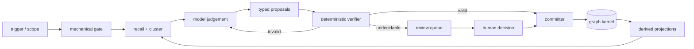

# Agentic knowledge curation — deep dive and long-term design

**Status:** Research — active (2026-11-18). No code. This is advice for a future system, not a
refactor plan for `src/knowledge/heuristic/`. The current model is in
[`src/knowledge/knowledge.md`](../src/knowledge/knowledge.md); the vocabulary is
[`plan/lexicon.md`](lexicon.md).

**Question:** what would it take to curate and manage the knowledge graph with an agent, instead of
the heuristic executor loops?

**Short answer:** build the agent and the substrate together, as one vertical slice. The agent is
the point — the heuristic is at its ceiling, and an agentic policy is the next precision/recall
lever. The substrate is the *small* thing that lets a non-deterministic actor touch the graph
without slowing the team down: every decision attributable, validated, reversible, and cheap to
propose. That is a proposal table, a committer, a run id, and a dry-run default — not a
production-hardening program.

---

## 1. What the evidence says

### 1.1 Agentic linking works, but costs two to three orders of magnitude more

The strongest recent evidence is GRASP's agentic entity-linking task
([Birmele, Walter & Bast, ISWC 2026](https://ad-publications.informatik.uni-freiburg.de/ISWC_entity_linking_grasp_BWB_2026.pdf)).
An LLM with graph-exploration tools beats a fine-tuned, non-agentic linker on four of five
benchmarks, and the gap is largest on hard disambiguation (KORE50: **88.2** vs **68.7** F₁).

| System | Avg F₁ | Time (5 benchmarks) | Input tokens | Cost |
| --- | ---: | ---: | ---: | ---: |
| ReFinED (fine-tuned, AIDA) | 72.6 | ~15 s on one V100 | — | — |
| GRASP + Kimi K2.7 Code | **80.3** | 30.3 h | 273.5 M | ~$16.92 (3-benchmark estimate) |
| Claude Code + Sonnet 5 | 80.9 | — | 45.9 M | ~$53.87 |
| GRASP + Gemma 4 31B IT (self-hosted) | 78.9 | 42.7 h | 257.8 M | ~$3.95 |

The variance is real but bounded: ten runs of one model spanned 82.2–86.6 F₁ (σ = 1.4). The
quality is not the question. **The economics are.** A per-observation agent call is not a
replacement for a cheap linker; it is a different product.

### 1.2 Identity errors are destructive, silent, and not recoverable in place

The most useful paper I found is not about agents at all. It is a production post-mortem from a
graph with 537k entities and 2.2M relationships
([Dangaich, Lewis & Pundalik, 2026](https://arxiv.org/html/2608.10644v1)). A similarity matcher
merged two power-grid records whose names differed only by whitespace and an underscore. The merge
combined properties, corrupted provenance, and a later *correct* per-document cleanup deleted eight
unrelated entities. No exception, no constraint violation, no warning. The damage was found only by
re-ingesting a source document and noticing the entity count had changed.

Their conclusion is the one to internalize:

> A destructive operation whose errors are undetectable should not be automated on a similarity
> signal, at any threshold. Not "at a higher threshold": at any.

They replaced merge-on-similarity with **flag-only entity resolution**: candidates go to a queue,
a person decides. Their queue then held 3,304 candidate pairs, 1,002 of them high-confidence, none
applied. They are explicit that this is a price, not a clean win: duplicates stay live and split
retrieval. But they prefer it to silent corruption.

They also learned the second lesson the hard way: **an unreviewed queue is not a safety mechanism.**
Their ontology proposal queue grew to 48,403 pending items against 775 human decisions. An
unworked queue is signal being discarded slowly, and it looks like safety while doing it.

### 1.3 The pattern that works: propose, verify, decide

Two independent systems converge on the same control structure.

**The triage agent** ([same paper, §6](https://arxiv.org/html/2608.10644v1)) is a state machine over
batches, not a free-running reason-and-act loop. A mechanical gate rejects junk and exact duplicates
with no model call. Survivors are clustered by embedding (expected 5–15× compression), so the model
sees hundreds of decisions rather than tens of thousands. The model returns a typed verdict; a
deterministic validator checks naming, parent existence, merge targets, collisions, domain/range,
and datatypes. A failed verdict gets **one** repair attempt with the errors attached; a second
failure goes to a human. The agent runs read-only by default; writes require an explicit flag, are
idempotent, and are stamped with a run id so the run can be reversed as a unit.

**The ingestion pipeline** ([Rankothge et al., 2026](https://arxiv.org/html/2611.11045v1)) states the
rule even more cleanly: **agents propose, code verifies, humans decide.** Narrow agents see compact,
citable evidence, never the full data, and return typed proposals. They never write code and never
touch the database. A deterministic verifier with 39 check types tests each proposal; a human
approves the schema and the load. On four datasets, **9 of 20 first proposals failed a check — and
every failure was caught**; the loops repaired eight, a one-line human edit fixed the ninth. 45.1M
values loaded with zero reconciliation gap, for 4–7 LLM calls and under $0.50 per dataset.

The common shape:

| Stage | Who | What it produces |
| --- | --- | --- |
| Select | code | a bounded batch, by rule or queue |
| Gate | code | mechanical rejects, exact matches, no model call |
| Recall / cluster | code + embeddings | a small candidate set |
| Judge | model | a **typed proposal**, with evidence and a reason |
| Verify | code | pass / typed errors / escalate |
| Decide | policy + human | auto, review, or deny |
| Apply | code | one transaction, before/after recorded |
| Report | code | what happened, what was deferred, why |

The model is a bounded reasoning step inside a deterministic machine. That is the opposite of an
agent with database credentials.

### 1.4 Tool design matters more than model choice

Anthropic's tool-writing guidance
([Writing effective tools for agents](https://www.anthropic.com/engineering/writing-tools-for-agents))
is directly applicable:

- **Few, workflow-shaped tools beat many API wrappers.** A `schedule_event` tool that finds
  availability and books the slot beats `list_users` + `list_events` + `create_event`.
- **Return high-signal context, not rows.** Resolve cryptic ids to names; paginate, filter, truncate
  with guidance; make errors actionable.
- **Consolidate chained operations.** If every agent run does search → inspect → compare → propose,
  those are the tools, not the six underlying queries.
- **Namespace** related tools so the model can tell them apart.
- **Make the agent's expected state explicit** if a write will later be checked against it.

The corollary for this repo: the current `GraphMutation` enum is a good *kernel* API. It is a bad
*agent* API. Do not simplify the kernel to make the agent happy; wrap it in a small curation surface.

### 1.5 The provider mechanics are solved; the control plane is not

The Gemini Interactions API supports function calling in both modes we would need
([function calling docs](https://ai.google.dev/gemini-api/docs/function-calling)):

- Tool declaration: `{"type": "function", "name", "description", "parameters"}`.
- Response step: `{"type": "function_call", "id", "name", "arguments"}`.
- **Stateful**: pass `previous_interaction_id` plus a `function_result` step; the provider keeps the
  chain. This requires `store: true` and a retention decision (the current client uses
  `store: false`).
- **Stateless**: resend the initial `user_input`, all model steps exactly as received, and the
  `function_result` with `call_id`. No provider-side retention, but the history grows and must be
  managed.

The current `llms::InferenceClient` is single-shot structured output: it parses the final
`model_output` text as JSON and does not surface `function_call` steps. An agent loop needs a
provider seam that exposes steps, tool calls, call ids, and a history type. That is a real but
bounded piece of plumbing — not the hard part.

---

## 2. Why "agent replaces heuristic loop" is the wrong frame

There are three separable planes. Today they are collapsed into `LinkHelper` and `IdentifyHelper`:
each helper selects work, applies a policy, writes, and reports in one executor.

| Plane | Question | Must be deterministic? | Today |
| --- | --- | --- | --- |
| **Kernel** | what is true, and what did we decide? | yes | `KnowledgeGraph`, `GraphMutation`, projection, verdicts |
| **Policy** | who decides, with what evidence? | no | `heuristic::HeuristicLinker`, `HeuristicIdentifier` |
| **Control** | when, with what budget, and who may write? | yes | scattered across helpers, tasks, CLI |

The long-term move is not "put a model where `HeuristicLinker` is." It is:

1. Make the **kernel** safe to change: non-destructive identity, append-only decisions, versioned
   projections.
2. Make **policy** a replaceable producer of typed proposals: heuristic, agent, human, all equal.
3. Make **control** a durable state machine: proposal ledger, verifier, autonomy tiers, budgets,
   review queue, evaluation.

The heuristic is not the enemy. It is the cheap prior and the recall mechanism — and it is at its
ceiling. More rules buy less; the tie classes, cross-type collisions, and missing-identity long
tail are not going to fall to another threshold. The agent is the next precision/recall lever, not
a side project. Start it on the residue the heuristic cannot separate, and let the measured win
justify taking more. **Route by uncertainty and cost of error, not by ideology.**

---

## The themes that generalize

Reversibility, auditability, and proposal-first are three of the load-bearing properties. Four more
belong at the same level:

| Theme | Why it is not a restatement | What it buys |
| --- | --- | --- |
| **Verification** | Auditability says a person can inspect a decision; verification says a *machine* can reject it before it lands. | The agent can be wrong cheaply. This is the fourth pillar; without it, "propose" is just "suggest." |
| **Boundedness** | Reversibility handles a bad decision; boundedness limits how many bad decisions one run can make. | Scope, budget, time, volume caps, and a kill switch. A run is finite and interruptible, so a bug is an incident, not a catastrophe. |
| **Plurality** | Proposal-first says there is one write path; plurality says *every* policy uses it — heuristic, agent, human, operator. | Policies can be compared on the same decisions, swapped, or run side by side. This is what makes the framework general rather than agent-specific. |
| **Evaluation** | Auditability is after the fact; evaluation is how you decide whether to trust the policy next time. | Decision-level precision/recall, cost per accepted decision, reversal rate, and replay. Without it, "higher precision and recall" is a claim, not a measurement. |

Two softer principles belong here too. **Context economy:** the agent should see compact, citable
evidence, not the graph. Recall and clustering are cheap deterministic stages; the model sees the
residue. That is both a cost lever and a quality lever — ten relevant rows beat a thousand.
**Defer as success:** a proposal the agent declines to make is a good outcome, not a failure,
because it keeps the residue visible instead of forcing a guess.

The test for any new theme: does it let a non-deterministic actor touch shared state without
slowing the team down? If yes, it belongs in the substrate, not in a prompt.

---

## 3. The long-term architecture



### 3.1 Kernel: four layers, one direction of truth

| Layer | Is | Mutability | Example |
| --- | --- | --- | --- |
| **Observation** | what a source said | immutable | a capture's text, an extracted name |
| **Assertion** | a provider-scoped claim | append / retract | `wikidata:Q42`, `platform:instagram/traindreams`, `type:film` |
| **Decision** | an actor-scoped choice | append-only | link, split, merge, distinct, veto, accept-identity |
| **Projection** | a derived view | rebuildable | entity row, search index, blocking index |

Today the graph already has observations, identities, decisions (partially), and projections. The
long-term difference is that **every decision is first-class and immutable**, not just merge, veto,
and distinct. Linking an observation, moving it, accepting an identity, and splitting a cluster are
all decisions with an actor, a reason, and evidence. They may still be *derived* on a rebuild — a
rebuild can re-run the policy — but the decision that was made should be recorded, because it is
what you audit, replay, learn from, and reverse.

This also resolves the current ambiguity between "derived" and "unrecorded." A decision can be
derived and logged; the log is the audit trail, the projection is the state. Reset destroys
projections, not decisions.

### 3.2 Identity must be non-destructive: constraints, not tombstones

The current `MergeEntity` sets `merged_into_id`, moves observations and identities, and is one-way.
`MarkDistinct` is also one-way. That is a one-way ratchet, and it is exactly the operation that the
production incident warns about. No amount of agent confidence makes a one-way row rewrite safe.

The long-term model:

- An **entity is an equivalence class** over observation ids, defined by a set of `same(a,b)` and
  `distinct(a,b)` constraints.
- A **merge** appends `same(winner, loser)` with provenance; it does not rewrite rows.
- A **split / unmerge** appends a retraction of a `same`, or a `distinct` that makes the set
  inconsistent.
- **Distinctness is a constraint**, not a verdict that can never be lifted. It can be retracted like
  any other decision.
- The live entity set is a **projection** of the constraint set (a provenance-aware union-find with
  consistency checks). A contradictory constraint set is a first-class reportable condition, not a
  silent overwrite.
- Projection is versioned. The agent always works against a pinned base version; a proposal carries
  `expected` (the base state it reasoned from) and the committer refuses on conflict.

This is the single most important long-term change, because it removes the irreversible operation
that makes autonomy dangerous. It also gives the agent a clean vocabulary: **propose constraints,
not row edits.** "These two are the same" and "these two are different" are the atoms; everything
else is derived.

Two real design questions, not hand-waved:

- **Non-transitivity.** `same(a,b)` and `same(b,c)` imply `same(a,c)`, which may conflict with
  `distinct(a,c)`. The kernel must detect the cycle and either refuse the last constraint or flag
  the component for review. A union-find with explanations is the starting point; a full
  constraint solver is not.
- **Granularity.** A Wikidata item can name an album and its songs. Identity equality is evidence
  for sameness, not proof. The constraint model handles this naturally: sharing a key is an
  *assertion*, not a `same` decision. A person or agent must still decide.

If full equivalence is too large a step, the bridge is a **reversible tombstone**: keep
`merged_into_id` but store the complete before/after graph delta for the merge, and support an
`unmerge` that replays the inverse. That is strictly worse than constraints (the row is still
rewritten, and concurrent merges can interleave), but it is a valid stepping stone.

### 3.3 The proposal ledger is the only write path for decisions

Adapt the append-only proposal ledger
([Duglas, 2026](https://pavelduglas.com/en/blog/agent-writes-append-only-proposal-ledger)) and the
verified-ingestion control plane. Every actor — heuristic, agent, human, operator — writes
proposals. A deterministic committer applies them.

A proposal carries:

| Field | Why |
| --- | --- |
| `proposal_id`, `run_id` | group a run; reverse it as a unit |
| `actor` (kind, id) | who decided: provider, model, user, operator |
| `model`, `prompt_version`, `tool_version` | reproducibility and drift detection |
| `base_version` | the graph snapshot/generation the decision was made against |
| `expected` | the preconditions the actor believed; optimistic concurrency |
| `action` | typed enum: link, detach, same, distinct, identify, retract, veto, unveto, retype |
| `payload` | typed arguments, no free-form SQL |
| `evidence` | refs to observations, assertions, tool outputs, external pages |
| `reason` | one or two sentences, for the human at 9am |
| `confidence` | the actor's number; never the only gate |
| `idempotency_key` | retries are harmless |
| `status` | proposed → validated → applied / rejected / conflicted / deferred / reverted |

The **committer** is deliberately dumb:

1. Lock the affected rows/entities.
2. Validate schema and referents.
3. Compare `base_version`/`expected` to reality; mismatch is a conflict, not an overwrite.
4. Evaluate policy: auto, review, deny.
5. Apply the kernel events in one transaction; capture before/after.
6. Append the outcome event; commit.

No model calls in the committer. No creative retries. If something is off, it stops and says why.

**Reversal is a new compensating proposal**, not a row edit. Because every applied proposal has
before/after and a run id, you can reverse one proposal, one run, or every write a model/prompt
version made on a day — without restoring a backup and losing unrelated human edits.

**Volume caps** are part of the ledger, not the prompt: if a run proposes more than N changes of
one type, hold all of them for review. A runaway loop becomes an alert, not an incident.

#### The envelope is generic; the action is not

`GraphMutation` is the right *action* type, not the right *ledger* type. Do not parameterize the
enum; parameterize the envelope:

```rust
struct Proposal<A> { /* the fields above */ action: A }
```

`A` can be `GraphMutation`, `Vec<GraphMutation>`, or a domain-level `GraphAction`. The table stores
`kind` + `action` as JSONB; a `Domain` trait (see §3.12) owns validation, application, and reads.
The graph is the first implementation; a second domain is additive, not a rewrite.

Three fields in today's enum are really ledger metadata and should move out:

| Field | Today | Long-term |
| --- | --- | --- |
| `record_verdict` | a replay flag on merge/veto, `#[serde(skip)]` | stays a graph apply concern: replay reads verdicts and passes `false`; the ledger never replays |
| `cause` | `Cause::Repair` on merge/distinct/veto | `actor.kind` + `reason_code` on the envelope |
| `why` | per-variant, optional on some | one required `reason` on the envelope |

With those out, `GraphMutation` is pure intent and serializes cleanly. One proposal is one
*decision*, which may compile to several mutations: identify is retract + assert; merge is move +
tombstone. `proc(&[GraphMutation])` already applies a batch atomically, so the action can be
`Vec<GraphMutation>`.

#### One ledger, two views

The audit log and the proposal queue are the same append-only table:

| Status | View |
| --- | --- |
| `proposed`, `validated`, `held` | queue |
| `applied`, `rejected`, `conflicted`, `reverted` | audit |

A status transition is an event; the row's status is a projection. The committer is the only writer.

**Verdicts stay durable graph state, and replay stays verdict-driven.** A verdict is the compact,
generation-independent decision that must survive `reset`; a proposal is the audit/queue envelope
for every action, including transient ones (attach, detach, identify) and rejected or held items.
Not every proposal should be replayed, and filtering them would buy complexity for a rare
operation. The domain's apply writes the verdict inside the graph transaction, as today; the
proposal row records the outcome and links to the verdict (`proposal_id` on the verdict, or
`verdict_id` on the proposal). Losing the proposal loses the reasoning; losing the verdict loses
the rebuild. That separation is the point.

The ledger can be pruned on an audit retention schedule; verdicts cannot. Making the ledger the
replay source would tie two different retentions together.

#### One ledger, many queues

The audit log should be universal; the queue should not. The wording is deliberate: **a queue is a
consumption pattern, not a table.** One table can back many queues.

- **One `proposals` table** with `kind`, `action` JSONB, `status`, scope, actor, run, base, evidence,
  reason, outcome, before/after. One audit query, one retention/access framework, one review UI,
  one committer.
- **A queue is a filtered view plus a worker.** `WHERE kind = 'graph' AND status = 'held'` is the
  graph queue. Each domain gets its own worker, concurrency, priority, policy, and review audience.
  A flood of low-value illumination proposals cannot starve graph review, and a bug in one handler
  cannot stall the others.
- **Do not build one universal FIFO.** Shared storage is good; shared scheduling is not.

The storage can split later without changing the protocol:

| Shape | When |
| --- | --- |
| one table, filtered per-domain views | default; small volume, shared retention |
| one table partitioned by `kind` | one domain's volume or retention diverges |
| separate table per domain | security/access or lifecycle genuinely different |

A queue table is not the first split; a partition is.

**What the ledger is not.** "Universal audit" means one place to query the proposal outcome, not
one table containing every fact:

| Log | Answers | Lives in |
| --- | --- | --- |
| proposal outcome | what was proposed, by whom, with what evidence, what happened | `proposals` |
| durable decision | what the graph believes and must re-apply on rebuild | verdicts/constraints |
| execution | which task ran, attempts, errors | `task_runs` |

The proposal *path* is columns on `proposals` for now: `status`, `decided_by`, `decided_at`,
`outcome`, `before`/`after`. Add a `proposal_events` table only when the path itself becomes a
product requirement — multiple reviewers, escalation, reversal audit. Until then it is a table
nobody reads.

Universal over **decisions**, not every write. Projection, task status, and other derived/internal
writes are not decisions; logging them turns the ledger into a WAL and drowns the signal. The
ledger is for choices an actor makes; `task_runs` is for execution; verdicts are for durable graph
decisions.

When a domain's volume, security, or retention is materially different, partition by `kind` or give
it its own table — but keep the envelope and the protocol. Do not split into N ledgers
preemptively.

### 3.4 The curation API: seven tools, not seventy

The agent should see a small, workflow-shaped surface over the kernel. The kernel's internal
mutation grammar can stay rich; the agent's tools are the shape of the job.

| Tool | Question it answers | Returns |
| --- | --- | --- |
| `graph_search` | what might this be? | candidates with provenance, uncertainty, and the keys that matched |
| `graph_inspect` | what do we know about this? | dossier: members, assertions by provider, decisions, constraints, projection, conflicts |
| `graph_compare` | are these the same, and why? | per-field agreement/disagreement, shared provenance, contradictory evidence, open questions |
| `graph_propose` | here is what I would change | validation result, status (applied / held / conflicted), typed errors |
| `graph_review` | what needs a person? | queue items with diffs, reasons, evidence, bulk actions |
| `graph_explain` | why is this here? | the decision chain, evidence, versions, before/after |
| `graph_run` | curate this scope | job status, budget, checkpoints, report |

Design rules, from the tool-writing guidance:

- **Search, don't list.** Never make the agent page through the graph to find one thing.
- **Consolidate chains.** `graph_compare` compiles the blocker, the scorer, the assertion set, and
  the provenance into one call.
- **Return evidence and affordances**, not raw rows. Names before ids; ids when a follow-up needs
  them; truncate with a hint.
- **Errors are prompts.** "Entity 42 is a tombstone; resolve the live entity with `graph_inspect`"
  beats a code.
- **Namespace** the tools, and keep the read/write boundary obvious.
- **The write tool is `propose`, full stop.** There is no `merge_entity` tool.

### 3.5 Control plane: a durable state machine, not a ReAct loop

A curation job is a state machine over a bounded scope:

`select → gate → recall/cluster → judge → validate → propose → commit/defer → report`

- **Checkpoint every stage.** A crash resumes; a re-run is idempotent.
- **Mechanical first.** Exact keys, normalized names, existing assertions, and duplicate detection
  run before any model call. The model sees only what survives.
- **Cluster before judging.** Embeddings or blocking keys compress many cases into one decision;
  the model should not pay per row for a family of near-duplicates.
- **Stateless model calls.** One bounded call per judgement, typed output, one repair attempt with
  the validator's errors. Multi-turn is for investigation, not for carrying state that belongs in
  the database.
- **Budgets everywhere.** Per job, per action type, per day; provider quota; concurrency caps. A
  refusal is a completed job with a report, not a retry loop.
- **Dry-run by default** for new actions. A write flag is asserted at the committer, not trusted
  from the caller.

This is the triage-agent shape, and it is the difference between a system you can operate and a
system that surprises you.

### 3.6 Autonomy is earned per action, not per agent

| Tier | Actions | Gate |
| --- | --- | --- |
| **Auto** | reversible, checkable, low blast radius; e.g. `identify` on a clear external match, `distinct` on an explicit contradiction | measured precision on a labelled sample, volume cap, sampled audit |
| **Review** | irreversible or high blast radius; e.g. merge/split until the kernel is reversible | a human approves the diff, with evidence one click away |
| **Deny** | anything without a reversal path, raw SQL, ownership/billing changes | never |

Graduation is data-driven: approval rate, reversal rate, conflict rate, and sampled audit results
per action and per model/prompt version. Demote on drift. The provider changing a model underneath
you is a real event; the ledger's versions make it visible.

Human review is a **throughput problem**. Instrument arrivals, decisions, queue latency, and
per-decision time. An unreviewed queue is not a safety mechanism; it is a slow leak. If the review
rate cannot exceed the arrival rate, automate more of the mechanical tail or reduce intake — do not
build a bigger queue.

### 3.7 Verification is the real work

The more you can validate mechanically, the more autonomy you can safely grant. The model's
self-reported confidence is the weakest signal; typed evidence is the strongest.

Validators should check, at least:

- **Schema and referents.** The action is well-formed; every entity/observation exists, is live, and
  is in the expected base version.
- **Evidence grounding.** Every asserted key/handle/QID appears in a cited observation or a cited
  external answer. No fabricated ids.
- **Independence.** For an auto-tier identity, corroboration from two independent providers, or a
  provider answer plus a capture assertion. One model's guess is not a citation.
- **Type compatibility.** Types **rank**, they do not veto. A hard refusal only when both sides are
  confident and disjoint. The current type vocabulary is capture text, not an ontology; do not let
  it make irreversible decisions.
- **Provenance invariants.** Do not merge entities that co-occur in the same source unless the
  source says they are the same; do not orphan an observation; do not merge the last members of a
  source. Generalize the existing shared-illumination refusal.
- **Constraint consistency.** A new `same` must not contradict a standing `distinct`; a new
  `distinct` must not break a component. Report the cycle, do not guess.
- **Reversibility.** Every auto action has a compensating action. If it does not, it is review or
  deny.
- **Calibration.** If confidence is used for ranking, it must be monotone. If it is used as a
  probability, it must be measured. Today it is a score; do not pretend otherwise.

The verifier returns typed errors. The model gets **one** repair attempt with those errors; a
second failure escalates. That bound should be structural (one re-judge in the loop), not a counter
that can drift.

### 3.8 Evaluation is a first-class subsystem

You cannot manage what you cannot measure, and agent quality is non-deterministic. Build the
evaluation harness before the agent.

- **Ground truth:** human decisions, curated pairs, hand-labelled samples, and the existing verdict
  log. Hold out a set that never enters a prompt.
- **Decision-level metrics:** pairwise precision/recall/F₁ for same/different; calibration; deferral
  rate; auto-apply precision; reversal rate; conflict rate; time-to-decision; queue latency; cost
  per **accepted** decision.
- **Shadow mode:** run the agent read-only on production; compare its proposals to the heuristic
  and to human decisions. No writes. This is the cheapest way to find out where it is worth it.
- **Replay:** stored evidence + model/prompt/tool versions let you rerun a new model on the same
  cases and diff the proposals. That is your regression suite, and it comes from production.
- **Adversarial tests:** prompt injection in captured text, fabricated ids, contradictory evidence,
  duplicate candidates, empty/degraded providers.
- **Drift detection:** rejection/conflict rates per model version; a jump is a signal.

Do not measure only aggregate F₁. A system that merges 1% of pairs wrongly at 99% precision is a
disaster if the 1% is silent. Measure the decision that hurts.

### 3.9 Economics and routing

The GRASP numbers make the routing decision for us:

- **Bulk path:** deterministic keys, normalized names, blocking, embeddings, a cheap classifier.
  This handles the majority, costs almost nothing, and is auditable.
- **Agent path:** ambiguous pairs, conflicting providers, destructive proposals, user-requested
  investigations, and repairs. This is where the agent's semantic reasoning earns its cost.
- **Human path:** anything the verifier cannot decide, anything irreversible until the kernel is
  reversible, and a sampled audit of auto decisions.

Budget in **accepted decisions**, not tokens. A $50 agent run that produces one correct merge is
expensive; a $0.02 run that produces 100 correct `distinct` decisions is cheap. Cache external
answers, batch independent cases, compress context, and use a small model for mechanical stages.

### 3.10 Security and tenancy

- The agent is an **authenticated principal** with scopes and a budget. It never gets a database
  connection, raw SQL, or arbitrary HTTP.
- Captured content is **untrusted input**. Screenshots and extracted text can contain instructions.
  Treat them as data; never follow them; label tool outputs; keep secrets out of context; allowlist
  external fetches.
- Multi-tenant boundaries belong at the edge and in the tools. The current graph is shared; a
  user-facing curator needs per-user scoping, and the kernel should not have to grow an owner
  column to provide it.
- Every write is attributable. If the graph becomes a public boundary, add a principal argument at
  the edge; do not put authorization in the mutation vocabulary.

### 3.11 Velocity-first: the minimum substrate

This is not a production-hardening program. The pragmatism ledger is explicit: the primary risk is
that the app is not useful, not that it is not five-nines. The substrate should be the smallest
thing that lets an agent fail cheaply and be corrected quickly.

| Piece | Minimum | Not needed yet |
| --- | --- | --- |
| Ledger | one `proposals` table: id, run_id, actor, action JSON, base_version, status, reason, evidence, created_at | separate event table, policy engine, UI |
| Write path | one `propose` function; one `commit` function that validates and calls the existing graph | a service, a queue, a distributed worker |
| Reversibility | actions that are already reversible: `identify`, `distinct`, `attach`/`detach`, `veto`/`unveto`; defer `merge` until unmerge exists | a full constraint solver |
| Audit | the proposal row is the audit; print it | a dashboard |
| Verification | one validator per action, returning typed errors | 39 check families |
| Control | `--dry-run` default, a run id, a volume cap, a kill switch | autonomy tiers, graduation |
| Evaluation | a labelled sample and a replay script | a metrics platform |

That is a table, a few functions, and a CLI. It is days, not months. The generalized framework below
is an extraction of this slice, not a prerequisite for it.

The heuristic stays useful: it is the cheap recall and the prior. The agent is the new policy for
the cases the heuristic cannot separate. Start where the heuristic is visibly wrong — the tie
classes, the cross-type collisions, the missing-identity long tail — and let the measured win
justify the next slice.

### 3.12 Beyond the graph: a generalized action framework

The opportunity is larger than the graph, and the substrate should be shaped to generalize from day
one — without becoming a platform project.

What generalizes:

- **The action protocol.** `Proposal<Action>`, `Actor`, `Run`, `Evidence`, `Status`, `base_version`,
  idempotency, conflict. Domain-agnostic.
- **The lifecycle.** propose → validate → policy → commit / review / reject → reverse. One state
  machine for every domain.
- **The audit and traceability.** Every action has a run, a reason, a before/after, and a version.
  Replay itself is domain-specific: it reads the domain's durable decisions, not the ledger.
- **The review surface.** A queue of held actions with diffs and evidence, reusable for any domain.
- **The producer interface.** A heuristic, an agent, a human, a task worker all implement the same
  `propose` contract.

What does not generalize, and should stay in the domain:

- The action enum and its schema.
- The validators (the graph's referents, provenance invariants, type rules).
- The read tools (`graph_search`, `graph_inspect`, …).
- The apply function (the existing `KnowledgeGraph::proc`).

The long-term shape is a small module with a domain trait. Sketch, not final code:

```rust
#[async_trait::async_trait]
trait Domain: Send + Sync {
    type Action: Serialize + DeserializeOwned;
    type Refusal;

    async fn validate(
        &self,
        proposal: &Proposal<Self::Action>,
        base: BaseVersion,
    ) -> Result<(), Vec<Self::Refusal>>;
    async fn apply(&self, action: &Self::Action) -> anyhow::Result<Outcome>;
    async fn read(&self, call: ToolCall) -> anyhow::Result<Evidence>;
}
```

The graph is the first implementation. Illumination, search indexing, backfills, and future capture
workflows are candidates for the second, third, and fourth. The framework is not a chat-agent
platform; it is an **auditable action protocol** that happens to have an agent as one producer. That
is the piece worth generalizing, because it is the piece that makes every future agent safe to run.

---

## 4. Conceptual data model

This is the shape, not a migration.

| Table / view | Grain | Truth | Notes |
| --- | --- | --- | --- |
| `observation` | one thing a source said | immutable | the only input; never rewritten |
| `extraction` | one model's reading of a source | versioned | prompt/model/version; may be superseded |
| `assertion` | subject + predicate + value + provider | append / retract | identity, type, description, link; provider-scoped |
| `proposal` | one actor's intended decision | append-only | the ledger; expected/base/evidence/status |
| `decision` | one applied choice | append-only | links, same, distinct, identify, veto; provenance |
| `constraint` | same/distinct over observations | derived from decisions | the equivalence structure |
| `entity` | an equivalence class | derived | projection; rebuildable |
| `projection` | materialized view | derived, versioned | entity rows, search/blocking indexes |
| `review_item` | one held proposal | mutable status | queue with diff, reason, evidence |

The important separation is **assertion vs. decision**. An assertion is what a provider says; a
decision is what we choose to believe about our own graph. Mixing them is how a provider's
classification becomes a hard veto, and how a model's guess becomes a citation.

---

## 5. What this implies for today's model (gap list, not a refactor plan)

| Today | Long-term | Why it matters |
| --- | --- | --- |
| Merge is a one-way tombstone; distinct is one-way; no unmerge/retract | equivalence + distinct constraints, retractable | removes the irreversible op that makes autonomy dangerous |
| Only merge/veto/distinct are durable decisions; link/membership/identity are derived state | every decision is append-only with actor/run/evidence | audit, explanation, learning, reversal |
| `Cause` is only `Repair`; no actor/model/prompt/run provenance | proposal ledger carries all of it | attribution and drift detection |
| `LinkHelper`/`IdentifyHelper` couple selection, policy, write, report | kernel / policy / control planes | replaceable policy; testable control |
| `GraphMutation` is the only write API | kernel grammar + typed proposals + validation/policy layer | the agent should not see the kernel's full grammar |
| No base version/optimistic concurrency | `base_version` + `expected` on every proposal | concurrent humans and agents do not overwrite each other |
| No review queue, shadow mode, or decision-level eval | first-class review + eval | an unreviewed queue is not safety; unmeasured autonomy is not autonomy |
| Provider seam is single-shot structured output | steps, tool calls, call ids, history | an agent loop needs it |
| Shared graph, no kernel ownership | edge/tool scoping | multi-tenant curation without polluting the kernel |

The current graph is closer than it looks. It already has immutable observations, provider-scoped
identities, a mutation enum, one-transaction application, projection, and a partial decision log.
The missing pieces are the ones that make the write path safe for a non-deterministic actor.

---

## 6. Sequencing

The order matters more than the phases' names.

1. **One vertical slice on the smallest safe action.** Read-only investigator + proposal table +
   committer + one reversible action (`identify` or `distinct`). The agent proposes; a person
   approves; the run is replayable. This is the whole loop, end to end, at small scale. The
   substrate is days of work, not a phase.
2. **Measure the slice.** A labelled sample, shadow mode against the heuristic, cost per accepted
   decision. This tells you where the agent is worth more, and it is also the demo that justifies
   the next slice.
3. **Widen the action set.** Add link decisions, then split/merge only after unmerge exists. Let the
   agent take work away from the heuristic as the measurement justifies it — the heuristic is the
   prior, not a permanent ceiling.
4. **Earn autonomy.** Auto-tier the actions that are reversible and measured; keep the rest in
   review. Instrument the queue's throughput, not just its size.
5. **Extract the framework.** When the second domain appears or the graph slice stabilizes, lift the
   ledger/committer/run/review into a domain-agnostic module. Do not build it speculatively.

The most common failure mode is building the agent for a problem you have not measured, then
discovering the heuristic was right for 95% of it. The second most common is building the
infrastructure for a year before the first agent decision. The vertical slice avoids both.

---

## 7. Decisions I would make now

1. **Adopt "propose, verify, decide" as the law.** The agent never gets a write tool. It gets
   `graph_propose`; code validates; policy or a human decides.
2. **Make identity non-destructive before granting any merge autonomy.** Constraint/equivalence
   events are the target; reversible tombstones are the acceptable bridge.
3. **Build the ledger and audit *with* the first agent slice.** They are the same week's work, not a
   prerequisite phase. Without them you cannot explain, replay, or reverse the agent; with them you
   can experiment fast.
4. **Start with the cases the heuristic visibly loses.** The tie classes, cross-type collisions,
   missing identities, and conflicting evidence. The agent is the new policy for the residue, not a
   rewrite of the bulk.
5. **Build the eval harness with the slice, and run shadow mode.** The agent is only as good as the
   measure; production replay is the regression suite.
6. **Design seven tools, not seventy.** Search, inspect, compare, propose, review, explain, run.
   Consolidate; return evidence, not rows.
7. **Keep the control plane deterministic.** The LLM is a bounded step inside a state machine, not
   the state machine.
8. **Grant autonomy per action, earned by measurement.** Tiers and volume caps are configuration,
   not prompt text.
9. **Treat human review as a throughput problem.** Instrument arrivals, decisions, and latency. An
   unreviewed queue is not safety.
10. **Budget in accepted decisions.** Route by expected value: cheap path for the bulk, agent for
    the uncertain, human for the irreversible.
11. **Treat captured content as adversarial.** Prompt injection is a data-integrity and security
    issue, not a prompt-engineering one.
12. **Build the action protocol generically, with the graph as domain #1.** Generalize the ledger,
    committer, run lifecycle, review, and evidence. Keep the action enum, validators, read tools,
    and apply function in the domain. Do not build a speculative agent platform before the first
    slice works.
13. **Let the agent earn the heuristic's work.** The heuristic is the prior and the recall; the
    agent takes over decision classes as it proves higher precision/recall on the measured set.
    Replacement is a measured migration, not a rewrite.

## 8. What I would not build

- A free-running ReAct loop with `merge`/`veto`/`delete` tools.
- A confidence threshold as the only gate on a destructive operation. At any threshold.
- A chat interface as the primary control plane. Curation is batch, queue, and diff.
- A review queue without throughput instrumentation. That is a graveyard with a UI.
- A second write path for the agent. One ledger, one committer, every actor.
- An LLM as the authority on identity. It is a proposer with evidence, not an oracle.
- A replacement of the heuristic for the bulk on day one. Let the agent earn decision classes as it
  is measured; do not rewrite the bulk to prove a point.
- A speculative agent platform with no second domain. Generalize the action protocol when the first
  slice works; not before.
- A general graph memory engine when the job is curating this graph.

## 9. Open questions

- **What is the product's acceptable error rate?** A useful graph and a perfect graph have
  different architectures. The review tier's size follows from this.
- **Who owns the shared graph?** Multi-tenant curation changes the tool scoping, the review
  audience, and the disclosure policy.
- **How much human review capacity exists?** If the answer is "none", the design must automate more
  of the mechanical tail or reduce intake; a queue is not a strategy.
- **Do we need temporal queries?** "What did we believe last week, and why?" is cheap if decisions
  are append-only and expensive to add later.
- **Is the equivalence constraint system consistent enough?** Non-transitivity and granularity need
  a real answer before merge autonomy.
- **Do we need the agent for link at all?** The GRASP result is about linking mentions to a large
  external KG. Our link problem is clustering a small personal corpus; the heuristic may be the
  right answer for most of it.
- **Which model, and what is the cost ceiling?** The provider seam and the ledger should let this be
  a config change, not a rewrite.
- **How do we evaluate "same entity" without a single ground truth?** Human judgement is the
  reference, but it is subjective and expensive; a labelled sample and a disagreement protocol are
  part of the design.
- **What is the undo UX?** "Reverse this run" is a product feature, not only a database operation.
- **Real-time or batch?** A capture's entities can wait; a user-facing correction cannot. The
  control plane should support both.

## 10. If I had to bet

The winning system is not "an agent that curates the graph." It is **a graph whose every decision is
a small, attributable, reversible proposal, plus a cheap policy that handles the bulk and an agent
that investigates the residue.** The agent is the point; the substrate is what makes it safe to
point at the graph. They are built together: the first slice is a table, a committer, a run id, a
validator, and one agent workflow — small enough to ship in days, real enough to measure.

The model is a choice, not a commitment. The action protocol is the commitment.

---

## Sources

- Birmele, Walter & Bast, *Agentic Knowledge Graph Entity Linking*, ISWC 2026.
  https://ad-publications.informatik.uni-freiburg.de/ISWC_entity_linking_grasp_BWB_2026.pdf
- Dangaich, Lewis & Pundalik, *Curate Before You Connect: Identity and Ontology Tagging in a
  Production Knowledge Graph*, 2026. https://arxiv.org/html/2608.10644v1
- Rankothge, Hodgkins, Rich & Kirby, *Agents Propose, Code Verifies, Humans Decide*, 2026.
  https://arxiv.org/html/2611.11045v1
- Duglas, *Append-Only Writes for AI Agents: The Proposal Ledger Pattern*, 2026.
  https://pavelduglas.com/en/blog/agent-writes-append-only-proposal-ledger
- Anthropic, *Writing effective tools for agents*, 2025.
  https://www.anthropic.com/engineering/writing-tools-for-agents
- Google, *Function calling with the Gemini API*.
  https://ai.google.dev/gemini-api/docs/function-calling
- Zep / Graphiti, *Knowledge graph memory for an agentic world* (for the temporal/entity-dedup
  contrast). https://neo4j.com/blog/developer/graphiti-knowledge-graph-memory

*Research provenance: found with the harness's `web_search` tool (queries: "agentic knowledge graph
entity linking", "LLM agent entity resolution knowledge graph curation", "Gemini Interactions API
function calling", "Anthropic writing effective tools for agents", "knowledge graph curation agent
audit undo proposal ledger"); primary sources fetched with `read`.*
