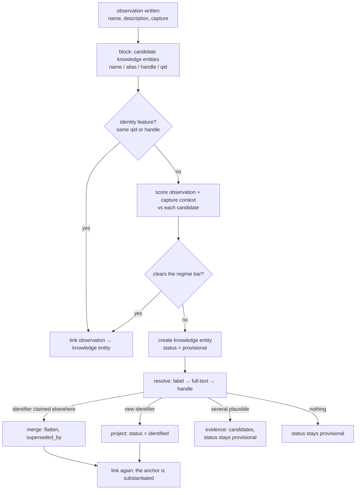

# Knowledge entities — observations, entities, and the evidence behind them

**Status:** Implemented (schema version 16, 2026-11-01). Three tables, named for what they hold:
**UserObservedEntity** (observation), **KnowledgeEntity** (the referent) and **KnowledgeEvidence**
(recorded fact — identity included). Names and verbs are governed by [lexicon.md](lexicon.md); this
doc is about the model, not the vocabulary.

Schema 16 collapsed the staging pair — the application wrote `knowledge_user` while `migrate` copied
into `user_knowledge_entities`, and the graph read the copy — into `user_observed_entities`, and
`migrate` is gone. The 2,525 observations moved across with their ids; the entities were rebuilt by
`link` and the claims restored from the answer cache by `resolve --offline`. Schema sync is manual:
`dreamscroll_db sync_schema`.

**See also:** [knowledge-entity-types.md](knowledge-entity-types.md) (taxonomy),
[knowledge-evidence-prototype.md](knowledge-evidence-prototype.md) (the measured prototype and its
failure catalogue), [knowledge-promotion-audit-prod.md](knowledge-promotion-audit-prod.md) (corpus
numbers), [knowledge-wikidata-recommender.md](knowledge-wikidata-recommender.md) (QID usage),
[pragmatism.md](pragmatism.md) (ledger), [backfill.md](backfill.md) (typed backfills),
`plan/archive/illuminate-v2.md` (the projection this builds on).

## The gap

Illumination gives us **mentions**, not **entities**. Every row is one span of text a model reported
for one capture: "Train Dreams", `movie`, in this capture. Nothing says the fourteen `Train Dreams`
mentions are one work, nothing says which of them is the same work another user captured, and nothing
lets us say how close two of them are.

```
  capture ──────────────────────────────────────────────────────────┐
    │ media, url, annotation                                        │  private, immutable
    ▼                                                               │
  UserObservedEntity   ("this capture said X")                     │  per user, owned
    │ name, description, search_query, platform link                │
    │ knowledge_entity_id ───────────────────────────────┐                      │
    ▼                                        │                      │
  KnowledgeEntity   ("X, as we understand it")                  │  one row per referent
    │ label, type, identifier, status         │                      │  no owner
    ▼                                        │                      │
  KnowledgeEvidence ("why we believe that")                     │  append-only facts
      kind, value, source, method, confidence, provenance
```

Three tables answering three different questions:

| Table | The question it answers | Owned by | Mutable |
| --- | --- | --- | --- |
| `user_observed_entities` | what did this capture say? | one user | only `knowledge_entity_id` |
| `knowledge_entities` | what is this referent? | nobody | projected columns only |
| `knowledge_evidence` | why do we believe it? | nobody | append-only |

## Properties that drive the design

1. **An observation is owned; a referent is not.** "Bob captured an actor, in this screenshot, and
   wrote this" belongs to Bob. "This is Kyle Chandler (Q359604)" belongs to nobody — it is a claim
   about the world, and it is the same claim whoever noticed it. Ownership is therefore a property of
   the *user entity* and never of the knowledge entity row.
2. **Substantiation, not ownership, describes a knowledge entity.** A knowledge entity becomes `identified` when it carries an
   identifier — a QID or a platform handle — because then it is checkable by anyone. Before that it is
   a hypothesis, recorded as such and not yet a referent other work should lean on. That is a *status*,
   derived from evidence, not an owner column.
3. **The knowledge entity is a projection.** Its label, type, identifier, description and status are recomputed
   from evidence by one function. The earlier design's central failure was storing a judgement
   (`promote` / `review_disambiguation` / …): 577 rows were held because their *name was short*, and
   the rule could not be revisited without reclassifying everything. Store facts, derive judgements.
4. **Precision beats recall, asymmetrically.** A missed merge is a duplicate row; a wrong merge fuses
   two referents and can swallow a neighbourhood through transitivity
   ([ER in Practice](https://arxiv.org/abs/2607.26298), third lesson). The two sides are not peers: a
   new observation is one speculative assertion, an established knowledge entity is N assertions plus, often, an
   identifier. Score against the anchor's weight.
5. **Merge is a decision about evidence, not a key comparison.** Names block; they never decide.
6. **Evidence is append-only.** A hypothesis that has not been decided is *derived*, not stored — so
   there is no mutable decisions column anywhere in the schema.

### Provenance, not policy

Every knowledge entity attribute records where it came from: the observation for a captured name or reading, the
evidence row for an identifier or an authority label. That is a graph requirement — an
attribute you cannot attribute cannot be trusted, re-derived or audited — and it is also the only thing
needed to answer disclosure questions later, at the read boundary, without changing the model.

Whether a given attribute should be **served** to someone who did not capture it is deliberately not a
schema constraint. See §Deferred.

## What the data says

Prod corpus, 5,245 mentions / 1,360 captures / 3 users (2026-10-31); detail in
[knowledge-promotion-audit-prod.md](knowledge-promotion-audit-prod.md) and
[knowledge-evidence-prototype.md](knowledge-evidence-prototype.md).

| Fact | Value |
| --- | --- |
| mentions | 5,245 over 1,360 captures; 4,500 distinct names |
| distribution | one user holds 5,113; a second 48; a third 84 |
| authority reachable | 43.0% identified, 9.9% ranked, 11.9% ambiguous, 34.6% none |
| identified **and** described | 2,116 (40.3%) — the first population of shared rows |
| platform links | 785 (15.0%); 107 (2.0%) resolve to an item via `P2002` |
| multi-source names | 75 (1.4%) — cross-user overlap is rare *today* |
| names repeating across captures | 408, of which 32 (7.8%) disagree on type |
| collision pairs | 179 over 74 groups: **111 type instability**, 62 distinct participants, 6 conflicting years |
| homonyms inside one capture | 8 pairs — the model writes the same string twice, meaning two things |
| descriptions | 97.9% publishable, 1.8% missing, 0 contain a private identifier |
| per-user resolvability | 43.2% (primary), **14.6%** (aesthetic corpus), 42.9% (third) |

Readings that shape the design:

- **A quarter of the corpus is already a duplicate under conservative normalization**, mostly
  cross-capture. Canonicalization is a real win, not housekeeping.
- **Type is unreliable as a veto.** 111 of 179 collision pairs are the same referent disagreeing with
  itself. Type disagreement is a weak negative, never a hard veto.
- **Name is unreliable as a decision.** Label equality is ~75% precise (`Sunset Boulevard` → a
  street, `Bacardi` → a family name), and eight pairs prove two referents can share a name *inside
  one capture*. Name blocks; nothing more.
- **The graph is small.** ~2k knowledge entity rows per user, 4.5k co-capture pairs.
- **Normalization must be conservative.** Stripping punctuation collapses `C`, `C#`, `C++` (observed);
  `@handle` vs `handle` is a genuine variant worth folding.
- **Authority covers the head, not the tail.** `Wojak`, `Claude Code` and `Invesco QQQ` resolve;
  `The Graph Maker`, `Max Dembo` and `MUME` do not. Provisional knowledge entities are a permanent population.
- **Genres differ.** 14.6% versus 43.2% — corpus averages hide this.
- **Handles are a first-class identifier.** 785 mentions carry one; 92% of sampled handles are live
  accounts; 375 mentions collapse to 340 accounts. The handle merges pairs the name never would.

## Decisions

1. **Three tables, named for their layers.** `UserObservedEntity` (observation), `KnowledgeEntity`
   (referent), `KnowledgeEvidence` (justification). Identity is not a fourth kind of thing: it is
   an evidence row like any other, which is why no authority needs a column or a table of its own.
2. **The user entity is the observation and the only owned thing.** It carries the verbatim name,
   description, `search_query`, platform link and the illumination position. Merging never rewrites
   any of it; the only column that changes is `knowledge_entity_id`.
3. **The knowledge entity has no owner column.** A referent is not owned: "this is Kyle Chandler (Q359604)" is the
   same statement whoever noticed it. What varies between knowledge entities is how well substantiated they are — a
   projected `status` of `provisional`, `identified` or `contested`.
4. **A user's graph is their observations, joined.** Every graph read is
   `user_observed_entities where user_id = :me` left joined to the knowledge entity, because that is what the
   user's graph *is*. No owner column, no visibility predicate on the join.
5. **A merge may cross users at any status.** Alice's provisional knowledge entity and Bob's nearby observation are
   one referent if the scorer says so; the result is a knowledge entity supported by two independent captures,
   which is better evidence than either alone. The merge is scored, recorded and reversible.
6. **Merge is a scored decision.** Blocking proposes; a scorer compares the observation *with its
   capture context* against the anchor. §The write path.
7. **Two regimes.** speculative → substantiated is a strong claim with a high bar; speculative →
   speculative is dedupe, private, and reversible by construction.
8. **Same-capture is a veto.** Two mentions of one name from one illumination are different referents
   (8 observed pairs).
9. **Merges flatten.** Observations are re-pointed at the winner; the loser keeps `merged_into_id`
   as a tombstone and the merge evidence row carries the moved ids. Reads are one join. Supersession
   is 0.5% of prod.
10. **No stored candidates and no mutable status.** An undecided near-miss is a *view* over unresolved
    knowledge entities; the two decisions worth persisting — accept (a merge) and reject (`identity_rejection`) —
    are ordinary append-only evidence.
11. **Alternates are `text[]` of verbatim surfaces; the keys are derived.** Provenance is free: every
    surface the model wrote is still on its observation row.
12. **One scorer serves resolution and merge.** Both ask "is this candidate this referent?" from one
    feature vector; two implementations would drift and their thresholds would stop meaning the same.
13. **The capture is an identity feature.** Sibling entities are the best disambiguation context we
    have: `Django` beside `Python` and `web framework` is the framework. Context ranks; it never
    auto-accepts.
14. **A bad knowledge entity is repaired by recomputing, never by editing.** Retire, unlink, seed if the fix
    needs it, relink — in one transaction. The observation table is untouched, which is what makes the
    operation safe and repeatable. §Repair.
15. **No edge table yet.** Co-capture connectedness is a join over `user_observed_entities`. Add
    `knowledge_edges` when we have non-derived edges — a persona relation, an LLM-asserted
    relation, a user-drawn link.

## Schema

Four tables — three layers plus the referent's identities — one column added to the live observation
table at seeding time, and the indexes that carry invariants. Naming: tables plural, except `knowledge_evidence` (mass noun).

```sql
user_observed_entities                    -- the observation; the only owned row
  id
  user_id        i32 not null -> users.id
  capture_id     i32 not null -> captures.id
  illumination_id i32 not null -> illuminations.id
  position       i32 not null
  name           text not null            -- verbatim, as the model wrote it
  entity_type    text not null            -- as the model guessed it
  description    text null                -- the model's reading of this capture
  search_query   text null                -- disambiguation hint, often populated
  platform       text null
  platform_handle text null
  platform_display_name text null
  knowledge_entity_id        i32 null -> knowledge_entities.id
  created_at
  unique (illumination_id, position)      -- replay-safe illumination
  index (user_id, knowledge_entity_id)
  index (capture_id, knowledge_entity_id)             -- overlay + neighbourhood feature

knowledge_entities                    -- the referent; owned by nobody
  id
  label            text not null          -- selected surface; survives a merge if a member has it
  alt_names       text[] not null default '{}'   -- every other surface, verbatim (keys derived)
  entity_type      text not null          -- selected type
  alt_types        text[] not null default '{}'   -- other types members asserted; agreement with any counts
  description      text null              -- selected text
  alt_descriptions text[] not null default '{}'   -- every other member description, verbatim
  status           text not null          -- provisional | identified | contested (projected)
  confidence       real null              -- best identity score behind the claim
  merged_into_id i32 null -> knowledge_entities.id
  created_at, updated_at
  index  (status) where status = 'provisional'
  -- planned, not built: gin (alt_names) with normalized keys alongside the verbatim surfaces

knowledge_evidence                    -- the justification; append-only
                                      -- (built, then split in schema 22: see plan/lexicon.md —
                                      --  knowledge_claims, knowledge_merges, knowledge_collisions)
  id
  knowledge_entity_id              i32 not null -> knowledge_entities.id
  related_knowledge_entity_id      i32 null -> knowledge_entities.id   -- collision other / merge child
  user_entity_id       i32 null -> user_observed_entities.id   -- provenance of an observation
  kind                 text not null   -- ontology | platform_link | description | collision
                                       -- | identity_claim | identity_rejection | merge
  value                jsonb not null
  source               text not null   -- wikidata | wikimedia | platform | capture | model
                                       -- | user | manual
  method               text null       -- exact_label | full_text | p2002 | description_overlap
                                       -- | neighbourhood | llm | manual
  confidence           real null
  source_user_id       i32 null        -- who asserted it, when a person did
  retracted_at         timestamptz null   -- we stopped believing it; frees its identity slot
  observed_at          timestamptz not null default now()
  unique index (knowledge_entity_id, kind, source, coalesce(method, ''),
                coalesce(user_entity_id, 0), coalesce(related_knowledge_entity_id, 0), md5(value::text))
  -- identity invariant, on the claims themselves:
  unique index ((value->>'scheme'), (value->>'id'))
    where kind in ('ontology', 'platform_link') and retracted_at is null
  index (knowledge_entity_id, kind)
  index (related_knowledge_entity_id) where related_knowledge_entity_id is not null
```

**Why there is no `owner_user_id` on the knowledge entity.** Ownership describes the observation, not the referent.
A knowledge entity row that says "this is Kyle Chandler" is not Bob's, and a column recording otherwise would
contradict the merges the graph is supposed to make. Two users' provisional knowledge entities converging (decision
5) is intended behaviour.

**Alternates are verbatim; keys are derived.** `alt_names` holds every surface the knowledge entity is known by —
each observation's name, platform display name and handle — as the capture spelled it. The linker
normalises on load (`normalize::comparable`) to get its blocking keys, so nothing is lost to the index and a
display surface keeps its accents and capitalisation. Today the blocking path is an in-process key map
built during `link`; the GIN index below is planned, not built.

The selected `label` is kept separate on purpose: it is a *decision*, while the array is *evidence*.
The same split applies to `description`/`alt_descriptions`, and to `entity_type`/`alt_types`.

**Why the dedupe key includes `md5(value)`.** Keyed on the query shape alone, a second candidate set
from the same lookup would collide with the first and be dropped by `on conflict do nothing`, so a
changed authority answer could never land. With the content hash an identical re-run collapses, a
different answer appends, and the projection reads the newest by `observed_at` with the old row kept
as history.

**An authority is a namespace, and identity is a claim like any other.** There is no
`wikidata_qid`, no `imdb_id`, no `platform_handle` column anywhere: an identity is a
`knowledge_evidence` row of kind `ontology` or `platform_link` with a payload of
`{"scheme": "wikidata", "id": "Q104919"}`. Adding IMDb, TMDB, MusicBrainz or OpenLibrary is a row,
not a migration, and a platform handle is the same shape as a QID — `('x','tsoding')` beside
`('wikidata','Q104919')`.

**Identities are plural because agreement is evidence.** A film known to both Wikidata and IMDb is a
stronger claim than either alone: two independent authorities asserting the same referent. Collapsing
that to "the primary identity" would throw the corroboration away, and corroboration is what should
move a knowledge entity from `provisional` towards `identified`.

**The constraint lives where the claims live.** A partial unique index keeps two knowledge entities from ever
holding a live claim to the same `(scheme, id)`:

```sql
CREATE UNIQUE INDEX "idx-core_evidence_identity"
    ON knowledge_evidence ((value->>'scheme'), (value->>'id'))
    WHERE kind IN ('ontology', 'platform_link') AND retracted_at IS NULL
```

That predicate is the whole trick. Append-only evidence cannot carry a plain unique constraint,
because a *retracted* claim would keep occupying the slot; `retracted_at` says "we no longer believe
this", the slot frees, and the history stays. Retraction is a fact with a timestamp, not a status, so
evidence stays append-only in spirit and the one mutable column has a clear meaning.

Two derived signals follow, both projections rather than columns:

| Signal | Rule |
| --- | --- |
| **corroboration** | the *kinds of question* answered about a knowledge entity, recorded per claim as `basis` (`text`, `handle`); `confidence` rises with each independent input. Two schemes naming one handle are one chain, however many providers they came from |
| **wrong incumbent** | the knowledge entity holding an identity is the wrong referent, and the right one is refused by the veto. Measured 2026-11-01: `Q85810391` (*Train Dreams, 2011 novella*) is held by the **movie** knowledge entity and the **book** knowledge entity — the correct referent — cannot claim it. The holder is flagged `contested`, but nothing adjudicates, so the right knowledge entity is locked out permanently |
| **conflict** | two schemes the authorities themselves disagree about (Wikidata's `P345` points at a different IMDb id than we hold) — a `collision` row, not a merge |

Authority cross-references make corroboration cheap: `P345` (IMDb), `P4947` (TMDB), `P434`
(MusicBrainz) let a QID *assert* an identifier without calling the other service. A confirmed
cross-reference is two schemes agreeing for the price of one query.

The rule this generalizes to: **the knowledge entity holds the projection; every claim, identity included, is
evidence; and an invariant is enforced by an index on the claims, not by a column that duplicates
them.**

**The identity index is load-bearing.** Two workers resolving the same new name can both create a knowledge entity
and both return the same `('wikidata', 'Q…')`; the index rejects the second claim, so the duplicate is
caught at the moment it would become a second referent — and it does so for every authority at once
rather than one column at a time.

**No mutable decisions column.** A candidate is a row of a *view*; accepting it writes a `merge`
evidence row plus the pointer, rejecting it writes `identity_rejection`. Nothing needs to be updated
in place, so no table in this design has a mutable business field — only projected columns, which are
written by `project()` and by nothing else.

Model files: `src/model/user_observed_entity.rs`, `knowledge_entity.rs`,
`knowledge_evidence.rs` — each `pub struct Model`, as SeaORM requires, so the layer lives in the
module path. Logic in `src/knowledge/`: `graph.rs` is the `Knowledge` facade, and the write paths
that carry their own tests live beside it (`link.rs`, `project.rs`, `merge.rs`), with `normalize.rs`,
`heuristic/linker.rs`, `evidence.rs` and `resolve/` as their supporting pieces.

### Rust shape

The evidence payload is the one place a typed view earns its keep: `value jsonb` is a contract between
the scorer, `project()` and the review view, and a mistyped key fails silently.

```rust
pub enum EvidenceValue {                 // src/knowledge/evidence.rs — not built
    Claim { scheme, id, label, description, classes },
    Collision { reason, claimant: KnowledgeEntityId },
    Merge { child: KnowledgeEntityId },
    Enrichment { text, lang },                        // reserved
    Rejection { candidate: KnowledgeEntityId, reason }, // reserved
}
```

The row's `kind` is `claim | collision | merge`; `enrichment` and `rejection` are reserved vocabulary,
written when resolution starts emitting more than identity. See [lexicon.md](lexicon.md).

with `TryFrom<Json>` / `Into<Json>`. `KnowledgeEntityId` / `ObservationId` newtypes in domain
signatures: three tables of `i32` keys means `link(observation) -> knowledge entity` is one swapped
argument away from corrupting the graph. Convert at the ORM boundary.

## The write path

`link(observation) -> knowledge entity` is the single entry point, called twice per observation: when it is
written, and again after resolution returns an identifier.



### Blocking

Recall-oriented and deliberately over-generating, from three independent sources:

- **`normalize::comparable(surface)` membership in `alt_names`** (planned: `knowledge entity.alt_names @> array[$verbatim]`
  over a GIN index on normalized keys) — covering the canonical label, every observed surface
  (including each capture's name and platform display name) and every authority alias. This is the whole name path: a provisional knowledge entity is reachable because its own captures put a
  surface in `alt_names`, and a surface the knowledge entity was never observed under is reachable because authority
  supplied it (`J.R. Cash` → the Johnny Cash knowledge entity). A target and a persona converge the same way.
- **`(platform, lower(handle))`** — identity for account-backed entities.
- **a QID the observation already carries**, from the fetch cache; plus token-set equality over
  the resulting candidate set, in-app, when the exact surface misses.

Candidates are not filtered by owner. Another user's provisional knowledge entity is a legitimate candidate, and
that is precisely how two captures of the same thing converge (decision 5).

**The entity's own `name` is indexed as well — 2026-11-01.** It was not, and the omission was
expensive. `project` keeps the selected surface *out* of `alt_names`, so an entity whose members all
agreed on one name was persisted with `alt_names = {}` and became invisible to blocking. Within a
single run this hid, because `absorb_names` puts the name into the in-memory `alt_names`; across runs
it did not, and every capture that repeated a name created a duplicate — the corpus carried ten such
pairs. Caught by a manual capture: *Francis Ford Coppola* already existed, and linking created a
second. `scoring::Core::new` now takes the name and indexes it alongside the alternatives.

### Scoring

| Feature | Sign | Weight | Note |
| --- | --- | --- | --- |
| same `(platform, handle)` | identity | decisive | a handle is public identity |
| QID equality | identity | decisive | |
| surface match (label or alias) | strong + | high | the knowledge entity already knows this form — from authority, or from an earlier capture |
| description overlap (IDF) | + | medium | `"web framework written in Python"` |
| neighbourhood overlap | + | medium | shared co-entities in the capture |
| type agreement | weak + | low | |
| type disagreement | **weak −** | low | 111 of 179 pairs are our own instability |
| mutually exclusive markers | strong − | high | `film`/`video game`; conflicting years |

Type is a weak signal both ways. When a knowledge entity's type is authority-derived and incompatible, that is a
real negative; when both are model-assigned, disagreement is evidence about the extractor.

### Regimes

The bar follows what the anchor can verify, not who owns it:

| Regime | Anchor | Evidence available | Bar |
| --- | --- | --- | --- |
| speculative → substantiated | `status = identified` | an identifier, so identity is decidable | decisive on a QID or handle match; high otherwise |
| speculative → speculative | `status = provisional` (either user) | name, description, capture neighbourhood | the normal scored bar; reversible |

A provisional→provisional merge across users is the point of a shared knowledge entity: two independent captures
are better evidence than one, and the row stays provisional until an identifier arrives. The asymmetry
that survives is the contradiction rule — one dissenting feature blocks a merge into a thin anchor and
cannot overturn a substantiated one.

Thresholds are constants in one module with a table test, and every merge stores the score and the
feature vector it was computed from. Without that, re-tuning the weights means re-deriving the graph.

### Vetoes

| Veto | Rationale |
| --- | --- |
| the candidate already has a mention in **this capture** | 8 observed homonym pairs in one illumination |
| `platform` set on both and differs | different accounts |
| `platform` equal, handles differ | different accounts |
| authority-derived knowledge entity type incompatible with the observation's | the only defensible type veto |

Everything else is a weight: a veto cannot be traded against evidence, a weight can.

### Concurrency

Two captures can create two provisional knowledge entities for one new referent. The unique indexes convert the
second resolution into a merge; until then the overlay shows two rows. Accepted, recorded in
[pragmatism.md](pragmatism.md).

## Repair: (retire, unlink, seed?, relink)

**Partly implemented.** `knowledge::merge::merge_core(loser, winner)` is the primitive: it re-points
observations, moves evidence (dropping duplicates of the winner's), records a `merge` evidence row,
tombstones the loser and re-projects the winner. It is wired to the one trigger that needs no human —
resolution discovering that two knowledge entities claim the same identity — and folded seven real duplicates on
its first run. The `repair` command, `seed` and unmerge are still to come.

A bad knowledge entity — two referents fused, one referent split across two knowledge entities, an observation pointing at the
wrong thing — is not edited. It is **recomputed**, because the knowledge entity graph is a projection over
observations and evidence. The observation table is never rewritten, `knowledge_entity_id` is nullable, and
nothing else about an observation depends on its referent. That is what makes repair cheap, local and
repeatable.

Every repair is **one transaction** with up to four steps:

1. **Retire** the bad knowledge entity. If a single replacement exists, `merged_into_id = <replacement>`;
   otherwise delete it — a split has no single replacement, and once its observations are unlinked and
   its evidence moved to the seeds, nothing should point at it. `status` is a projection and stays
   one: retirement is a pointer or a deletion, never a status value.
   This is the step that is easy to forget and the one that decides whether the repair converges:
   leave the knowledge entity in the candidate set and the re-link finds it again and reproduces the exact
   badness the repair was meant to fix.
2. **Unlink** its observations: `knowledge_entity_id = NULL … RETURNING id`. Nothing else on those rows changes —
   not the name, not the description, not the capture.
3. **Seed**, only when the fix depends on information no live knowledge entity carries. Seed the knowledge entities that
   address the badness *with the evidence that separates the observations* — an identifier, a type, a
   description — not merely new labels.
4. **Relink** exactly the unlinked ids, in observation-id order, against every live knowledge entity.

### Why re-linking is not just "run it again"

The scorer is deterministic. Given the same anchors it returns the same answer, so a repair only
works if the anchor set changed — a knowledge entity retired, a knowledge entity seeded with distinguishing evidence. The
shape of the fix decides which steps are load-bearing:

| Badness | Retire | Unlink | Seed | What makes the relink succeed |
| --- | --- | --- | --- | --- |
| **Wrong merge** — two referents, one knowledge entity | the fused knowledge entity | its observations | no, if the two correct knowledge entities already exist | the fused knowledge entity is gone, so each observation chooses between real referents |
| **Wrong split** — one referent, two knowledge entities | the loser | its observations | no | the survivor's `alt_names` and derived keys already cover the surfaces |
| **Wrong referent** — points at the wrong thing | no | the observation | yes, a knowledge entity with the right identifier | an identifier is decisive (G4) |
| **Collision** — one name, two referents, one knowledge entity | the knowledge entity | its observations | yes, one seed per referent | the seeds differ in something the scorer can see: type, description, identifier |

### Mechanics

- **The veto set is pre-populated, not rebuilt.** The same-capture veto is a set of `(knowledge entity, capture)`
  pairs. During a normal build it accumulates as the linker runs; during a repair most pairs already
  exist, so the set must be seeded from `user_observed_entities` first. Otherwise the repair can fold
  a capture's second observation into a knowledge entity that already holds one of that capture's rows.
- **Scope is the retired knowledge entity's observations**, plus any knowledge entity the repair names. Not a full rebuild.
- **Deterministic order.** Process by observation id, exactly as `link` does, or a repair and a
  rebuild disagree about the same input.
- **Isolation.** `SELECT … FOR UPDATE` on the affected observations, or the `pg_advisory_xact_lock`
  pattern `sync_schema` already uses. Two repairs touching neighbouring knowledge entities otherwise interleave.
- **Atomicity is user-visible.** Outside a transaction, the overlay renders observations with
  `knowledge_entity_id IS NULL` — entities that exist but have no referent. The commit is what stops that being
  observable.
- **A targeted recompute is not a rebuild.** Earlier links are not re-evaluated, so a repair
  yields *a* valid partition, not *the* partition a full rebuild would produce. That is the price of
  preserving every prior decision, and it is the right price.

### The line between pointers and evidence

`knowledge_entity_id` records an outcome. Anything a future rebuild must respect — a forced link, "these two are
not the same" — has to be an **evidence row** (`identity_claim` / `identity_rejection`, `source =
user`), because a rebuild reads evidence and discards pointers. Without that, the graph has two
classes of decision: those it can replay, and those that live only in a column.

### Convergence property

> Applying the same repair twice yields the same partition, and the second run creates no knowledge entities and
> links nothing.

That is the acceptance test for the machinery, and it is cheap: run it twice in a test and compare the
`(observation → knowledge entity)` mapping.

### Why this is the test of the model

If a wrong merge can be undone in one transaction without touching a single observation, the
projection framing holds: the graph is derived, disagreements are about derivation, and history stays
intact. If a repair ever needs to rewrite an observation, the model has failed somewhere upstream.

### Command shape (future)

```sh
dreamscroll_knowledge repair --knowledge entity 812 --retire --into 914
dreamscroll_knowledge repair --knowledge entity 812 --split \
    --seed "Dune|book|Q219559" --seed "Dune|movie|Q21100355"
```

The seeding is the part a human supplies; everything else is mechanical, which is the point.

## Evidence and the projection

| kind | `value` | source | purpose |
| --- | --- | --- | --- |
| `ontology` | `{qid, label, desc, classes, candidates[]}` | wikidata | identity + enrichment |
| `platform_link` | `{site, handle, url}` | platform | identity with no text |
| `description` | `{text, lang}` | wikidata / wikimedia | the shared definition |
| `collision` | `{reason, score}` + `related_knowledge_entity_id` | model | competing identity |
| `identity_claim` | `{candidate, score, features}` | model / user | a near-miss, recorded, not applied |
| `identity_rejection` | `{candidate, reason}` | user / model | "these are not the same" |
| `merge` | `{child, occurrences[], score, method}` | model / user | the decision + how to undo it |

`project(knowledge_entity_id)` recomputes the mutable columns after every evidence append:

| Column | Derived from |
| --- | --- |
| `label` | the selected surface: the current one while a member still carries it, else the earliest member's |
| `alt_names` | every other member surface (name, platform display name, handle), verbatim, ordered by member id |
| `entity_type` | the selected type, same rule; `alt_types` collects the rest |
| `description` | the current text while a member still carries it, else the earliest member's; preserved when no member has one |
| `alt_descriptions` | every other member description, verbatim, ordered by member id |
| `confidence` | the best claim's score, plus 0.1 per extra independent input (`text` and `handle` are the two), from `knowledge_claims.basis` |
| `status` | `identified` if any live identity claim exists; `contested` if a `collision` row does; else `provisional` |
| `merged_into_id` | written by `merge`, and by a repair that replaces a knowledge entity |

Projection runs at the end of `link` and after every evidence append, so a knowledge entity is a function of
its members and its evidence — never of whichever observation happened to create it. That is what makes
a merge safe: the loser's surfaces and text are recovered from the observations that moved.

Every projected column is derived from the members or the evidence, so
any later question about an attribute can be answered without re-deriving it. Whether a given attribute
should be *served* to a non-capturer is a read-boundary decision, deferred (see §Deferred).

`mention_count` and `distinct_users` are **not** columns: they are `count(*)` / `count(distinct
user_id)` over the overlay, and a stored copy would be one more thing that can disagree with the rows.

**What a merge writes, in one transaction:** re-point the loser's observations; move its evidence
(`on conflict do nothing`); insert the `merge` row on the winner with the moved observation ids; set
`loser.merged_into_id`; `project(winner)`. Unmerge reverses it from that row — which is why the ids
are in the payload.

## Resolution

Implemented as a cache-first provider pipeline — see
[knowledge-resolution.md](knowledge-resolution.md) for the cache table, the `Engine` seam and the TTLs.
The shape below is the target; only identity (`label`, `handle`, `search`) exists today.

Three sources, merged rather than ordered:

1. **Exact label, batched.** One SPARQL query per 50 names returns candidates *with* descriptions and
   `P31` classes, so the type filter runs before any cap. Capping first is what resolved `Django` to a
   2021 video game.
2. **Full-text on `search_query`.** Populated on ~52% of observations, previously read by nothing. It
   carries exactly the disambiguation the label index cannot reach: `"Cure 1997 film"` → Q1144476.
   Per-query call, so only when no type-plausible candidate exists.
3. **Handle → item** via `P2002`, batched.

Then rank the plausible candidates with the same scorer — description overlap, type plausibility,
capture neighbourhood — and accept only on a clear margin over the runner-up. Otherwise the knowledge entity stays
`provisional` with the candidates recorded as `identity_claim` evidence, and the review view surfaces
it. Measured: label coverage 68% of names; full-text adds candidates for ~45% of names that lack one;
107 of 785 handle-bearing observations resolve.

**Candidate validation.** A hit becomes an identifier only when the `P31` class is compatible, the
description is consistent, and the shape is not known-wrong (`family name`, `given name`,
`Wikimedia disambiguation page`). Otherwise it is `identity_claim` evidence.

**Cache invariants** (from the prototype, worth preserving verbatim): cache facts keyed by item, not
queries keyed by text; tag cached lookups with the query shape and expire negatives; re-running
resolution must issue zero requests; filter before cap.

## Re-illumination

Illuminations are append-only and only the latest per capture is live: 34 of 628 local captures carry
two or three, and the read path exposes only `max(id)`. Earlier runs' observations are still rows
(149 of 2,518), so anything counting "all mentions" double-counts a capture. Therefore:

- every consumer scopes to the latest illumination per capture;
- superseded runs' observations are marked (or deleted) when a new illumination lands;
- every "mentions" metric applies the same filter, or the audit drifts by ~6%.

The write path upserts by `(illumination_id, position)` rather than delete-and-reinsert, so a
re-illumination preserves `knowledge_entity_id` for unchanged positions and re-links only what changed.

Restricted to the latest illumination, **zero** groups repeat a name inside one run: the model does
not duplicate entities, re-running illumination does.

## Descriptions

Two descriptions, one per table. They answer different questions and neither overrides the other:

| | Lives on | Provenance | Rendered as |
| --- | --- | --- | --- |
| "why is this in my graph" | `user_observed_entities.description` | the model's reading of that capture | the observation block |
| "what is this" | `knowledge_entities.description` | best available, source recorded: `wikidata` → `wikipedia` → `model` → `capture` | the node block |

The knowledge entity's description is an **attribute with provenance**, not a different kind of object. Authority
text outranks a generated one, which outranks a capture's own reading — so a provisional entity still
has something to show, and an authority description displaces it the moment enrichment lands. Nothing
is lost: the displaced capture text stays in `alt_descriptions`, and the evidence row records the
authority's own wording.

- **Generation inputs:** `P31`, `P106`, dates, the Wikipedia lead, cited web results for
  source-grounded rows.
- **Contract:** entity-centric, timeless, no assumed context, one or two sentences, naming the claim
  relied on.
- **Provenance:** every description row records source, method and model. A sourced description
  outranks a generated one; generation fills gaps and never invents facts.
- **Refresh:** on material change to the model or the entity's claims. Cheap — once per knowledge entity row.
- **Verification:** sample audit; a wrong shared description is visible to everyone.

Rendering both is the honest UI: *what it is* / *why it's here*.

## Enrichment

Lazy, not a mirror: resolution returns a QID → the knowledge entity row is the shared row → `core_enrich` fetches
`wbgetentities` (labels, descriptions, aliases, `P31`, `P18`, sitelinks), maps the class to our type,
stores the image in shared storage → `core_describe` generates the shared description from cited
material. Cost is per knowledge entity row, once, for every user forever. Images are the only bytes: cache per
QID, serve from one path.

## Read path and UI

The overlay is the query the design is built around:

```sql
select e.*, c.*
from user_observed_entities e
join knowledge_entities c on c.id = e.knowledge_entity_id
where e.user_id = $1
  and c.merged_into_id is null;
```

The left join is doing the security work: anything the viewer cannot reach through one of their own
observations is not in the result set. There is no visibility predicate to forget and no owner column
to keep honest. Add the latest-illumination and archived-capture filters with the existing read
guards.

`/api/knowledge entity/{id}` returns the node. It carries the viewer's own observations and no one else's (A3);
anything stricter about which *attributes* are served is the deferred disclosure policy, not a
structural decision.

- `GET /api/knowledge entity/{id}` returns the knowledge entity, its evidence grouped by kind, its observations grouped by
  capture, its collisions, and its merge children.
- `KnowledgeEntityInfo` stays the observation shape; add `knowledge_entity_id` and a compact knowledge entity summary
  (`label`, `entity_type`, `status`) so clients group without a second call.
- WebUI: `/entity/{id}` becomes the knowledge entity page — shared block, observation blocks, collision and merge
  history. A shared page renders the shared definition only: no counts, no "also captured by" (A3).
- `/graph`: force-directed over knowledge entities and co-capture edges. Cytoscape.js at this scale.

## Invariants

Graph:

- **G1.** One knowledge entity per referent. A merge is a pointer (`merged_into_id`) plus re-pointed observations;
  nothing is deleted, and every attribute keeps its provenance.
- **G2.** Every knowledge entity attribute is attributable — the evidence row, or the observation it came from.
  Nothing on a knowledge entity row is an orphan.
- **G3.** An observation points at exactly one knowledge entity, and a merge changes nothing on it but `knowledge_entity_id`.
- **G4.** Identity is decided by evidence, never by a name: a QID or handle match is decisive, a name is
  a blocking key.
- **G5.** `identified` requires an identifier. For `real_person` and `social_media_account` that is a
  platform handle (corroborated by display name or role when promoting under the person's name) or an
  external public source; volume of mentions is never evidence.
- **G6.** A knowledge entity with no observation and no identifier is garbage: deleting a capture leaves it
  unreachable, and it is collected.
- **G7.** A repair is a single transaction. At commit no observation points at a retired knowledge entity, and no
  observation is left unlinked.

Association:

- **A1.** No table holds a column joining rows of two different users, and `knowledge_entities` has
  no user column at all.
- **A2.** Every graph read starts at `user_observed_entities where user_id = :me`, left joined to the
  knowledge entity, because that is what a user's graph is. No per-row ACL to consult.
- **A3.** A knowledge entity page renders the node and the viewer's own observations. Other users' observation rows
  are never in the response.

### Veto variants considered and rejected — 2026-11-01

The same-capture veto refuses a merge when both knowledge entities have observations in one capture. Two extensions
were proposed and rejected after measurement:

- **Position** (same image *and* different position ⇒ conflict). Rejected: position is an artefact of one
  extraction run. Two users can upload the same image and the model can emit its entities in any order,
  so a position mismatch is not evidence of two referents — it would block correct merges.
- **Image hash** (`medias.hash_blake3` instead of `capture_id`). Rejected: it refuses the *right* merge.
  If the linker misses a join between two captures of the same image, merging is the only repair, and a
  hash-keyed veto would forbid it — trading a rare wrong merge for a permanent duplicate.

The unit that survives is one **extraction** (`illumination_id`), because that is the only reading in
which "the extractor emitted two of these" is evidence of two things. `capture_id` happens to equal it
today (626 captures, 626 illuminations among linked observations); `illumination_id` is the honest
expression and the two diverge if more than one illumination of a capture is ever linked.

## Linking and merging converge

A pair the linker keeps apart is usually folded later by the identity-conflict merge, so the two
mechanisms are not competing answers. Measured 2026-11-01: a narrow gate and a wider one produced
**identical membership** — `compare` reported 0 split, 0 merged, 0 moved — differing only in whether the
join happened at link time or after resolution. That is why the linker can afford to be conservative: a
missed join is recoverable.

The exception matters more than the rule. A pair where **neither knowledge entity ever resolves** produces no
identity conflict, so no merge is ever attempted and the duplicate stands forever. That is why the
provisional tail (339 knowledge entities on 2026-11-01) is where the real linking debt sits, and why resolution
coverage, not a looser gate, is the lever.

## Next: the linker seam

Linking is one function with no contract, while resolution already has `Engine` (`plan`/`parse`/`fetch`)
plus an executor that owns the cache. That asymmetry blocks a second linker — an LLM one — because
there is nothing to plug into.

```
Blocker   surface → candidate knowledge entities      recall-oriented; the in-memory key map today
Linker    candidates → Decision          heuristics here; an LLM would be plan/parse/fetch + cache
Executor  applies decisions, owns writes and invariants (the same-capture veto stays here)
```

```rust
enum Decision { Link { knowledge entity, confidence, rationale }, New, Abstain { reason } }
```

`Abstain` is the state the graph cannot express today: "probably this, not enough evidence". The
executor records decisions in an append-only `link_assignments` log (`observation_id`, `knowledge_entity_id`,
`linker`, `confidence`, `rationale`, `superseded_at`), and `user_observed_entities.knowledge_entity_id` becomes a
projection of the live assignment — the same selected-versus-accumulated shape as
`label`/`alt_names`. That is what makes re-linking, selective A/B, splits and "why is this here?"
answerable at all.

**Do this before the LLM linker, not after.** The refactor is mechanical and behaviour-preserving, and
it is the part that constrains the future.

## Deferred: disclosure

Not a design constraint, and deliberately not in the schema. Recorded here so it is not lost.

- **The yardstick, for later:** an attribute of a knowledge entity should be safe to show to any user knowing
  nothing about who captured it. That is a test to apply at the read boundary, not a rule for what the
  graph may store.
- **Where policy will attach:** the member observation, and evidence `source` + `source_user_id`. A filter
  can hide capture-derived attributes from non-capturers without touching a single write path.
- **What is already measured** (2026-10-31): names — 0 emails, phone numbers or URLs across 4,511
  distinct prod names; 66 `@handles`, which are public identities; 3 caption-like fragments, two of
  them meme or song titles. Descriptions — 0 private identifiers across 5,245 rows.
- **Also deferred:** whether a knowledge entity page shows other users' observations, and any aggregate counts
  ("captured by N users"), which need k-anonymity if they ever leave the operator CLI.

## Backfill and measurement

- **The first population is a data load.** The prototype's `resolved.jsonl` already carries, per
  observation, the identifier, method, candidates and confidence: map it onto the new tables with
  zero network calls. Raw illuminations make this a rebuild, not a migration.
- **Idempotent by construction:** unique evidence `(kind, source, method, provenance, md5(value))`,
  `unique (scheme, value)` on identifiers, and upsert-by-position. Re-running changes nothing; that
  is the test.
- **`dreamscroll_knowledge reset --yes`** snapshots the projection, then empties it: it copies
  the knowledge entities, the evidence and the membership (one row per observation, naming its knowledge entity) to
  `<name>__<timestamp>`,
  then unlinks every observation and deletes the live rows. Observations are untouched.
  Three things this buys:

  - **Iterations are comparable.** The snapshot keeps *membership*, not just the knowledge entities: membership
    lives on `user_observed_entities.knowledge_entity_id`, so snapshotting knowledge entities alone would keep the referents
    and lose which observations were in them — and that grouping is the only thing a scorer change is
    judged on. Two snapshots are diffed by observation id.
  - **Rebuild must be deterministic.** Reset and rebuild yields the same partition, and the test
    asserts exactly that — a projection you cannot recompute is not a projection.
  - **The live schema is never touched.** Snapshotting *copies* rather than renames: renaming the
    live tables would drag `user_observed_entities.knowledge_entity_id`'s foreign key along with them, leaving
    the new empty knowledge entity table unreferenced while the archive held the constraint — and the fixed
    evidence index name would then collide with the copy. A frozen artifact needs no constraints.

- **`dreamscroll_knowledge compare <before> <after>`** diffs two snapshots and reports unchanged
  groups, splits, merges and moved observations, largest change first. The comparison is over
  *groupings*, keyed by observation id — knowledge entity ids are not comparable across runs because the
  sequence keeps advancing. A clean rebuild reports `no differences`, which is what makes the tool
  worth having: it turns "the rebuild looks the same" into a number.

  The snapshots are **debug artifacts, not schema**: no model, no constraints, nothing in the
  application reads them, and they can be dropped at any time. Live membership is
  `user_observed_entities.knowledge_entity_id`; a snapshot is only a copy of it taken just before it was
  nulled. Note that `reset` runs against whichever database the config points at — against prod
  it would archive and empty the real graph, so the `--yes` flag is a speed bump, not a safety rail.
- **`dreamscroll_db entities stats --user <id>`**: observations, knowledge entities, provisional/identified/
  contested counts, collisions by reason, merges by method, duplicate rate
  `1 - distinct_cores / observations`, and a **name and description scan** (private-identifier and
  caption patterns) so the deferred disclosure question has numbers attached to it rather than a
  hunch. The command measures; the design does not assume.

## Phases

| Phase | Work | Acceptance |
| --- | --- | --- |
| **0 — Measure** | `entities stats`; the tables above reproduce. | Numbers in this doc come from the command. |
| **1 — Link** | Three tables; normalization; blocking; `link()` without resolution; upsert-by-position; overlay query; `/api/knowledge entity/{id}`; backfill from `resolved.jsonl`. | Re-running the backfill changes nothing; the 408 cross-capture name groups collapse correctly on a spot audit; the overlay is one join. |
| **2 — Resolve** | Label → full-text → handle; evidence; `project()`; status; the cache. | Zero requests on a second run; statuses match the prototype's per-row verdicts on a sample; no knowledge entity column holds text that came from an observation's description. |
| **3 — Score** | The scorer; two regimes; vetoes; the review view; neighbourhood; collisions; `retire`/`unlink`/`relink` and the `repair` command. | Merge precision ≥ 0.95 on 50 pairs; the 8 intra-capture homonyms never merge; re-tuning a weight re-derives without a data change; a repair run twice yields the same partition. |
| **4 — Share** | Promotion on identifier; enrichment; shared descriptions; background re-link. | Link precision ≥ 0.9 on 50 labelled mentions; the measured wrong referents are rejected; a second user's `Elon Musk` costs zero network calls; describe reads no private table (test). |
| **5 — Graph** | `/graph` over knowledge entities and co-capture edges. | Renders 2k nodes with pan/zoom. |

## Non-goals and limits

- **Cross-user identity for provisional knowledge entities.** Only identified knowledge entities accept other users' observations.
- **Entities without public evidence become shared.** They stay provisional forever.
- **No cross-user recommendations.**
- **No user-contributed commons** without consent, moderation and a curation path.
- **Fine-tuned entity-linking models.** Rules + one scorer + targeted LLM calls.
- **A graph database.** Postgres adjacency at personal-graph scale.
- **Sentence-level coreference inside a capture** — the illumination prompt's job.
- **Rewriting the taxonomy.** See [knowledge-entity-types.md](knowledge-entity-types.md).
- **Promotion is not free and not instant.** A shared row costs a lookup, a verification and a
  background re-link.

## Alternatives considered

| Alternative | Why not |
| --- | --- |
| **Seven tables (nodes / aliases / merges / candidates / public_*)** | Over-partitioned: the shared layer is a status, aliases are an array, candidates are a view, merges are evidence. Less schema, same invariants. |
| **`owner_user_id` on the knowledge entity** | Ownership describes the observation, not the referent; the property that matters is substantiation. It also drifts against the links that contradict it. |
| **Forbid cross-user merges on provisional knowledge entities** (the previous revision) | Publishability already makes the merge safe, and the rule blocks the main value of a shared knowledge entity: two independent captures agreeing. |
| **One identity per knowledge entity** (a single `(scheme, value)` pair) | Simplest to guard, but it discards corroboration: a film known to both Wikidata and IMDb would keep one identity and treat the other as a loose claim, losing the strongest signal we have. |
| **One column per authority** (`wikidata_qid`, `imdb_id`, `platform_handle`, …) | Every new oracle is a migration, every decisive lookup is a different column, and "no two referents share an identifier" becomes N partial indexes instead of one. The namespace table costs one join and removes the whole class. |
| **A separate `knowledge_identifiers` table** | A second home for the same fact: identity would be written twice (evidence for provenance, table for lookup) and kept in sync by hand. The partial unique index on evidence gives the same guarantee with one writer. |
| **A `knowledge_candidate` table** | A candidate is an undecided hypothesis, derivable from evidence plus the scorer. Persisting it gives a decision a second home and makes the table mutable. |
| **Merge on (normalized name, type) without scoring** | 111 of 179 collisions are type instability and 8 homonyms share a name inside one capture. |
| **Resolve before merge, always** | Pays resolution per observation instead of per knowledge entity, on the weakest possible input. |
| **A stored confidence verdict per row** | Unre-derivable when the rule changes; the 577-row string-length failure is the proof. |
| **Global entity table keyed by QID** ([recommender doc](knowledge-wikidata-recommender.md)) | The tail misses a clean QID, the write path gains a network dependency, per-user evidence is lost. QID stays an optional identifier. |
| **Unique (user, type, normalized name) and re-point** | Cheapest to write, not reversible, and cannot express aliases or "same name, different type". |
| **Mention↔knowledge entity many-to-many** | One observation belongs to one referent in every case we can name. Ambiguity is a status, not a fan-out. |
| **In-context LLM clustering per illumination** ([design space](https://arxiv.org/abs/2506.02509)) | Non-deterministic across runs; cost per capture rather than per ambiguity; no audit trail. |
| **pgvector or a second Vertex index** | At ~2k knowledge entities per user, in-app work is the boring answer. |
| **Per-user enrichment** | Everyone pays to describe Elon Musk and the definition drifts. |
| **Shared record built from the union of mentions** | Depends on who captured what; degrades as the user base changes. |
| **Mirror Wikidata in bulk** | Hundreds of millions of items for a corpus touching a few thousand. |
| **One description, overridden per user** | Forces a loser. Two descriptions, one per table. |
| **Promote on mention without a citable source** | Turns the shared graph into an unverifiable projection of user traffic. |

## Risks and open questions

| Risk | Mitigation |
| --- | --- |
| Same-name distinct people merge. | Scorer + vetoes + precision-first bars; every merge stores its feature vector. |
| A repair re-derives the same badness. | Retire before unlinking (step 1), and seed with the evidence that separates the observations — a label alone changes nothing the scorer can see. |
| Transitive mega-cluster. | Leaf-into-root for automatic merges; flattening bounds the blast radius; unmerge restores exactly the moved ids. |
| Two unverified hypotheses merge across users, so one mistake lands in two graphs. | Scored and reversible, the merge row keeps the feature vector, and the result stays provisional — nothing is published on the strength of it. |
| Provisional knowledge entities accumulate and never resolve. | They are a permanent population (34.6% of prod); the review view is their only exit. Measure the share over time. |
| Type churn invalidates merges. | Type is a weak weight across model-assigned types. |
| Resolution cost on a cold corpus. | Cache + batching + cheap paths first; steady state is free. |
| Authority rate limits. | Global concurrency cap and backoff; the cache makes a rerun free. |
| A wrong shared row is imposed on every user. | Citable sources only, evidence on every row, reversible merges, sampled audit. |

Open, to decide before the phase that needs them:

1. **Threshold values.** Calibrate on the labelled sheet; do not ship numbers picked from intuition.
2. **Does an archived capture feed evidence?** **Decided 2026-10-31: yes, without restriction.** There
   is no privacy risk in an archived capture's observations reaching the graph, so nothing filters on
   `archived_at` — and today nothing does. (Archiving stays a user-facing concept, not a graph rule.)
3. **Does a knowledge entity's type override an observation's?** Suggested: no.
4. **The promotion bar for a QID-less entity.** Which sources count, and how do we reject a private
   individual whose name appears in a screenshot? Start strict, measure, loosen.
5. **`P31` → type mapping ownership.** A curated table; who maintains it, and how does it interact
   with the taxonomy pass?
6. **When does the derived candidate view need a table?** If the review list gets slow or the scorer
   becomes expensive to run on demand. Not a volume threshold — a latency one.
7. **Garbage collection of provisional knowledge entities.** Suggested: on capture deletion, drop knowledge entities with no
   observations and no identifier. Cheap, and keeps the table honest.

## References

- [Entity Resolution in Practice](https://arxiv.org/abs/2607.26298) — bake-off thinking, precision
  vetoes, transitive closure.
- [Almost all of entity resolution](https://www.science.org/doi/10.1126/sciadv.abi8021) — blocking →
  comparison → clustering.
- [In-context Clustering-based Entity Resolution with LLMs](https://arxiv.org/abs/2506.02509) —
  pair-vs-cluster tradeoffs.
- [Match, Compare, or Select?](https://aclanthology.org/2025.coling-main.8.pdf) — listwise prompting.
- [Entity Resolution and Record Linkage, Explained Plainly](https://dedupe.dev/guides/entity-resolution)
  — wrong merges are worse than missed ones.
- [Wikidata `wbsearchentities`](https://www.wikidata.org/w/api.php?action=help&modules=wbsearchentities)
- [Schema.org Person / Role / author](https://schema.org/Role)
- [Cytoscape.js](https://js.cytoscape.org/) / [sigma.js](https://www.sigmajs.org/)
