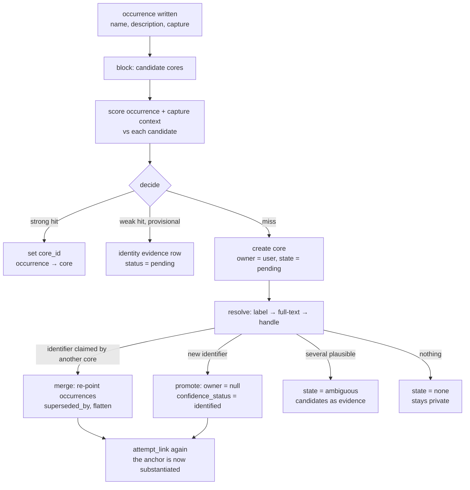

# Knowledge entities — occurrences, the core graph, and the evidence behind them

**Status:** Design, revised 2026-10-31. Replaces the earlier seven-table proposal
(`knowledge_nodes` / `knowledge_aliases` / `knowledge_merges` / `knowledge_candidates` /
`public_entities` / `public_entity_aliases` / `public_entity_merges`) with **three tables**
and a scored merge against a substantiated anchor. Nothing implemented.

**See also:** [knowledge-entity-types.md](knowledge-entity-types.md) (taxonomy; settled by the
2026-10-29 audit), [knowledge-evidence-prototype.md](knowledge-evidence-prototype.md) (the measured
prototype this is sized from, including the failure catalogue),
[knowledge-promotion-audit-prod.md](knowledge-promotion-audit-prod.md) (corpus numbers),
[knowledge-wikidata-recommender.md](knowledge-wikidata-recommender.md) (QID-keyed recommender),
[pragmatism.md](pragmatism.md) (ledger), [backfill.md](backfill.md) (typed backfills),
`plan/archive/illuminate-v2.md` (the projection this builds on).

## The gap

Illumination v2 gives us **mentions**, not **entities**. Every `knowledge_user` row is one span
of text a model reported for one capture: "Train Dreams", `movie`, in this capture. Nothing says the
fourteen `Train Dreams` mentions are one work, nothing says which of them is the same work another
user captured, and nothing lets us say how close two of them are.

```
  capture ───────────────────────────────────────────────────────┐
    │ media, url, annotation                                     │  private, immutable
    ▼                                                            │
  occurrence  ("this capture said X")       knowledge_user    │  exists today
    │ name, description, search_query, platform_link             │
    │ core_id ────────────────────────────────┐                  │
    ▼                                         │                  │
  core        ("X, as we understand it")  knowledge_core         │  new
    │ label, type, QID or handle, state      │                  │
    │ owner_user_id: null = shared           │                  │
    ▼                                        │                  │
  evidence    ("why we believe that")    knowledge_evidence       │  new
      dimension, value, source, method, confidence                 │
```

Three tables, three jobs:

| Table | Row means | Mutable? |
| --- | --- | --- |
| `knowledge_user` | "this capture said this" | append-only per illumination |
| `knowledge_core` | "this is an entity, and here is our current best account of it" | projected columns only |
| `knowledge_evidence` | "here is a fact that bears on that account, and where it came from" | append-only (one exception, §Evidence) |

## Properties that drive the design

1. **The occurrence is evidence, never rewritten.** Merging never edits a mention row: the user's
   description, spelling and handle stay exactly as captured. Everything an overlay displays as
   "why is this in my graph" comes from the occurrence.
2. **The core is a projection, not a verdict.** Columns on `knowledge_core` are recomputed from
   evidence by one function. The earlier design's central failure was storing a judgement
   (`promote` / `review_disambiguation` / …); 577 rows were held because their *name was short*,
   and the rule could not be revisited without reclassifying everything. Store facts, derive
   judgements. [knowledge-evidence-prototype.md](knowledge-evidence-prototype.md) §5 is the
   catalogue of what happens otherwise.
3. **Precision beats recall, asymmetrically.** A missed merge is a duplicate row. A wrong merge
   silently fuses two referents, and through transitivity can swallow a neighbourhood
   ([ER in Practice, 2026](https://arxiv.org/abs/2607.26298), third lesson). But the two sides of a
   merge are not equally trustworthy: the new occurrence is one speculative assertion, the core is
   N assertions plus, often, an authority identifier. The decision must be scored against the
   anchor's weight, not as if both were peers.
4. **The entity is public; the association is private.** *Elon Musk*, *Game of Thrones*, *C++* are
   public referents; a record saying "this is Elon Musk, here is a definition, an image" carries no
   user information. What is private is that **Bob captured him**, in **which screenshot**, with
   **what description**, next to **which other entities**.
5. **Resolution is promotion.** An entity becomes shared at the moment it acquires an identifier —
   a QID or a platform handle. One state transition, one column: `owner_user_id` goes from the user
   to `null`. There is no separate promotion pipeline and no draft shared rows.

### The publishability test

> Every column of a shared core row must be safe to show to **any** user, knowing **nothing** about
> who captured it. If a value fails that test, it is not a shared attribute.

| Value | Publishable? | Where it lives |
| --- | --- | --- |
| Canonical label, aliases, authority description, image, QID, type | yes | `knowledge_core` with `owner_user_id = null` |
| `"the documentary about him that I saved"` | no — meaningless without the capture | `knowledge_user.description` |
| The user's spelling `"the Elon guy"` | no — it is the user's phrasing | `knowledge_user.name` |
| Co-capture edges, related-entity ranking | no — derived from one person's activity | derived, never stored on a shared row |
| "captured by 12 users" | publishable in isolation, but aggregate behaviour | separate decision, A5 |

The test has a mechanical consequence: **`knowledge_core.description` is authority-derived only**
(§Descriptions). A private node has no `description` of its own; the model's reading stays on the
occurrence where it was written. This makes S2 checkable by construction rather than by discipline —
there is no field a private description could be copied into.

## What the data says

Measured against the prod corpus (5,245 mentions, 1,360 captures, 3 users, 2026-10-31) and the
local dev database. Method and per-bucket detail:
[knowledge-promotion-audit-prod.md](knowledge-promotion-audit-prod.md) and
[knowledge-evidence-prototype.md](knowledge-evidence-prototype.md).

| Fact | Value |
| --- | --- |
| mentions (prod, current) | 5,245 over 1,360 captures; 4,500 distinct names |
| distribution | one user holds 5,113 rows; a second holds 48; a third 84 |
| resolvable to an authority | 43.0% identified, 9.9% ranked, 11.9% ambiguous, 34.6% none |
| identified **and** described | 2,116 (40.3%) — the natural first population of shared rows |
| platform links | 785 mentions (15.0%); 107 (2.0%) resolve to a Wikidata item via `P2002` |
| multi-source names | 75 mentions (1.4%) — cross-user overlap is rare *today* |
| names repeating across captures | 408, of which **32 (7.8%) disagree on type** |
| collision pairs | 179 over 74 name groups: **111 are type instability**, 68 genuine (62 distinct named participants, 6 conflicting years) |
| homonyms inside one capture | 8 pairs — the model writes the same string twice, meaning two things |
| descriptions | 97.9% publishable, 1.8% missing, 0 contain a private identifier |
| per-user resolvability | 43.2% (primary), **14.6%** (aesthetic corpus), 42.9% (third) |

Readings that shape the design:

- **A quarter of the corpus is already a duplicate under conservative normalization**, and most of it
  is cross-capture. Canonicalization is a real win, not housekeeping.
- **Type is unreliable as a veto.** 111 of 179 collision pairs are the same referent disagreeing with
  itself (`brand` vs `organization`, `product` vs `software`). Type disagreement is a weak negative,
  never a hard veto — the old design's veto table was wrong on this.
- **Name is unreliable as a decision.** Label equality is ~75% precise (`Sunset Boulevard` → a
  street, `Bacardi` → a family name), and eight pairs prove two different referents can share a name
  *inside one capture*. Name is a blocking key, and only that.
- **The graph is small.** ~2k core rows per user, 4.5k co-capture pairs. Anything that needs a
  service to hold vectors is premature.
- **Normalization must be conservative.** Stripping punctuation collapses `C`, `C#` and `C++` into
  one key (observed, three variants); `@handle` vs `handle` is a genuine variant worth folding.
- **Wikidata covers the head, not the tail.** `Wojak`, `Claude Code` and `Invesco QQQ` resolve;
  `The Graph Maker`, `Max Dembo` and `MUME` do not. Private-only nodes are a permanent population.
- **Genres differ.** The aesthetic corpus resolves at 14.6% versus 43.2% for the primary one.
  Corpus-wide averages hide this entirely.
- **Handles are a first-class identifier.** 785 mentions carry one, 92% of sampled handles resolve
  to live accounts, and 375 mentions collapse to 340 distinct accounts. The handle merges pairs the
  name never would.

## Decisions

1. **Three tables.** `knowledge_user` (occurrence, exists), `knowledge_core`, `knowledge_evidence`.
   No alias, merge-log, candidate or public-table family: aliases are an array, merges are a
   self-reference plus an evidence row, candidates are evidence rows, and the shared layer is the
   same table with `owner_user_id = null`.
2. **The occurrence table is `knowledge_user`.** Renamed from `knowledge_entities` in schema
   version 9, because it is the per-user table of what a capture said. `SchemaRegistry::sync` creates
   but never renames, so the rename is an explicit guarded DDL step in `sync_schema`; a registry-only
   change would leave a populated old table beside an empty new one. The Rust module keeps the name
   `knowledge_entity` — its rows are entity mentions, not users — and the unique key follows the
   table as `knowledge_user_position`. One new nullable column, `core_id`.
3. **`knowledge_core.owner_user_id` is nullable: `null` means shared.** Private nodes are created by
   private users; a node becomes shared by acquiring an identifier. The merge rules refuse to link
   an occurrence across an owner boundary, which is what lets the overlay query carry **no
   visibility predicate** — the invariant is enforced at write time, not at read time.
4. **Merge is a scored decision, not a key match.** Blocking proposes candidates; a scorer decides,
   comparing the occurrence *with its capture context* against a substantiated core row. §The write
   path.
5. **Two merge regimes with different thresholds.** speculative → substantiated is a strong claim and
   gets a high bar; speculative → speculative is dedupe, gets a lower bar, stays private, and is
   reversible by construction.
6. **Same-capture is a veto, not a feature.** Two occurrences of the same name from one illumination
   are different referents; the model wrote the same flat string twice (8 observed pairs).
7. **Merges flatten.** On merge, occurrences are re-pointed at the winner and the loser keeps
   `superseded_by_id` as a tombstone. Reads are one join, no recursive CTE. Supersession is 0.5% of
   prod, so the write cost is negligible.
8. **Evidence is append-only, with one mutable field.** `status` on an `identity` evidence row
   (`pending | accepted | rejected`) is the single exception, logged in
   [pragmatism.md](pragmatism.md). Near-misses are decisions-in-waiting, not facts.
9. **Aliases are `text[]` of normalized surfaces, GIN-indexed.** Provenance needs nothing extra:
   every surface the model ever wrote is still on its occurrence row, and merges never delete them.
   A dedicated alias table is the upgrade path if blocking gets slow.
10. **One scorer serves resolution and merge.** Both ask "is this candidate this referent?" from the
    same feature vector. Two implementations would drift and their thresholds would stop meaning the
    same thing.
11. **The capture is an identity feature.** The sibling entities of an illumination are the best
    disambiguation context we have: `Django` next to `Python` and `web framework` is the framework;
    `Dito` next to `Pokémon` is the Pokémon. Context may rank and propose; it never auto-accepts.
12. **No edge table yet.** Co-capture connectedness is a join over `knowledge_user`. Add
    `knowledge_edges` when we have non-derived edges — a persona relation, an LLM-asserted relation,
    a user-drawn link. That is the trigger, not "we want a graph".

## Schema

Two new tables, one column on the occurrence table, and three partial indexes that carry invariants.
Bump `REQUIRED_SCHEMA_VERSION` (currently 8).

```sql
knowledge_user                       -- existing occurrence table
  + core_id i32 null -> knowledge_core.id
  -- unchanged: user_id, capture_id, illumination_id, position, name, entity_type,
  --            description, search_query, platform, platform_handle, platform_display_name
  -- existing: unique (illumination_id, position)
  index (user_id, core_id)
  index (capture_id, core_id)            -- the overlay and the neighbourhood feature

knowledge_core
  id
  owner_user_id     i32 null             -- null = shared; private otherwise
  normalized_name   text not null        -- blocking key, set once at creation
  label             text not null        -- display; the best surface we have
  entity_type       text not null        -- 'unknown' until authority-mapped
  description       text null            -- authority-derived ONLY (see publishability)
  wikidata_qid      text null
  platform          text null            -- primary identity when no QID
  platform_handle   text null
  resolution_state  text not null        -- pending | resolved | ambiguous | none | failed
  confidence_status text not null        -- provisional | identified | contested
  confidence        real null            -- best identity score behind the claim
  superseded_by_id  i32 null -> knowledge_core.id   -- tombstone after a merge
  aliases           text[] not null default '{}'    -- normalized surfaces
  source_count      i32 not null default 1          -- distinct users behind it
  created_at, updated_at

  unique (wikidata_qid) where wikidata_qid is not null
  unique (platform, lower(platform_handle)) where platform_handle is not null
  index  (owner_user_id, normalized_name)
  index using gin (aliases)
  index  (resolution_state) where resolution_state in ('pending', 'failed')

knowledge_evidence
  id
  core_id          i32 not null -> knowledge_core.id
  dimension        text not null    -- ontology | platform_link | identity | collision
                                    -- | description | merge
  value            jsonb not null
  source           text not null     -- wikidata | wikimedia | platform | model | user | manual
  method           text null         -- exact_label | full_text | p2002 | description_rank
                                     -- | neighbourhood | llm | manual
  confidence       real null
  related_core_id  i32 null -> knowledge_core.id   -- collisions, merge targets
  source_user_id   i32 null          -- null for authority sources
  status           text null         -- pending | accepted | rejected  (identity rows only)
  observed_at      timestamptz not null default now()

  unique index (core_id, dimension, source, coalesce(method, ''),
                coalesce(source_user_id, 0), md5(value::text))
                                             -- idempotent re-runs collapse; a changed
                                             -- answer (new candidates, revised
                                             -- description) appends instead of vanishing
  index (core_id, dimension)
  index (related_core_id) where related_core_id is not null
```

**The evidence dedupe key includes the content hash, not just the query shape.** Keyed on
`(core, dimension, source, method, user)` alone, a second ontology candidate set from the same
lookup would collide with the first and be dropped by `on conflict do nothing` — so a changed
Wikidata answer would never land. With `md5(value::text)` an identical re-run collapses and a
different answer appends; the projection reads the newest by `observed_at`, and the old row stays as
history.

**The `unique (wikidata_qid)` partial index is load-bearing.** Two workers resolving two occurrences
of the same new name can both score below threshold, create a core row, and both come back with the
same QID. The index turns that race into a merge (the second insert fails, the code re-reads and
merges) instead of a duplicate. Same for the platform index.

**Why the core row carries the identifier instead of a link to another table:** the earlier design
kept `public_entities` separate so it could be rebuilt independently. With `owner_user_id`, rebuilding
the shared subset is `delete from knowledge_core where owner_user_id is null` — no separate table
needed, and no text-vs-integer join. The decoupling the old design bought is now bought by a column.

**What is deliberately absent:**

- `knowledge_candidates` — the ambiguous band is an `identity` evidence row with `status = 'pending'`,
  carrying the score and features. A table would add a second place where a decision lives.
- an alias table — `aliases text[]` plus the occurrence rows.
- `knowledge_merges` — a `merge` evidence row plus `superseded_by_id`.
- an edge table — see decision 12.

### Rust shape: one model per table, typed views over the jsonb

Three SeaORM models, one per table — `knowledge_user::Model` (existing module
`knowledge_entity.rs`), `knowledge_core::Model`, `knowledge_evidence::Model`. There is no
`Candidate` or `Node` entity: a SeaORM model implies a table, and neither concept is one. A
candidate is a *state* of an `identity` evidence row; a node is the core row itself.

What does deserve a type is the evidence payload, because `value jsonb` is a contract between the
scorer, `project()` and the review UI, and a mistyped key fails silently:

```rust
pub enum EvidenceValue {                 // src/knowledge/evidence.rs
    Ontology { qid, label, description, classes, candidates },
    PlatformLink { site, handle, url },
    Identity { candidate: CoreId, score: f32, features: Features },
    Collision { reason, other: CoreId },
    Description { text, lang },
    Merge { child: CoreId, occurrences: Vec<OccurrenceId>, score: f32 },
}
```

with `TryFrom<Json>` / `Into<Json>`. If a dimension outgrows the enum, it becomes its own table — the
trigger is a second kind of decision, not the row count.

`CoreId` / `OccurrenceId` newtypes are optional and probably worth it once there are three tables of
`i32` keys: `attempt_link(occurrence) -> core` is one swapped argument away from corrupting the
graph. Use them in domain signatures and convert at the ORM boundary, where SeaORM wants `i32`.

Logic in `src/knowledge/` (`normalize.rs`, `resolve.rs`, `score.rs`, `merge.rs`, `project.rs`,
`promotion.rs`) with a lean root.

## The write path

`attempt_link(occurrence) -> core_id` is the single entry point, called at two moments: when an
occurrence is written, and again after resolution returns an identifier. That is the whole flow.



### Blocking

Recall-oriented, cheap, and over-generating by design:

- exact `normalized_name` on a core row, or `aliases @> array[$normalized]`;
- same `(platform, lower(handle))`;
- an identifier the occurrence already carries (a QID cached from a previous resolution of the same
  name — the prototype's cache makes this free);
- token-set key equality on names, in-app, over the candidate set only.

### Scoring

The occurrence side is one assertion plus its capture. The core side is an entity plus everything
that has accrued to it.

| Feature | Sign | Weight | Note |
| --- | --- | --- | --- |
| same `(platform, handle)` | identity | decisive | merge immediately; a handle is public identity |
| occurrence QID == core QID | identity | decisive | ditto |
| `normalized_name` equal | strong + | high | the common case; still must clear vetoes |
| alias exact match | strong + | high | the core already knows this surface form |
| description overlap (IDF) | + | medium | `"web framework written in Python"`; the prototype's ranking already does this |
| neighbourhood overlap | + | medium | shared co-entities in the capture; needs the `capture_id` join |
| type agreement | weak + | low | see below |
| type disagreement | **weak −** | low | 111 of 179 collisions are our own type instability |
| mutually exclusive markers | strong − | high | `film`/`video game` vs `framework`; conflicting years or nationalities |

**Type is a weak signal in both directions.** When the core's type is authority-derived (mapped from
`P31`) and incompatible with the occurrence's, that is a real negative. When both types are
model-assigned, disagreement says more about our extractor than about the referent — the corpus
proves it. Encode the distinction; do not collapse it into one weight.

### Regimes and thresholds

| Regime | Anchor | Bar | On merge |
| --- | --- | --- | --- |
| **speculative → substantiated** | core resolved, `confidence_status = identified` | high | flatten, record score; a strong claim |
| **speculative → speculative** | core `provisional`, same owner | low | dedupe only, stays private, reversible |

- **Decisive** (identity feature): link, no score needed.
- **Merge**: regime bar cleared and no veto. Leaf into root only for automatic merges.
- **Candidate**: within the band below the bar → `identity` evidence row, `status = 'pending'`.
  Visible, reversible, not applied.
- **New core**: everything else.

Thresholds are constants in one module with a table test, and every merge writes the score and the
feature vector it was computed from into its evidence row. Without that, re-tuning the weights means
re-deriving the whole graph — the exact failure the prototype exists to avoid.

### Vetoes

Few, and only structural:

| Veto | Rationale |
| --- | --- |
| the candidate core already has an occurrence in **this capture** | 8 observed homonym pairs within one illumination |
| `platform` set on both and differs | different accounts |
| `platform` equal, handles differ | different accounts |
| core's type is authority-derived and incompatible with the occurrence's | the only defensible type veto |

Everything else is a weight, because a veto cannot be traded against evidence and a weight can.

### The second call site

After resolution returns a QID, `attempt_link` runs again against the now-substantiated core set. Two
jobs: collapse the duplicate the unique index exposed, and catch the case where the new core's
neighbourhood evidence now points at an existing node. Same function, no special-casing.

### Concurrency

Two captures can create two cores for the same new entity. Accepted: the unique indexes convert the
second resolution into a merge, and until then the overlay shows two rows. Record it in
[pragmatism.md](pragmatism.md) when phase 1 lands.

## Evidence and the projection

Dimensions the prototype validates:

| Dimension | `value` | Source | Example |
| --- | --- | --- | --- |
| `ontology` | `{qid, label, desc, classes, candidates[]}` | wikidata | `Q752937`, via `exact_label`, conf 1.0 |
| `platform_link` | `{site, handle, url}` | platform | `instagram/cremieux` |
| `identity` | `{candidate_core_id, score, features}` | model | near-miss, `status = pending` |
| `collision` | `{reason, score}` + `related_core_id` | model | `type software vs organization` |
| `description` | `{text, lang}` | wikidata / wikimedia | authority definition |
| `merge` | `{child_core_id, occurrence_ids[], score, method}` | model / manual | audit + unmerge |

**The projection.** `project(core_id)` recomputes the mutable columns from evidence, in one function,
after every evidence append:

| Column | Derived from |
| --- | --- |
| `label` | best surface: authority label if shared, else the most frequent occurrence name |
| `entity_type` | authority `P31` map when available, else the modal occurrence type |
| `description` | `description` evidence with an authority source; **null if none** |
| `wikidata_qid` | the highest-confidence `ontology` evidence |
| `resolution_state` | presence and outcome of `ontology` / `platform_link` evidence |
| `confidence_status` | `identified` if an identifier evidence row exists; `contested` if a `collision` row does; else `provisional` |
| `confidence` | max identity score |
| `source_count` | distinct `knowledge_user.user_id` behind the core |

`confidence_status` is the mutable field the design asked for: it is rewritten whenever evidence about
the node changes, never hand-set. `resolution_state` is the job lifecycle; `confidence_status` is the
quality of the identity claim. They usually agree — a `resolved` node is `identified` — but they
answer different questions, and a hand-resolved ambiguous node is both `resolved` and `provisional`.

**The one mutable evidence field.** `status` on `identity` rows (`pending | accepted | rejected`).
A near-miss is a decision-in-waiting, not a fact; making it immutable would need a second table to
hold the decision. Logged as a deliberate exception in [pragmatism.md](pragmatism.md). All other
evidence is append-only, and `on conflict do nothing` against the unique index makes re-running safe.

**What a merge writes, in one transaction:**

1. `update knowledge_user set core_id = winner where core_id = loser`;
2. re-point the loser's evidence at the winner (`on conflict do nothing`);
3. insert the `merge` evidence row on the winner, carrying the moved occurrence ids and the score;
4. `loser.superseded_by_id = winner` and `loser.resolution_state = 'resolved'` (tombstone);
5. `project(winner)`.

Unmerge reverses 1–4 from the `merge` row. The occurrence ids are in `value` because that is the only
record of which rows moved; at a 0.5% merge rate the arrays stay small.

## Resolution

Three candidate sources, merged rather than ordered:

1. **Exact label, batched.** One SPARQL query per 50 names returns candidates *with* descriptions and
   `P31` classes, so the type filter can run before any cap. Capping first is what resolved `Django`
   to a 2021 video game.
2. **Full-text on `search_query`.** Populated on ~52% of rows and previously read by nothing. It
   carries exactly the disambiguation the label index cannot reach: `"Cure 1997 film"` → Q1144476.
   Per-query API call, so only where no type-plausible candidate exists.
3. **Handle → item** via `P2002`, batched. Identity with no text at all.

Then **rank** the plausible candidates with the same scorer as merges, using description overlap,
type plausibility, and capture neighbourhood. Only call one when it clears the runner-up by a margin;
otherwise the node stays `ambiguous` with the candidates recorded as evidence.

Measured on prod: exact-label coverage 68% of names; full-text adds candidates for ~45% of the names
that lack one; 107 of 785 handle-bearing mentions resolve through `P2002`.

**Candidate validation.** A hit becomes an identifier only when the `P31` class is compatible with
the occurrence's type, the description is consistent (token containment, or a scorer call in the
ambiguous band), and the match is not a known-wrong shape (`family name`, `given name`,
`Wikimedia disambiguation page`). Otherwise it becomes evidence with `status = 'pending'`.

**The ambiguous band is where neighbourhood earns its keep.** The prototype parked 11.9% of rows as
`ambiguous`; re-ranking those candidates with the sibling entities of the capture is the cheapest
precision available, and it uses the same feature vector as merge scoring.

**Cache invariants** (from the prototype, worth preserving verbatim):

1. Cache facts keyed by item, not queries keyed by text.
2. Tag cached lookups with the query shape that produced them, and expire negatives — a stale
   negative must not outlive the fixed query that wrote it.
3. After any change, re-running resolution must issue zero requests. That assertion is the test.
4. Filter before cap.

## Re-illumination

`insert_illumination_v2` currently deletes all `knowledge_user` for an illumination and re-inserts
them. That would silently discard every `core_id`. Change it to upsert by the existing unique key
`(illumination_id, position)`:

- position in both runs → same occurrence row, keep `core_id` unless `(normalized name, type)` changed;
- new positions → insert, `attempt_link`;
- vanished positions → delete the occurrence; the core survives, its projection recomputed.

**A capture can have several illuminations, and only the latest is live.** Illuminations are
append-only: 34 of 628 illuminated local captures carry two or three, and the read path exposes only
`max(id)`. Earlier runs' rows are still in the table (149 of 2,518), so anything that counts "all
mentions" double-counts a capture. Therefore:

- every consumer scopes to the latest illumination per capture;
- superseded runs' occurrences are marked (or deleted) when a new illumination lands;
- every "mentions" metric applies the same filter, or the audit drifts by ~6%.

This is also the whole explanation for apparent "duplicate inside one capture" groups: restricted to
the latest illumination, **zero** groups repeat a name inside one run. The model does not duplicate
entities; re-running illumination does.

## Descriptions

Two descriptions, one per table — which is the cleanest mapping this design gives us:

| | Lives on | Provenance | Rendered as |
| --- | --- | --- | --- |
| **"why is this in my graph"** | `knowledge_user.description` | the model's reading of that capture, or the user's words | the occurrence block |
| **"what is this"** | `knowledge_core.description` | Wikidata claims, the Wikipedia lead, cited web results for source-grounded entities — never a mention | the shared block |

The private description needs no machinery: it is produced per illumination, stored once, never
promoted, and never copied. The shared description is generated once per core row and identical for
everyone:

- **Inputs:** `P31`, `P106`, dates, the Wikipedia lead, and for source-grounded entities a small number
  of cited results. Never a mention, a capture, or a private description.
- **Prompt contract:** entity-centric, timeless, no assumed context — what this is for someone who has
  never heard of it, in one or two sentences, naming the claim being relied on.
- **Provenance:** `description` evidence records source, method and model. A sourced description
  outranks a generated one; generation fills gaps, it never invents facts.
- **Refresh:** regenerate when the model or the entity's claims change materially. Cheap, because it
  is once per shared row for all users.
- **Verification:** sample-audit accuracy. A wrong shared description is visible to everyone — a
  different failure class from a wrong private one.

Rendering both is the honest UI: *what it is* / *why it's here*.

## Enrichment

Lazy, not a Wikidata mirror:

1. Resolution returns a QID with no core row → the core row *is* the shared row; insert the identifier
   evidence and promote.
2. `core_enrich` fetches `wbgetentities` (labels, descriptions, aliases, `P31`, `P18`, sitelinks),
   maps the class to our type, stores the image in shared storage.
3. `core_describe` generates the shared description from sourced material.
4. `description` evidence's `observed_at` drives refresh — months, not minutes.

Cost is per shared core row, once, for every user forever. Images are the one place where "shared"
means bytes and money: cache per QID, serve from one path, never re-fetch per user.

## Read path and UI

- **The overlay** is the query the design is built around:

```sql
select e.*, c.*
from knowledge_user e
join knowledge_core c on c.id = e.core_id
where e.user_id = $1
  and c.superseded_by_id is null;
```

  One join, no aggregation, no visibility predicate — cross-owner links cannot exist (decision 3).
  Add the latest-illumination and archived-capture filters at the same level as today's reads.
- **Evidence is a detail view, not a read-path join.** `GET /api/core/{id}` returns the core, its
  evidence grouped by dimension, its occurrences grouped by capture, its collisions, and its merge
  children.
- `KnowledgeEntityInfo` stays the mention shape. Add `core_id` and a compact core summary
  (`label`, `entity_type`, `confidence_status`, `mention_count`) so clients group without a second
  call.
- WebUI: `/entity/{id}` becomes the core page — shared block, occurrence blocks, merge/collision
  history. Mentions link to it; the old per-mention page folds in as a section.
- A shared core page renders the shared definition only: no counts, no "also captured by" (A3).
- `/graph` (later): force-directed over cores and co-capture edges. Cytoscape.js is the boring choice
  at this scale; sigma.js if it outgrows canvas. The "Mind Map view" carried in
  [backlog.md](backlog.md).

## Invariants

Publishability of the shared row:

- **S1.** Every column of a `knowledge_core` row with `owner_user_id is null` is safe to show to any
  user, knowing nothing about who captured anything.
- **S2.** A private action may *trigger* a shared row; it may never *populate* one. The mechanical
  form: `knowledge_core.description` is written only by the describe task from cited sources, and
  `label`/`aliases`/`entity_type` come from authority data. The test: regenerate the row from its
  evidence alone and it must match, without reference to any occurrence.
- **S2a.** Promotion of `real_person` / `social_media_account` requires an identifier — a platform
  handle (with display-name or role corroboration when promoting under the person's name) or an
  external public source. Volume of mentions is never evidence.
- **S3.** Deleting a user changes no shared row. `owner_user_id` becomes null; occurrences cascade.

Association:

- **A1.** No table joins rows of two different users. `knowledge_core` has exactly one owner column.
- **A2.** No response reveals another user's data: no counts, no ids, no "also captured by", no
  cross-user co-occurrence.
- **A3.** A shared core page renders the shared definition only.
- **A4.** `knowledge_user.core_id` may point at another user's core **only** when that core is
  shared (`owner_user_id is null`). Enforced where links are written, asserted in a test.
- **A5.** Aggregate statistics over shared rows (if ever built) are a separate, explicit product
  decision with k-anonymity — not a side effect of this design.

A4 is the invariant that replaces the old design's schema-level separation, and it is the one a
future path could break by forgetting a check. It is worth a database-level guard: links are written
by one function, and a `before update` check on `knowledge_user.core_id` (or a nightly assertion
query) keeps it honest.

## Backfill and measurement

- **The first population is a data load, not a re-resolution.** The prototype's `resolved.jsonl`
  already carries, per occurrence, the identifier, the method, the candidates and the confidence.
  Phase 1 backfill maps it onto `knowledge_core` + `knowledge_evidence` with zero network calls.
- **Idempotent by construction:** unique indexes on evidence, `unique (wikidata_qid)`, and
  upsert-by-position. Re-running must change nothing; that is the acceptance test.
- **`dreamscroll_db entities stats --user <id>`**: occurrences, core rows, clusters, shared rows,
  coverage by `confidence_status`, collisions by reason, merges by method, duplicate rate
  `1 - distinct_core / current_occurrences`. This is the number that tells us whether the framework
  works.

## Phases

| Phase | Work | Acceptance |
| --- | --- | --- |
| **0 — Measure** | `entities stats` over the current corpus; the tables above reproduce. | Numbers in this doc come out of the command. |
| **1 — Link** | Two tables + `core_id`; normalization; blocking; `attempt_link` without resolution; mention upsert-by-position + latest-illumination scoping; overlay query; `/api/core/{id}`; backfill from `resolved.jsonl`. | Re-running the backfill changes nothing; the 408 cross-capture name groups collapse correctly on a spot audit; the overlay is one join. |
| **2 — Resolve** | Label → full-text → handle; evidence rows; `project()`; `confidence_status`; the cache. | Zero requests on a second run; `confidence_status` matches the prototype's per-row verdicts on a sample; no occurrence points at an unshared foreign core. |
| **3 — Score** | The scorer; two regimes; vetoes; the candidate band; neighbourhood feature; collision evidence. | Merge precision ≥ 0.95 on a 50-pair sample; the 8 intra-capture homonyms never merge; a re-tuned weight re-derives without a data change. |
| **4 — Share** | Promotion on identifier; enrichment; shared descriptions; the background re-match. | Link precision ≥ 0.9 on 50 labelled mentions; the measured wrong referents are rejected; a second user's `Elon Musk` costs zero network calls; describe reads no private table (test). |
| **5 — Graph** | `/graph` over cores and co-capture edges. | Renders 2k nodes with pan/zoom and click-through. |

Phase 2 needs 1. Phase 3 needs 2 (an anchor has to be substantiated before there are two regimes).
Phase 4 needs 3. Phase 5 needs 2.

## Non-goals and limits

- **Cross-user identity for private rows.** Private cores never link across owners; the shared layer is
  the only cross-user surface.
- **Entities without public evidence.** A name that only exists inside a screenshot never becomes a
  shared row. `Wojak` and `Claude Code` are in Wikidata; `The Graph Maker` is not, and stays private.
- **No cross-user recommendations.** "People who captured X also captured Y" is aggregate behaviour,
  not an entity fact.
- **No user-contributed commons.** If it ever becomes desirable it needs consent, moderation and a
  curation path; it must be explicit.
- **Fine-tuned entity-linking models.** Rules + one scorer + targeted LLM calls.
- **A graph database.** Postgres adjacency is sufficient at personal-graph scale.
- **Sentence-level coreference inside a capture** — the illumination prompt's job.
- **Rewriting the taxonomy.** See [knowledge-entity-types.md](knowledge-entity-types.md).
- **Promotion is not free and not instant.** A shared row costs a lookup, a verification and a
  background re-match across users.

## Alternatives considered

| Alternative | Why not (now) |
| --- | --- |
| **Seven tables (nodes / aliases / merges / candidates / public_*)** | Correct but over-partitioned: the shared layer is a column, aliases are an array, candidates are evidence rows, merges are a self-reference. Less schema, same invariants. |
| **Merge on `(normalized_name, type)` without scoring** | 111 of 179 collisions are type instability and 8 homonyms share a name inside one capture. A key match would fuse referents. |
| **Resolve before merge, always** | Pays resolution per occurrence instead of per core, and the occurrence is the weakest possible input. Merge-then-resolve-then-merge-again is cheaper and no less correct. |
| **A `confidence` verdict stored per row** | Unre-derivable when the rule changes; the 577-row string-length failure is the proof. |
| **Global entity table keyed by QID** ([recommender doc](knowledge-wikidata-recommender.md)) | Coverage and ambiguity: the tail misses a clean QID, the write path gains a network dependency, and per-user evidence ("what *I* mean by Ditto") is lost. QID stays an optional identifier. |
| **Unique `(user, type, normalized_name)` and re-point occurrences** | Cheap to write, not reversible: a wrong merge rewrites history. Also cannot express aliases or "same name, different type". |
| **Mention↔core many-to-many** | One occurrence belongs to one referent in every case we can name. Ambiguity is expressed as `resolution_state`, not as fan-out. |
| **In-context LLM clustering per illumination** ([design space](https://arxiv.org/abs/2506.02509)) | Non-deterministic across runs, so re-illumination reshuffles identity; cost per capture rather than per ambiguity; no per-decision audit trail. |
| **pgvector or a second Vertex index for similarity** | At ~2k cores per user, in-app token/cosine work is the boring answer. Revisit above ~100k. |
| **Per-user enrichment** | Every user pays to describe Elon Musk and the definition drifts. The shared row is the upgrade; `owner_user_id` makes it a column, not a table. |
| **Shared record built from the union of user mentions** | The record stops being self-contained: its content depends on who captured what, and it degrades as the user base changes. |
| **Mirror Wikidata in bulk** | Hundreds of millions of items for a corpus that touches a few thousand. Lazy per-QID enrichment keeps storage proportional to usage. |
| **One description, shared, overridden per user** | Forces a loser: either the definition or the user's context is hidden. Two descriptions, one per table, answer two questions. |
| **Promote on mention without a citable source** | Turns the shared graph into an unverifiable projection of user traffic: private individuals and model misreadings become link targets imposed on everyone. |
| **Separate service or graph database** | A second source of truth and a network hop for data that fits in a few Postgres tables. |

## Risks and open questions

| Risk | Mitigation |
| --- | --- |
| Same-name distinct people merge (`julius_caesar`). | Scorer + vetoes + precision-first bars; recorded score and features make every merge auditable and re-tunable. |
| Transitive mega-cluster from one bad merge. | Leaf-into-root only for automatic merges; flattening bounds the blast radius to the occurrences moved; unmerge restores exactly those. |
| The scorer drifts into a black box. | Feature weights are constants with a table test; every merge stores its feature vector. |
| An occurrence points at a foreign private core through a bug. | A4 asserted in a test, and a single write path for `core_id`. |
| Re-illumination orphans assignments. | Upsert-by-position + latest-illumination scoping; a prerequisite, not a follow-up. |
| Type churn invalidates merges. | Type is a weak weight, never a hard veto across model-assigned types. |
| Resolution cost on a cold corpus. | Cache + batching + cheap-paths-first; steady state is free. |
| Wikidata rate limits on a cold backfill. | Global concurrency cap and backoff; `maxlag` alarm; the cache makes a rerun free. |
| A wrong shared row is imposed on every user. | Citable sources only, evidence on every row, reversible merges, sampled audit instead of a review queue. |

Open, worth deciding before the phase that needs them:

1. **Threshold values.** Start from the prototype's description-overlap bands and calibrate on the
   labelled sheet; do not ship numbers picked from intuition.
2. **Does an archived capture feed evidence?** Current answer: yes for aliases and neighbourhood, no
   for read surfaces.
3. **Should a core's type ever override an occurrence's type?** Suggested: no. The occurrence records
   what the model said; the core records what we concluded.
4. **Where is the promotion bar for a QID-less entity?** Which sources count (Wikipedia, an official
   site, two independent reports), and how do we reject a private individual whose name appears in a
   screenshot? Start strict, measure, loosen with evidence.
5. **`P31` → type mapping ownership.** A curated table; who maintains it, and how does it interact
   with the taxonomy pass?
6. **Display precedence.** Proposed: the user's label is the title in their overlay; the shared
   description and the occurrence description are two labelled blocks, never merged into a paragraph.
7. **When does the mutable `status` become a table?** If the candidate band grows past a few hundred
   pending rows, or if a second kind of decision appears, promote it. Until then it is one column.

## References

- [Entity Resolution in Practice: Lessons from a Self-Serve Pipeline](https://arxiv.org/abs/2607.26298)
  — bake-off thinking, precision vetoes, and the transitive-closure failure mode.
- [Almost all of entity resolution](https://www.science.org/doi/10.1126/sciadv.abi8021) — the canonical
  blocking → comparison → clustering framing this design follows.
- [In-context Clustering-based Entity Resolution with LLMs](https://arxiv.org/abs/2506.02509) —
  pair-vs-cluster prompting tradeoffs; why pairwise judgements need transitivity guards.
- [Match, Compare, or Select? LLMs for Entity Matching](https://aclanthology.org/2025.coling-main.8.pdf)
  — listwise prompting beats pairwise at equal cost for small candidate lists.
- [Entity Resolution and Record Linkage, Explained Plainly](https://dedupe.dev/guides/entity-resolution)
  — normalize before matching; wrong merges are worse than missed ones.
- [Wikidata `wbsearchentities`](https://www.wikidata.org/w/api.php?action=help&modules=wbsearchentities)
  — the label lookup; QIDs are stable keys, Wikipedia URLs are not.
- [Schema.org Person / Role / author](https://schema.org/Role) — the reference for the
  occurrence-vs-role distinction in the taxonomy doc.
- [Cytoscape.js](https://js.cytoscape.org/) / [sigma.js](https://www.sigmajs.org/) — phase-5
  visualization candidates.
