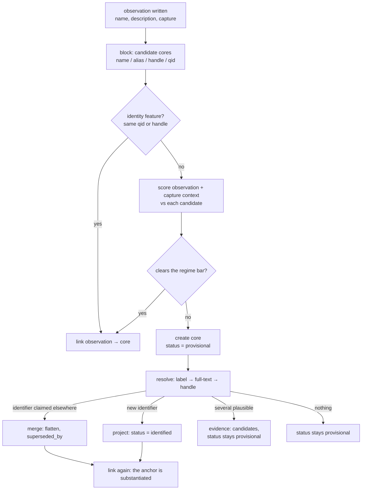

# Knowledge entities — observations, the core graph, and the evidence behind it

**Status:** Design, second revision (2026-10-31). Three tables, named for their layers:
**UserKnowledgeEntity**, **CoreKnowledgeEntity**, **CoreKnowledgeEvidence**. Nothing implemented.
Raw illuminations are retained, so any schema here can be built from scratch rather than migrated —
treat that as licence to choose the right model rather than the cheapest transition.

**See also:** [knowledge-entity-types.md](knowledge-entity-types.md) (taxonomy),
[knowledge-evidence-prototype.md](knowledge-evidence-prototype.md) (the measured prototype and its
failure catalogue), [knowledge-promotion-audit-prod.md](knowledge-promotion-audit-prod.md) (corpus
numbers), [knowledge-wikidata-recommender.md](knowledge-wikidata-recommender.md) (QID usage),
[pragmatism.md](pragmatism.md) (ledger), [backfill.md](backfill.md) (typed backfills),
`plan/archive/illuminate-v2.md` (the projection this builds on).

## The gap

Illumination gives us **mentions**, not **entities**. Every row is one span of text a model reported
for one capture: "Train Dreams", `movie`, in this capture. Nothing says the fourteen `Train Dreams`
mentions are one work, nothing says which of them is the same work another user captured, and nothing
lets us say how close two of them are.

```
  capture ──────────────────────────────────────────────────────────┐
    │ media, url, annotation                                        │  private, immutable
    ▼                                                               │
  UserKnowledgeEntity   ("this capture said X")                     │  per user, owned
    │ name, description, search_query, platform link                │
    │ core_id ───────────────────────────────┐                      │
    ▼                                        │                      │
  CoreKnowledgeEntity   ("X, as we understand it")                  │  one row per referent
    │ label, type, identifier, status         │                      │  no owner
    ▼                                        │                      │
  CoreKnowledgeEvidence ("why we believe that")                     │  append-only facts
      kind, value, source, method, confidence, provenance
```

Three tables answering three different questions:

| Table | The question it answers | Owned by | Mutable |
| --- | --- | --- | --- |
| `user_knowledge_entities` | what did this capture say? | one user | only `core_id` |
| `core_knowledge_entities` | what is this referent? | nobody | projected columns only |
| `core_knowledge_evidence` | why do we believe it? | nobody | append-only |

## Properties that drive the design

1. **An observation is owned; a referent is not.** "Bob captured an actor, in this screenshot, and
   wrote this" belongs to Bob. "This is Kyle Chandler (Q359604)" belongs to nobody — it is a claim
   about the world, and it is the same claim whoever noticed it. Ownership is therefore a property of
   the *user entity* and never of the core row.
2. **Substantiation, not ownership, decides what is shared.** A core row is shared when it carries an
   identifier — a QID or a platform handle — because then anyone can check it. Before that it is one
   user's hypothesis and must not be visible to anyone else. That is a *status*, derivable from
   evidence, not an owner column.
3. **The core is a projection.** Its label, type, identifier, description and status are recomputed
   from evidence by one function. The earlier design's central failure was storing a judgement
   (`promote` / `review_disambiguation` / …): 577 rows were held because their *name was short*, and
   the rule could not be revisited without reclassifying everything. Store facts, derive judgements.
4. **Precision beats recall, asymmetrically.** A missed merge is a duplicate row; a wrong merge fuses
   two referents and can swallow a neighbourhood through transitivity
   ([ER in Practice](https://arxiv.org/abs/2607.26298), third lesson). The two sides are not peers: a
   new observation is one speculative assertion, an established core is N assertions plus, often, an
   identifier. Score against the anchor's weight.
5. **Merge is a decision about evidence, not a key comparison.** Names block; they never decide.
6. **Evidence is append-only.** A hypothesis that has not been decided is *derived*, not stored — so
   there is no mutable decisions column anywhere in the schema.

### The publishability test

> Every column of a shared core row must be safe to show to **any** user, knowing **nothing** about
> who captured it.

| Value | Publishable? | Where it lives |
| --- | --- | --- |
| Canonical label, aliases, authority description, identifier, type | yes | `core_knowledge_entities` |
| `"the documentary about him that I saved"` | no | `user_knowledge_entities.description` |
| The user's spelling `"the Elon guy"` | no | `user_knowledge_entities.name` |
| Co-capture edges, related-entity ranking | no | derived from `user_knowledge_entities` |
| "captured by 12 users" | publishable in isolation, but aggregate behaviour | separate decision, A5 |

Mechanical consequence: **`core_knowledge_entities.description` is authority-derived only.** The
model's reading stays on the observation where it was written. There is no field a private
description could be copied into, so the invariant is structural rather than disciplinary.

## What the data says

Prod corpus, 5,245 mentions / 1,360 captures / 3 users (2026-10-31); detail in
[knowledge-promotion-audit-prod.md](knowledge-promotion-audit-prod.md) and
[knowledge-evidence-prototype.md](knowledge-evidence-prototype.md).

| Fact | Value |
| --- | --- |
| mentions | 5,245 over 1,360 captures; 4,500 distinct names |
| distribution | one user holds 5,113; a second 48; a third 84 |
| authority reachable | 43.0% identified, 9.9% ranked, 11.9% ambiguous, 34.6% none |
| identified **and** described | 2,116 (40.3%) — the first population of shared rows |
| platform links | 785 (15.0%); 107 (2.0%) resolve to an item via `P2002` |
| multi-source names | 75 (1.4%) — cross-user overlap is rare *today* |
| names repeating across captures | 408, of which 32 (7.8%) disagree on type |
| collision pairs | 179 over 74 groups: **111 type instability**, 62 distinct participants, 6 conflicting years |
| homonyms inside one capture | 8 pairs — the model writes the same string twice, meaning two things |
| descriptions | 97.9% publishable, 1.8% missing, 0 contain a private identifier |
| per-user resolvability | 43.2% (primary), **14.6%** (aesthetic corpus), 42.9% (third) |

Readings that shape the design:

- **A quarter of the corpus is already a duplicate under conservative normalization**, mostly
  cross-capture. Canonicalization is a real win, not housekeeping.
- **Type is unreliable as a veto.** 111 of 179 collision pairs are the same referent disagreeing with
  itself. Type disagreement is a weak negative, never a hard veto.
- **Name is unreliable as a decision.** Label equality is ~75% precise (`Sunset Boulevard` → a
  street, `Bacardi` → a family name), and eight pairs prove two referents can share a name *inside
  one capture*. Name blocks; nothing more.
- **The graph is small.** ~2k core rows per user, 4.5k co-capture pairs.
- **Normalization must be conservative.** Stripping punctuation collapses `C`, `C#`, `C++` (observed);
  `@handle` vs `handle` is a genuine variant worth folding.
- **Authority covers the head, not the tail.** `Wojak`, `Claude Code` and `Invesco QQQ` resolve;
  `The Graph Maker`, `Max Dembo` and `MUME` do not. Provisional cores are a permanent population.
- **Genres differ.** 14.6% versus 43.2% — corpus averages hide this.
- **Handles are a first-class identifier.** 785 mentions carry one; 92% of sampled handles are live
  accounts; 375 mentions collapse to 340 accounts. The handle merges pairs the name never would.

## Decisions

1. **Three tables, named for their layers.** `UserKnowledgeEntity` (observation), `CoreKnowledgeEntity`
   (referent), `CoreKnowledgeEvidence` (justification). The name of each type states its scope, so a
   signature that mentions two of them is visibly a cross-layer operation.
2. **The user entity is the observation and the only owned thing.** It carries the verbatim name,
   description, `search_query`, platform link and the illumination position. Merging never rewrites
   any of it; the only column that changes is `core_id`.
3. **The core has no owner column.** A referent is not owned. What varies between cores is how well
   substantiated they are, which is a projected `status` — `provisional`, `identified`, `contested`.
4. **Cross-user linking requires an identified core.** A mention may link to a core that is
   `identified`, or to a provisional core whose existing mentions all belong to the same user:
   `status = 'identified' OR NOT EXISTS (select 1 from user_knowledge_entities e
   where e.core_id = c.id and e.user_id <> :me)`. That single rule is what makes provisional rows
   private without an owner column and without a read-time visibility predicate.
5. **Merge is a scored decision.** Blocking proposes; a scorer compares the observation *with its
   capture context* against the anchor. §The write path.
6. **Two regimes.** speculative → substantiated is a strong claim with a high bar; speculative →
   speculative is dedupe, private, and reversible by construction.
7. **Same-capture is a veto.** Two mentions of one name from one illumination are different referents
   (8 observed pairs).
8. **Merges flatten.** Occurrences are re-pointed at the winner; the loser keeps `superseded_by_id` as
   a tombstone and the merge evidence row carries the moved ids. Reads are one join. Supersession is
   0.5% of prod.
9. **No stored candidates and no mutable status.** An undecided near-miss is a *view* over unresolved
   cores; the two decisions worth persisting — accept (a merge) and reject (`identity_rejection`) —
   are ordinary append-only evidence.
10. **Aliases are `text[]` of normalized surfaces, GIN-indexed.** Provenance is free: every surface the
    model wrote is still on its observation row.
11. **One scorer serves resolution and merge.** Both ask "is this candidate this referent?" from one
    feature vector; two implementations would drift and their thresholds would stop meaning the same.
12. **The capture is an identity feature.** Sibling entities are the best disambiguation context we
    have: `Django` beside `Python` and `web framework` is the framework. Context ranks; it never
    auto-accepts.
13. **No edge table yet.** Co-capture connectedness is a join over `user_knowledge_entities`. Add
    `core_knowledge_edges` when we have non-derived edges — a persona relation, an LLM-asserted
    relation, a user-drawn link.

## Schema

Three tables, one column on the observation table at seeding time, and four partial indexes that
carry invariants. Naming: tables plural, except `core_knowledge_evidence` (mass noun).

```sql
user_knowledge_entities                    -- the observation; the only owned row
  id
  user_id        i32 not null -> users.id
  capture_id     i32 not null -> captures.id
  illumination_id i32 not null -> illuminations.id
  position       i32 not null
  name           text not null            -- verbatim, as the model wrote it
  entity_type    text not null            -- as the model guessed it
  description    text null                -- the model's reading of this capture
  search_query   text null                -- disambiguation hint, often populated
  platform       text null
  platform_handle text null
  platform_display_name text null
  core_id        i32 null -> core_knowledge_entities.id
  created_at
  unique (illumination_id, position)      -- replay-safe illumination
  index (user_id, core_id)
  index (capture_id, core_id)             -- overlay + neighbourhood feature

core_knowledge_entities                    -- the referent; owned by nobody
  id
  normalized_name  text not null          -- blocking key; set once at creation
  label            text not null          -- display surface
  entity_type      text not null          -- authority-mapped, else modal
  description      text null              -- authority-derived ONLY
  wikidata_qid     text null
  platform         text null              -- primary identifier when no QID
  platform_handle  text null
  status           text not null          -- provisional | identified | contested (projected)
  confidence       real null              -- best identity score behind the claim
  superseded_by_id i32 null -> core_knowledge_entities.id
  aliases          text[] not null default '{}'   -- normalized surfaces
  created_at, updated_at
  unique (wikidata_qid) where wikidata_qid is not null
  unique (platform, lower(platform_handle)) where platform_handle is not null
  index  (normalized_name)
  index  using gin (aliases)
  index  (status) where status = 'provisional'

core_knowledge_evidence                    -- the justification; append-only
  id
  core_id              i32 not null -> core_knowledge_entities.id
  related_core_id      i32 null -> core_knowledge_entities.id   -- collision other / merge child
  user_entity_id       i32 null -> user_knowledge_entities.id   -- provenance of an observation
  kind                 text not null   -- ontology | platform_link | description | collision
                                       -- | identity_claim | identity_rejection | merge
  value                jsonb not null
  source               text not null   -- wikidata | wikimedia | platform | model | user | manual
  method               text null       -- exact_label | full_text | p2002 | description_overlap
                                       -- | neighbourhood | llm | manual
  confidence           real null
  source_user_id       i32 null        -- who asserted it, when a person did
  observed_at          timestamptz not null default now()
  unique index (core_id, kind, source, coalesce(method, ''),
                coalesce(user_entity_id, 0), coalesce(related_core_id, 0), md5(value::text))
  index (core_id, kind)
  index (related_core_id) where related_core_id is not null
```

**Why there is no `owner_user_id` on the core.** Ownership describes the observation, not the
referent; a core row that says "this is Kyle Chandler" is not Bob's. The property we actually need —
"this claim is not shared yet" — is substantiation, and decision 4 enforces it with a condition on
existing mentions rather than a denormalized column that can drift away from the links that contradict
it. The cost is one `NOT EXISTS` in the linker, which runs once per observation.

**Why the dedupe key includes `md5(value)`.** Keyed on the query shape alone, a second candidate set
from the same lookup would collide with the first and be dropped by `on conflict do nothing`, so a
changed authority answer could never land. With the content hash an identical re-run collapses, a
different answer appends, and the projection reads the newest by `observed_at` with the old row kept
as history.

**The unique indexes are load-bearing.** Two workers resolving the same new name can both create a
core and both return the same QID; `unique (wikidata_qid)` turns that race into a merge instead of a
duplicate. Same for the platform index.

**No mutable decisions column.** A candidate is a row of a *view*; accepting it writes a `merge`
evidence row plus the pointer, rejecting it writes `identity_rejection`. Nothing needs to be updated
in place, so no table in this design has a mutable business field — only projected columns, which are
written by `project()` and by nothing else.

Model files: `src/model/user_knowledge_entity.rs`, `core_knowledge_entity.rs`,
`core_knowledge_evidence.rs` — each `pub struct Model`, as SeaORM requires, so the layer lives in the
module path. Logic in `src/knowledge/` (`normalize.rs`, `resolve.rs`, `score.rs`, `link.rs`,
`merge.rs`, `project.rs`, `promote.rs`).

### Rust shape

The evidence payload is the one place a typed view earns its keep: `value jsonb` is a contract between
the scorer, `project()` and the review view, and a mistyped key fails silently.

```rust
pub enum EvidenceValue {                 // src/knowledge/evidence.rs
    Ontology { qid, label, description, classes, candidates },
    PlatformLink { site, handle, url },
    Collision { reason, other: CoreId },
    Description { text, lang },
    IdentityClaim { candidate: CoreId, score: f32, features: Features },
    IdentityRejection { candidate: CoreId, reason },
    Merge { child: CoreId, occurrences: Vec<ObservationId>, score: f32 },
}
```

with `TryFrom<Json>` / `Into<Json>`. `CoreId` / `ObservationId` newtypes in domain signatures:
three tables of `i32` keys means `link(observation) -> core` is one swapped argument away from
corrupting the graph. Convert at the ORM boundary.

## The write path

`link(observation) -> core` is the single entry point, called twice per observation: when it is
written, and again after resolution returns an identifier.



### Blocking

Recall-oriented and deliberately over-generating: exact `normalized_name` or `aliases @> array[$n]`;
same `(platform, lower(handle))`; a QID the observation already carries (from the resolution cache);
token-set equality over the candidate set, in-app.

Cross-user candidates are filtered by decision 4's condition before scoring, so a foreign provisional
core never becomes a candidate.

### Scoring

| Feature | Sign | Weight | Note |
| --- | --- | --- | --- |
| same `(platform, handle)` | identity | decisive | a handle is public identity |
| QID equality | identity | decisive | |
| `normalized_name` equal | strong + | high | the common case; still clears vetoes |
| alias exact match | strong + | high | the core already knows this surface |
| description overlap (IDF) | + | medium | `"web framework written in Python"` |
| neighbourhood overlap | + | medium | shared co-entities in the capture |
| type agreement | weak + | low | |
| type disagreement | **weak −** | low | 111 of 179 pairs are our own instability |
| mutually exclusive markers | strong − | high | `film`/`video game`; conflicting years |

Type is a weak signal both ways. When a core's type is authority-derived and incompatible, that is a
real negative; when both are model-assigned, disagreement is evidence about the extractor.

### Regimes

| Regime | Anchor | Bar | Effect |
| --- | --- | --- | --- |
| speculative → substantiated | `status = identified` | high | strong claim; flatten and record |
| speculative → speculative | `status = provisional`, same user | low | dedupe only, private, reversible |

Thresholds are constants in one module with a table test, and every merge stores the score and the
feature vector it was computed from. Without that, re-tuning the weights means re-deriving the graph.

### Vetoes

| Veto | Rationale |
| --- | --- |
| the candidate already has a mention in **this capture** | 8 observed homonym pairs in one illumination |
| `platform` set on both and differs | different accounts |
| `platform` equal, handles differ | different accounts |
| authority-derived core type incompatible with the observation's | the only defensible type veto |

Everything else is a weight: a veto cannot be traded against evidence, a weight can.

### Concurrency

Two captures can create two provisional cores for one new referent. The unique indexes convert the
second resolution into a merge; until then the overlay shows two rows. Accepted, recorded in
[pragmatism.md](pragmatism.md).

## Evidence and the projection

| kind | `value` | source | purpose |
| --- | --- | --- | --- |
| `ontology` | `{qid, label, desc, classes, candidates[]}` | wikidata | identity + enrichment |
| `platform_link` | `{site, handle, url}` | platform | identity with no text |
| `description` | `{text, lang}` | wikidata / wikimedia | the shared definition |
| `collision` | `{reason, score}` + `related_core_id` | model | competing identity |
| `identity_claim` | `{candidate, score, features}` | model / user | a near-miss, recorded, not applied |
| `identity_rejection` | `{candidate, reason}` | user / model | "these are not the same" |
| `merge` | `{child, occurrences[], score, method}` | model / user | the decision + how to undo it |

`project(core_id)` recomputes the mutable columns after every evidence append:

| Column | Derived from |
| --- | --- |
| `label` | authority label, else the most frequent observation name |
| `entity_type` | authority `P31` map, else the modal observation type |
| `description` | `description` evidence with an authority source; **null if none** |
| `wikidata_qid` / `platform*` | the highest-confidence `ontology` / `platform_link` evidence |
| `status` | `identified` if an identifier exists; `contested` if a `collision` row does; else `provisional` |
| `confidence` | the max identity score behind the current claim |
| `aliases` | authority aliases plus every observation surface |
| `superseded_by_id` | written by `merge` only |

`mention_count` and `distinct_users` are **not** columns: they are `count(*)` / `count(distinct
user_id)` over the overlay, and a stored copy would be one more thing that can disagree with the rows.

**What a merge writes, in one transaction:** re-point the loser's observations; move its evidence
(`on conflict do nothing`); insert the `merge` row on the winner with the moved observation ids; set
`loser.superseded_by_id`; `project(winner)`. Unmerge reverses it from that row — which is why the ids
are in the payload.

## Resolution

Three sources, merged rather than ordered:

1. **Exact label, batched.** One SPARQL query per 50 names returns candidates *with* descriptions and
   `P31` classes, so the type filter runs before any cap. Capping first is what resolved `Django` to a
   2021 video game.
2. **Full-text on `search_query`.** Populated on ~52% of observations, previously read by nothing. It
   carries exactly the disambiguation the label index cannot reach: `"Cure 1997 film"` → Q1144476.
   Per-query call, so only when no type-plausible candidate exists.
3. **Handle → item** via `P2002`, batched.

Then rank the plausible candidates with the same scorer — description overlap, type plausibility,
capture neighbourhood — and accept only on a clear margin over the runner-up. Otherwise the core stays
`provisional` with the candidates recorded as `identity_claim` evidence, and the review view surfaces
it. Measured: label coverage 68% of names; full-text adds candidates for ~45% of names that lack one;
107 of 785 handle-bearing observations resolve.

**Candidate validation.** A hit becomes an identifier only when the `P31` class is compatible, the
description is consistent, and the shape is not known-wrong (`family name`, `given name`,
`Wikimedia disambiguation page`). Otherwise it is `identity_claim` evidence.

**Cache invariants** (from the prototype, worth preserving verbatim): cache facts keyed by item, not
queries keyed by text; tag cached lookups with the query shape and expire negatives; re-running
resolution must issue zero requests; filter before cap.

## Re-illumination

Illuminations are append-only and only the latest per capture is live: 34 of 628 local captures carry
two or three, and the read path exposes only `max(id)`. Earlier runs' observations are still rows
(149 of 2,518), so anything counting "all mentions" double-counts a capture. Therefore:

- every consumer scopes to the latest illumination per capture;
- superseded runs' observations are marked (or deleted) when a new illumination lands;
- every "mentions" metric applies the same filter, or the audit drifts by ~6%.

The write path upserts by `(illumination_id, position)` rather than delete-and-reinsert, so a
re-illumination preserves `core_id` for unchanged positions and re-links only what changed.

Restricted to the latest illumination, **zero** groups repeat a name inside one run: the model does
not duplicate entities, re-running illumination does.

## Descriptions

Two descriptions, one per table — the cleanest mapping this design gives us:

| | Lives on | Provenance | Rendered as |
| --- | --- | --- | --- |
| "why is this in my graph" | `user_knowledge_entities.description` | the model's reading of that capture | the observation block |
| "what is this" | `core_knowledge_entities.description` | Wikidata claims, the Wikipedia lead, cited results | the shared block |

- **Inputs:** `P31`, `P106`, dates, the Wikipedia lead, cited web results for source-grounded rows.
  Never an observation, a capture, or a private description.
- **Contract:** entity-centric, timeless, no assumed context, one or two sentences, naming the claim
  relied on.
- **Provenance:** the `description` evidence row records source, method and model. Sourced outranks
  generated; generation fills gaps and never invents facts.
- **Refresh:** on material change to the model or the entity's claims. Cheap — once per core row.
- **Verification:** sample audit. A wrong shared description is visible to everyone.

Rendering both is the honest UI: *what it is* / *why it's here*.

## Enrichment

Lazy, not a mirror: resolution returns a QID → the core row is the shared row → `core_enrich` fetches
`wbgetentities` (labels, descriptions, aliases, `P31`, `P18`, sitelinks), maps the class to our type,
stores the image in shared storage → `core_describe` generates the shared description from cited
material. Cost is per core row, once, for every user forever. Images are the only bytes: cache per
QID, serve from one path.

## Read path and UI

The overlay is the query the design is built around:

```sql
select e.*, c.*
from user_knowledge_entities e
join core_knowledge_entities c on c.id = e.core_id
where e.user_id = $1
  and c.superseded_by_id is null;
```

No visibility predicate: decision 4 guarantees an observation can only point at an identified core or
at a provisional core built entirely from that user's own observations. Add the latest-illumination
and archived-capture filters with the existing read guards.

Direct access needs one check that the overlay gets for free:

```sql
-- a core page or a search hit
where c.status = 'identified'
   or exists (select 1 from user_knowledge_entities e
              where e.core_id = c.id and e.user_id = $1);
```

- `GET /api/core/{id}` returns the core, its evidence grouped by kind, its observations grouped by
  capture, its collisions, and its merge children.
- `KnowledgeEntityInfo` stays the observation shape; add `core_id` and a compact core summary
  (`label`, `entity_type`, `status`) so clients group without a second call.
- WebUI: `/entity/{id}` becomes the core page — shared block, observation blocks, collision and merge
  history. A shared page renders the shared definition only: no counts, no "also captured by" (A3).
- `/graph`: force-directed over cores and co-capture edges. Cytoscape.js at this scale.

## Invariants

Publishability:

- **S1.** Every column of a `core_knowledge_entities` row with `status <> 'provisional'` is safe to
  show to any user, knowing nothing about who captured anything.
- **S2.** An observation may *trigger* a shared core; it may never *populate* one. The mechanical
  form: `description`, `label`, `aliases`, `entity_type` on a shared row come from authority evidence.
  Test: regenerate the row from its evidence alone and it must match.
- **S2a.** Promotion of `real_person` / `social_media_account` requires an identifier — a platform
  handle (corroborated by display name or role when promoting under the person's name) or an external
  public source. Volume of mentions is never evidence.
- **S3.** Deleting a user changes no shared row; their provisional cores become unreachable and are
  garbage-collected when they have no observations and no identifier.

Association:

- **A1.** No table joins rows of two different users. `core_knowledge_entities` has no user column.
- **A2.** No response reveals another user's data: no counts, no ids, no cross-user co-occurrence.
- **A3.** A shared core page renders the shared definition only.
- **A4.** An observation may point at a provisional core **only** if every observation of that core
  belongs to the same user. Enforced in the linker, asserted in a test, and the one invariant most
  likely to be broken by a future write path that forgets.
- **A5.** Aggregate statistics over shared rows are a separate product decision with k-anonymity.

## Backfill and measurement

- **The first population is a data load.** The prototype's `resolved.jsonl` already carries, per
  observation, the identifier, method, candidates and confidence: map it onto the three tables with
  zero network calls. Raw illuminations make this a rebuild, not a migration.
- **Idempotent by construction:** unique evidence `(kind, source, method, provenance, md5(value))`,
  `unique (wikidata_qid)`, and upsert-by-position. Re-running changes nothing; that is the test.
- **`dreamscroll_db entities stats --user <id>`**: observations, cores, provisional/identified/
  contested counts, collisions by reason, merges by method, duplicate rate
  `1 - distinct_cores / observations`.

## Phases

| Phase | Work | Acceptance |
| --- | --- | --- |
| **0 — Measure** | `entities stats`; the tables above reproduce. | Numbers in this doc come from the command. |
| **1 — Link** | Three tables; normalization; blocking; `link()` without resolution; upsert-by-position; overlay query; `/api/core/{id}`; backfill from `resolved.jsonl`. | Re-running the backfill changes nothing; the 408 cross-capture name groups collapse correctly on a spot audit; the overlay is one join. |
| **2 — Resolve** | Label → full-text → handle; evidence; `project()`; status; the cache. | Zero requests on a second run; statuses match the prototype's per-row verdicts on a sample; no observation points at a foreign provisional core. |
| **3 — Score** | The scorer; two regimes; vetoes; the review view; neighbourhood; collisions. | Merge precision ≥ 0.95 on 50 pairs; the 8 intra-capture homonyms never merge; re-tuning a weight re-derives without a data change. |
| **4 — Share** | Promotion on identifier; enrichment; shared descriptions; background re-link. | Link precision ≥ 0.9 on 50 labelled mentions; the measured wrong referents are rejected; a second user's `Elon Musk` costs zero network calls; describe reads no private table (test). |
| **5 — Graph** | `/graph` over cores and co-capture edges. | Renders 2k nodes with pan/zoom. |

## Non-goals and limits

- **Cross-user identity for provisional cores.** Only identified cores accept other users' observations.
- **Entities without public evidence become shared.** They stay provisional forever.
- **No cross-user recommendations.**
- **No user-contributed commons** without consent, moderation and a curation path.
- **Fine-tuned entity-linking models.** Rules + one scorer + targeted LLM calls.
- **A graph database.** Postgres adjacency at personal-graph scale.
- **Sentence-level coreference inside a capture** — the illumination prompt's job.
- **Rewriting the taxonomy.** See [knowledge-entity-types.md](knowledge-entity-types.md).
- **Promotion is not free and not instant.** A shared row costs a lookup, a verification and a
  background re-link.

## Alternatives considered

| Alternative | Why not |
| --- | --- |
| **Seven tables (nodes / aliases / merges / candidates / public_*)** | Over-partitioned: the shared layer is a status, aliases are an array, candidates are a view, merges are evidence. Less schema, same invariants. |
| **`owner_user_id` on the core** | Ownership describes the observation, not the referent; the property that matters is substantiation. It also drifts against the links that contradict it. |
| **A `core_knowledge_candidate` table** | A candidate is an undecided hypothesis, derivable from evidence plus the scorer. Persisting it gives a decision a second home and makes the table mutable. |
| **Merge on `(normalized_name, type)` without scoring** | 111 of 179 collisions are type instability and 8 homonyms share a name inside one capture. |
| **Resolve before merge, always** | Pays resolution per observation instead of per core, on the weakest possible input. |
| **A stored confidence verdict per row** | Unre-derivable when the rule changes; the 577-row string-length failure is the proof. |
| **Global entity table keyed by QID** ([recommender doc](knowledge-wikidata-recommender.md)) | The tail misses a clean QID, the write path gains a network dependency, per-user evidence is lost. QID stays an optional identifier. |
| **Unique `(user, type, normalized_name)` and re-point** | Cheapest to write, not reversible, and cannot express aliases or "same name, different type". |
| **Mention↔core many-to-many** | One observation belongs to one referent in every case we can name. Ambiguity is a status, not a fan-out. |
| **In-context LLM clustering per illumination** ([design space](https://arxiv.org/abs/2506.02509)) | Non-deterministic across runs; cost per capture rather than per ambiguity; no audit trail. |
| **pgvector or a second Vertex index** | At ~2k cores per user, in-app work is the boring answer. |
| **Per-user enrichment** | Everyone pays to describe Elon Musk and the definition drifts. |
| **Shared record built from the union of mentions** | Depends on who captured what; degrades as the user base changes. |
| **Mirror Wikidata in bulk** | Hundreds of millions of items for a corpus touching a few thousand. |
| **One description, overridden per user** | Forces a loser. Two descriptions, one per table. |
| **Promote on mention without a citable source** | Turns the shared graph into an unverifiable projection of user traffic. |

## Risks and open questions

| Risk | Mitigation |
| --- | --- |
| Same-name distinct people merge. | Scorer + vetoes + precision-first bars; every merge stores its feature vector. |
| Transitive mega-cluster. | Leaf-into-root for automatic merges; flattening bounds the blast radius; unmerge restores exactly the moved ids. |
| An observation points at a foreign provisional core. | A4 asserted in a test; one write path for `core_id`. |
| Provisional cores accumulate and never resolve. | They are a permanent population (34.6% of prod); the review view is their only exit. Measure the share over time. |
| Type churn invalidates merges. | Type is a weak weight across model-assigned types. |
| Resolution cost on a cold corpus. | Cache + batching + cheap paths first; steady state is free. |
| Authority rate limits. | Global concurrency cap and backoff; the cache makes a rerun free. |
| A wrong shared row is imposed on every user. | Citable sources only, evidence on every row, reversible merges, sampled audit. |

Open, to decide before the phase that needs them:

1. **Threshold values.** Calibrate on the labelled sheet; do not ship numbers picked from intuition.
2. **Does an archived capture feed evidence?** Suggested: yes for aliases and neighbourhood, no for
   read surfaces.
3. **Does a core's type override an observation's?** Suggested: no.
4. **The promotion bar for a QID-less entity.** Which sources count, and how do we reject a private
   individual whose name appears in a screenshot? Start strict, measure, loosen.
5. **`P31` → type mapping ownership.** A curated table; who maintains it, and how does it interact
   with the taxonomy pass?
6. **When does the derived candidate view need a table?** If the review list gets slow or the scorer
   becomes expensive to run on demand. Not a volume threshold — a latency one.
7. **Garbage collection of provisional cores.** Suggested: on capture deletion, drop cores with no
   observations and no identifier. Cheap, and keeps the table honest.

## References

- [Entity Resolution in Practice](https://arxiv.org/abs/2607.26298) — bake-off thinking, precision
  vetoes, transitive closure.
- [Almost all of entity resolution](https://www.science.org/doi/10.1126/sciadv.abi8021) — blocking →
  comparison → clustering.
- [In-context Clustering-based Entity Resolution with LLMs](https://arxiv.org/abs/2506.02509) —
  pair-vs-cluster tradeoffs.
- [Match, Compare, or Select?](https://aclanthology.org/2025.coling-main.8.pdf) — listwise prompting.
- [Entity Resolution and Record Linkage, Explained Plainly](https://dedupe.dev/guides/entity-resolution)
  — wrong merges are worse than missed ones.
- [Wikidata `wbsearchentities`](https://www.wikidata.org/w/api.php?action=help&modules=wbsearchentities)
- [Schema.org Person / Role / author](https://schema.org/Role)
- [Cytoscape.js](https://js.cytoscape.org/) / [sigma.js](https://www.sigmajs.org/)
