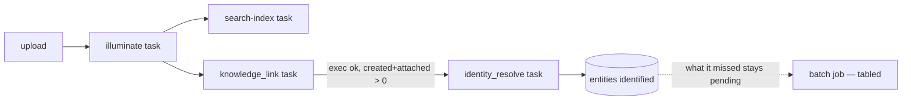

# Knowledge task queues — the online resolve

**Status:** Active — the online task is built 2026-11-14; production queue provisioning is the
remaining step. The nightly drain is split out and tabled:
`plan/knowledge-batch-job.md`. The `knowledge-link` queue defect in §1 is live and blocks
the next production deploy, so it is fixed first.

**Purpose:** a capture that has been linked gets its entities identified without an operator. The
online task resolves exactly what one illumination touched; everything it misses waits for the batch
job (tabled), or for `knowledge identity resolve` meanwhile.

**See also:** `src/knowledge/knowledge.md` §Resolving and §Rebuild; `src/logic/knowledge_link.rs`
and `src/logic/beacon.rs` (the chain this copies); `src/task/task_def.rs` (the `Task`/`TaskRun`
contract); `gcloud/cloud_task_queue.md`; `ServiceApiClient::illumination_entities` (the join).

## 1. The queue defect (fixed first, independently shippable)

The app names four queues; production has three.

| where | illuminate | search-index | spark | knowledge-link |
| --- | --- | --- | --- | --- |
| `config_local.env` / `config_prod.env` | set | set | set | **absent** (serde default) |
| `config_def.rs` | required | required | required | `#[serde(default)]` → `knowledge-link` |
| `docker-compose.yaml` | set | set | set | set |
| `prod-dreamscroll-web.yaml` (manifest) | set | set | set | **absent** |
| `gcloud/cloud_task_queue.md` | documented | documented | documented | **absent** |
| Cloud Tasks (us-central1) | running | running | running | **does not exist** |

The deployed revision (`dreamscroll-webui-api-00112-7tt`, 2026-10-30) predates the task
(`d07ff2d`, 2026-11-03), so nothing has failed yet. The first deploy that includes main would submit
a `knowledge_link` task to a queue that does not exist, and the submit error propagates out of
`beacon` (it uses `?`).

**Fix:** make `TASK_QUEUE_NAME_KNOWLEDGE_LINK` required (no serde default), add it to both env files,
the manifest and `gcloud/cloud_task_queue.md`, and create the queue in Cloud Tasks. Same treatment for
the new `TASK_QUEUE_NAME_IDENTITY_RESOLVE`.

**Validate names at boot, not in prose.** `Config::task_queue_names()` must be checked against the
route suffixes `webhook::make_webhook_router` registers; a typo is otherwise a 404 per delivery,
which the retry policy turns into a retry storm. Only `dreamscroll_web` parses `Config` at all
(`dreamscroll_db` and `dreamscroll_knowledge` read Postgres settings), so a required name cannot
break a job manifest.

## 2. What already exists, and must not be rebuilt

**`ServiceApiClient::illumination_entities(illumination_id)`** is the whole read side: one LEFT JOIN
from the illumination's observations to their entities. It answers both questions a resolve has —
*which* entities (distinct, live, in observation order) *and whether linking finished* (an
observation with no entity is reported, not skipped). The entity set is derived at call time, so the
payload can be an illumination id and nothing else; a tombstone in the join is an error rather than a
silent drop.

**The cache lives with the wiring, the engine with the policy.** `FetchCache` owns a pool handle
(it no longer borrows), so `LogicState` holds exactly one for the process; `IdentityEngine` holds
the graph, its options and its resolvers, and a run supplies entities, that cache and an allowance. So
the task passes `&state.cache`, never a connection — and no layer but the cache holds one at runtime.

The engine replaces one provider's annotation set per entity it answered and skips entities that
provider already annotated, so re-delivery is cheap and idempotent. The fetch layer is cache-first,
paced and budgeted behind `Gateway::answers_for`.

The task framework supplies the rest: `logical_id = u{owner}-{task_type}-{entity_type}{id}` refuses a
duplicate while a run is in flight and allows a fresh run after it settles; `*_from_worker`
submissions inherit `backfill_id`; at-least-once delivery is handled by
`begin_attempt`/`finish_attempt`.

## Decisions

### D1 — one queue, `identity-resolve`, concurrency ≤2, one task type

The online path is the only producer. `identity_resolve` is the only task on it. Cloud Tasks
The cap is **2 concurrent dispatches**, and it is arithmetic rather than taste: a run paces at 1 s ⇒
60 requests/min, two runs = 120/min against the 200/min bucket a compliant User-Agent gets, leaving
80/min for one operator run. Three (180/min) plus a CLI run breaks the bucket and earns 429s, which
latch the provider for the run. One is safe but serialises the drain; never exceed two.

The batch job (tabled) will later need an advisory lock to share that invariant; this plan does not
add one — while only the queue runs resolution, its concurrency covers the online path.

### D2 — the task is chained from the link webhook through a new `Beacon` method

`r_knowledge_link::post` does what `r_illuminate::post` already does — run `exec`, then hand the
result to a per-request `Beacon`:

```rust
let result = match logic::knowledge_link::exec(&state.logic, &task_run, attempt).await {
    Ok(report) => logic::Beacon::new(state.task_master.clone())
        .knowledge_linked(
            task_run.task.illumination_id,
            task_run.task.entity_owner_id,
            task_run.backfill_id.as_deref(),
        )
        .await
        .map(|()| report)
        .map_err(api::ApiError::internal),
    Err(error) => Err(error),
};
```

`Beacon` is the one place that knows follow-up ordering, `backfill_id` inheritance and outcome
logging, so the submission is a **new method** there, not a second `TaskMaster` call in a route.
There is no "touched anything" guard: linking processes only pending observations and a completed
run is acked before `exec`, so the only no-op link is an empty illumination (2 of 720 on the local
corpus) — not worth a special case:

```rust
/// A link that touched the graph enqueues the resolve of what it touched.
pub async fn knowledge_linked(&self, illumination_id: i32, entity_owner_id: i32, backfill_id: Option<&str>) -> anyhow::Result<()> {
    let outcome = self.task_master
        .submit_identity_resolve_from_worker(IdentityResolveTask { .. }, backfill_id)
        .await?;
    Self::log_outcome("identity_resolve", task.illumination_id, outcome);
    Ok(())
}
```

Prerequisite: `TaskMaster` gains `identity_resolve_queue` (field, builder setter, `submit_*` and
`submit_*_from_worker`), exactly as `knowledge_link_queue` is built. `WebhookState` and `LogicState`
do not change; `Beacon::new(state.task_master.clone())` is the established pattern.

### D3 — the payload is the illumination, not its entities

```rust
pub struct IdentityResolveTask {
    pub illumination_id: i32,
    pub entity_owner_id: i32,
}
// task_type "identity_resolve", entity_type "illumination"
```

Entity ids are generation-scoped: a task queued before a `reset` and delivered after one would name
rows that no longer exist, or different rows. The illumination id is stable, and the join re-derives
the set at execution. The owner is carried for the same reason `KnowledgeLinkTask` carries it —
`exec` checks the illumination's `user_id` against it.

An illumination that references entities created by other captures still resolves them: they are the
ones that just gained a name or a hint, and the join takes the distinct set.

### D4 — failure policy: submission propagates, execution refusal completes

A failed **submission** becomes the task's `result`, so the link attempt fails and Cloud Tasks
retries it. That is what `r_illuminate` does for search-index, and the retry is cheap: link is
idempotent (a re-link attaches and creates nothing), and the resolve submission that follows is
deduped by its logical id — a submission that landed but whose response was lost is refused as
already-in-flight, not duplicated. Logging and completing instead would let a systematic submission
failure (queue missing, IAM) leave every capture unidentified, visible only as a growing pending
count.

An **execution** refusal (`Budget`, `RateLimited`) or a failed attempt is a completed run with a
report, not a retry loop: the entity simply stays pending. While the batch job is tabled, that means
the next touch of the entity (another capture) or a manual `identity resolve`.

### D5 — config knobs

| var | default | why |
| --- | --- | --- |
| `TASK_QUEUE_NAME_KNOWLEDGE_LINK` | required | name doubles as the route suffix |
| `TASK_QUEUE_NAME_IDENTITY_RESOLVE` | required | same |
| `TASK_WIKIDATA_MAX_REQUESTS` | 80 | per-**attempt** spend ceiling; the worst observed illumination needs 58 cold calls, p95 is 24. A retried task can spend `attempts × this` |
| `TASK_WIKIDATA_MIN_INTERVAL` | 1000 ms | the pace the CLI already uses |

Nothing else: the resolvers, their strategies and their cache are not configurable per environment.

### D6 — observability

- `exec` logs one line per run: entities considered/resolved, identities written/replaced/vetoed, and
  the fetch counters (mirroring `knowledge_link::exec`).
- Add "awaiting a resolver" to `knowledge stats`, so a backlog is visible without running a drain.
- TaskRun rows already give status, duration and attempts.

## Flow



## Work plan

1. **Queue fix (§1).** Required fields, boot-time name validation, both env files, manifest, gcloud
   doc; create `knowledge-link` in Cloud Tasks. Test: boot fails clearly when unset or
   when a name is not a registered route suffix.
2. **Task plumbing.** `IdentityResolveTask` in `src/logic/identity_resolve.rs`, `Task` impl,
   `TaskMaster` field + `submit_identity_resolve` / `_from_worker`, queue in `task::maker` (local
   dispatchers 1; prod uses the configured name), route `/_wh/cloudtask/identity-resolve`.
3. **Exec.** Owner check via `service_api.illumination`, then `service_api.illumination_entities`
   for the batch and its linkage state; an unlinked observation is refused. The engine resolves the
   batch with the attempt's allowance. No connection is passed.
4. **Chain (D2).** `Beacon::linked` + the call in `r_knowledge_link::post`, mirroring
   `r_illuminate::post`.
5. **Stats + logs (D6).**
6. **Prod rollout:** create the queue, deploy, verify one real capture end-to-end.

## Verification

- Local (`TASK_BACKEND=local`): upload a capture; expect three TaskRuns (illuminate, knowledge_link,
  identity_resolve) and an `identified` entity with a QID *without* running the CLI.
- Tests: exec refuses an illumination owned by someone else; a second delivery of the same
  illumination makes zero transport calls (engine skip); a link that touches nothing submits nothing;
  a submission failure fails the link attempt; queue-name validation rejects an unknown name.
- No graph logic changes: no table, column or projection. A full rebuild before and after must
  reproduce 1,631 identities / 181·10·5 on the fixed set.

## Non-goals

- The nightly drain and its advisory lock — `plan/knowledge-batch-job.md`.
- Continuous resolution on every entity mutation.
- Proximity scan/auto-merge tasks; they stay operator commands.
- Re-resolution of old annotations; unmerge; resolving a tombstone.
