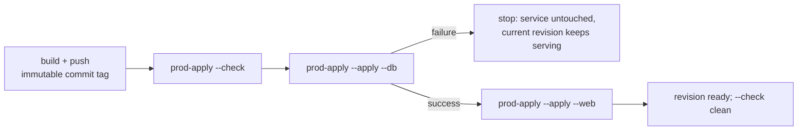

# Production deploy

**Status:** manifests, `prod-apply.sh`, and the build guard are written; offline
checks pass and the first read-only `--check` against production is clean for the
service. Nothing has been applied and no cloud resources were created.
**Updated:** 2026-10-27.

## Scope

This doc owns the production release path for everything that runs on Cloud Run:

- image build and push from the laptop,
- checked-in configuration for the `dreamscroll-webui-api` service and the
  `dreamscroll-db-sync` job,
- schema synchronization before application code that needs it,
- drift detection, verification, and rollback.

Out of scope, deliberately: application behavior, Cloud Tasks queue settings
(`gcloud/cloud_task_queue.md`), CI/trigger automation (researched and not
pursued — `plan/archive/cloud_build_release_deployment.md`), and the semantics
of schema sync itself (`plan/schema-migration-strategy.md`).

## Decision

Two Cloud Run resources, released separately, configured from checked-in
manifests, driven by one script:

1. `gcloud/prod-build-push.sh` — build and push the image tagged with the
   current commit SHA.
2. `gcloud/prod-apply.sh --apply --db` — apply the job manifest at that image and
   execute `dreamscroll_db sync_schema` with `--wait`.
3. `gcloud/prod-apply.sh --apply --web` — apply the service manifest at that
   image, which deploys the new revision.

The two targets are never combined in one invocation, so code cannot ship in the
same command as the schema update. This stays laptop-driven: no Cloud Build
minutes for routine releases, and no pipeline in the critical path.

Operator prerequisites: `gcloud` authenticated as a project owner, `docker` for
the build, `yq` >= 4.18 (mikefarah, for `strenv`) and `jq` for manifest
rendering, canonicalization, and drift comparison. `gcloud` alone cannot compare
manifests structurally.

## Why a Cloud Run Job for the schema sync

| Approach | Verdict |
| --- | --- |
| Cloud Run Job | **Chosen.** Same image, no inbound traffic, execution history, task timeout and retries, logs in Cloud Logging, manual or CI trigger. Google's own execution matrix lists `create/update --execute-now` for "CI/CD deployments, schema migrations". |
| DDL on service startup | Rejected in `plan/schema-migration-strategy.md`: every cold start would be a schema writer. |
| Cloud Build step running the binary | Needs Cloud SQL wiring inside ephemeral builders, cannot be re-run from the console, and pays build minutes per run. |
| Local `cloud-sql-proxy` + `cargo run` | Acceptable for a one-off dry run only; not a repeatable release mechanism. |

## Verified production environment (read-only, re-verified 2026-10-27)

| Fact | Value |
| --- | --- |
| Project / region | `mdrcode` / `us-central1` |
| Service | `dreamscroll-webui-api`, `https://dreamscroll-webui-api-xdrchnynaq-uc.a.run.app` (also `…-783246871160.us-central1.run.app`) |
| Current image | `us-central1-docker.pkg.dev/mdrcode/dreamscroll-repo/dreamscroll-web@sha256:058cd4db546364b8c1f27af03ec99e59754f094adae3c26e01e9a2bf0a821137` |
| Cloud Run Jobs | none configured (`jobs list` empty) |
| Cloud SQL | `mdrcode:us-central1:dreamscroll-prod-db4`, PostgreSQL 18, tier `db-f1-micro`, **public IP** (`ipv4Enabled: true`), `GOOGLE_MANAGED_INTERNAL_CA` |
| DB access path | unix socket: `POSTGRES_CONNECTION_PARAMS=host=/cloudsql/mdrcode:us-central1:dreamscroll-prod-db4`, `POSTGRES_HOST_PORT=localhost` |
| DB name / users | `dreamscroll-prod`; `dreamscroll-web` (built-in), `mike.repass@gmail.com` (IAM), `postgres` |
| Password secret | `DREAMSCROLL_PROD_POSTGRES_PASSWORD`, referenced as `:latest` |
| Service identity | Compute Engine default service account (derived at check/apply time from the project, not committed) |
| Service networking | Direct VPC egress `private-ranges-only`, network/subnet `default` |
| Service shape | 30 env vars, 3 secret refs, 1 vCPU / 512 MiB, concurrency 80, port 8080, `timeoutSeconds 300`, startup probe `tcpSocket 8080` with `periodSeconds 240` |
| Max instances | 20, declared by both `run.googleapis.com/maxScale` (service) and `autoscaling.knative.dev/maxScale` (template) after the 2026-10-27 console edit |
| Public access | annotation `run.googleapis.com/invoker-iam-disabled: 'true'` (no `allUsers` binding) |
| Schema marker | `dreamscroll_schema_version`, `REQUIRED_SCHEMA_VERSION = 8` in the current binary |

Because the instance has a public IP and the binary connects over the
`/cloudsql/...` socket, the job needs only `--set-cloudsql-instances`; no VPC
configuration is required ([connect-run](https://docs.cloud.google.com/sql/docs/postgres/connect-run)).
Mirror the service's `--network/--subnet/--vpc-egress` only if a socket connect
actually fails.

## Identity and IAM

No new IAM is needed for the manual flow. The job runs as the Compute Engine
default SA, exactly like the service.

| Principal | Bindings found | Consequence |
| --- | --- | --- |
| `783246871160-compute@developer.gserviceaccount.com` | project `roles/editor`; secret-level `secretmanager.secretAccessor` on `DREAMSCROLL_PROD_POSTGRES_PASSWORD` | `cloudsql.instances.connect`, secret read, and `run.services.*` / `run.jobs.*` are all covered — the same SA already serves production and reads this secret. |
| `783246871160@cloudbuild.gserviceaccount.com` (legacy Cloud Build SA) | project `roles/cloudbuild.builds.builder` only | Builds and pushes images; has **zero** `run.*` permissions, no `iam.serviceAccounts.actAs`, no Cloud SQL or Secret Manager access. A build using this identity could not run `gcloud run deploy`. |
| `user:mike.repass@gmail.com` | project `roles/owner`, `roles/cloudsql.instanceUser` | Operator; the manual flow authenticates as this identity. |

Cloud Build identity correction (2026-10-26): builds in this project run as
`783246871160-compute@developer.gserviceaccount.com`
(`gcloud builds get-default-service-account` agrees), and build
`43c3b3fa-b915-4216-bf06-dc95f4d678d3` (SUCCESS, 2026-10-01) ran the 3-step
build/push/`gcloud run deploy` config. Editor includes
`run.services.create/update`, `run.jobs.*`, and `iam.serviceAccounts.actAs`, so
that deploy step works. The legacy Cloud Build SA is *not* in use; only if
builds were switched to it would `run deploy` need explicit
`roles/run.developer` + `roles/iam.serviceAccountUser` grants.

Note that Editor does **not** include `secretmanager.versions.access`; secret
access comes from the secret-level binding. Any different runtime identity for
the job must receive its own `secretmanager.secretAccessor` binding on that
secret.

## What this repo manages

| Managed here | Managed outside this repo |
| --- | --- |
| Service spec (`prod-dreamscroll-web.yaml`) | Secret values (Secret Manager) |
| Job spec (`prod-dreamscroll-db.yaml`) | IAM bindings and service accounts |
| Which image tag is released | Cloud SQL instance, users, backups |
| When the schema sync runs | Cloud Tasks queues and OIDC identities |
| Drift detection between repo and prod | Artifact Registry repository, Cloud Build triggers |

Consequence: `prod-apply.sh` cannot make prod exist from nothing. It reconciles
an existing service and an existing-or-created job.

## Current vs target workflow

| | Today | Target |
| --- | --- | --- |
| Config source of truth | live Cloud Run service; `config_prod.env` is gitignored | two checked-in manifests |
| Deploy command | Cloud Run UI | `prod-apply.sh --apply --web` (UI stays read-only) |
| Schema changes | no mechanism: no job exists and `sync_schema` has never run in production | `prod-apply.sh --apply --db`, executed and waited on |
| Drift visibility | none until something breaks | `prod-apply.sh --check` |
| Image reference | UI picks the tag | resolved from the commit being released, verified in Artifact Registry |
| Rollback | pick an older revision in the UI | re-apply the previous manifest at the previous digest |

## Configuration as code

| File | Holds |
| --- | --- |
| `gcloud/prod-dreamscroll-web.yaml` | Full Service spec, captured from the live export, minus `image` |
| `gcloud/prod-dreamscroll-db.yaml` | Full Job spec (authored from the settings table below; no job exists yet) |
| `gcloud/prod-apply.sh` | Render, `services`/`jobs replace`, execute the sync for `--db`, verify, drift check |
| `gcloud/prod-canonical.jq` | Canonical projection used for drift comparison (shared with the local tests) |
| `gcloud/prod-config.sh` | Shared constants: project, region, Artifact Registry repo, image name, service, job, Cloud SQL instance |
| `gcloud/prod-build-push.sh` | Build for linux/amd64, push, assert the platform, print the digest and release commands |

Rules:

- **Manifests omit `image:`.** `prod-apply.sh` sets
  `.spec.template.spec.containers[0].image` with `yq` (`strenv(IMAGE)`), so the
  committed file cannot be applied directly and the deployed image stays a
  function of the commit being released.
- **Secrets stay references.** Only `valueFrom.secretKeyRef`; a lint fails if a
  secret-named environment variable carries a literal `value:`.
- **Identity is not committed.** Manifests omit `serviceAccountName`; Cloud Run
  defaults it to the project's Compute Engine default service account.
  `prod-apply.sh` derives that address from
  `gcloud compute project-info describe --format='value(defaultServiceAccount)'`
  and asserts both live resources use it, so an out-of-band identity change is
  still reported even though the field is masked in the projection. A manifest
  that pins a service account fails validation.
- **No environment-value templating.** Only the image is injected. A gitignored
  values file was evaluated and rejected (2026-10-27) as machinery not worth its
  cost; environment values are literal in the manifests. The repo stays public,
  `gcloud/` stays in-tree (no submodule, no second repo), and the identifiers it
  publishes — project, region, instance, bucket, queue names, secret names — are
  not credentials. Credential values live only in Secret Manager.
- **`prod-apply.sh` is the only writer.** No arguments means `--check` for both
  targets (read-only). `--apply` takes exactly one target: `--db` replaces the
  job manifest *and* executes `sync_schema` with `--wait`; `--web` replaces the
  service manifest, which deploys that image. There is deliberately no
  `--apply --all`. `--apply` refuses a dirty worktree, checks that the image
  exists in Artifact Registry, waits for readiness, then requires `--check` to
  return empty.
- **Drift is a sorted `path = value` diff.** Both sides are canonicalized, then
  server-managed paths are deleted: `status`, `metadata.{namespace,uid,selfLink,
  resourceVersion,generation,creationTimestamp}`,
  `run.googleapis.com/{urls,ingress-status,operation-id,client-name}`,
  `serving.knative.dev/{creator,lastModifier}`,
  `cloud.googleapis.com/location`, `client.knative.dev/nonce`. Env arrays are
  `sort_by(.name)`, the image is blanked. Key order, indentation, and env
  ordering cannot fake drift, and each diff line names the field.
- **Invariants gate `--apply`**: kind/name, no `image` in the manifest, required
  env names present, the three secret refs intact, runtime SA, Cloud SQL
  annotation, port 8080, startup probe, `invoker-iam-disabled`, traffic 100 %
  latest; for the job, `command`/`args`, `taskCount 1`, `maxRetries 0`,
  `timeoutSeconds 900`.
- **No combined apply by design.** Applying the web manifest also deploys its
  image, so a single command touching both resources could ship code before the
  schema update. Separate invocations make the order explicit: `--db` then
  `--web` on schema-changing releases. If it is ever run in the wrong order, the
  new revision fails the startup marker check and traffic stays on the previous
  revision.

## Image build and push

`gcloud/prod-build-push.sh`, with all identifiers from `gcloud/prod-config.sh`:

- `docker buildx build --platform linux/amd64 --push` — one step, so a failed
  push cannot leave behind a locally built image that looks releasable.
- `--provenance=false` keeps the pushed reference a single image manifest whose
  digest is directly deployable; enabling provenance later yields an index
  digest (Cloud Run accepts either).
- Tags with the full commit SHA, labels `org.opencontainers.image.revision`, and
  never produces `latest`.
- Asserts that the pushed manifest advertises `linux/amd64`; a wrong-architecture
  image deploys fine and then dies with `exec format error`.
- Prints the digest and the exact `prod-apply.sh --image <base>@<digest>`
  commands, so the release pins an immutable reference instead of re-resolving a
  mutable tag later.
- Refuses a dirty worktree (`ALLOW_DIRTY=1` overrides, but such an image cannot
  be released: `prod-apply.sh` refuses dirty trees too).
- `--check` runs the preflight only — tools, buildx, project, worktree — and
  prints the reference it would push.

The destination is **declared**, not discovered: `prod-config.sh` holds project,
region, Artifact Registry repository, image name, service, job, and SQL instance,
and both scripts source it. Previously the build read `artifacts/location` and
`artifacts/repository` from local gcloud config (both unset, so it silently used
defaults) while the release script hard-coded its own copy — a mismatch would
only surface as "image not found" at apply time. Both scripts now also refuse to
run under a project other than `mdrcode`.

`.dockerignore` additionally excludes `gcloud/`, `plan/`, and `issues/`: the
image build never needs them, and keeping ops files out of the build context is
one less route for a future secret to reach a layer.

## Schema sync job configuration

These are the settings `gcloud/prod-dreamscroll-db.yaml` must express. The
manifest is also the bootstrap path: `jobs replace` creates the job on first use,
so there is no separate `jobs create` step and no env file.

Environment (literal, no templating):

```yaml
NO_LOCAL_CONFIG_FILES: "true"
RUST_LOG: info
POSTGRES_HOST_PORT: localhost
POSTGRES_USER: dreamscroll-web
POSTGRES_DB: dreamscroll-prod
POSTGRES_CONNECTION_PARAMS: host=/cloudsql/mdrcode:us-central1:dreamscroll-prod-db4
```

Fallback if the hand-authored YAML shape is rejected by the API: create the job
once with these flags, then export it and commit the export as the manifest.

```bash
gcloud run jobs create dreamscroll-db-sync \
  --region us-central1 \
  --image "$IMAGE" \
  --command /app/dreamscroll_db \
  --args sync_schema \
  --set-cloudsql-instances mdrcode:us-central1:dreamscroll-prod-db4 \
  --set-env-vars NO_LOCAL_CONFIG_FILES=true,RUST_LOG=info,POSTGRES_HOST_PORT=localhost,POSTGRES_USER=dreamscroll-web,POSTGRES_DB=dreamscroll-prod,POSTGRES_CONNECTION_PARAMS=host=/cloudsql/mdrcode:us-central1:dreamscroll-prod-db4 \
  --set-secrets POSTGRES_PASSWORD=DREAMSCROLL_PROD_POSTGRES_PASSWORD:latest \
  --tasks 1 --parallelism 1 --max-retries 0 --task-timeout 15m

gcloud run jobs describe dreamscroll-db-sync --region us-central1 --format export
```

| Setting | Value | Why |
| --- | --- | --- |
| `--command` / `--args` | `/app/dreamscroll_db` `sync_schema` | The image `CMD` is `/app/dreamscroll_web` and there is no `ENTRYPOINT`; the job overrides argv directly. |
| `--set-cloudsql-instances` | full connection name | Mounts `/cloudsql/<conn>`, which `POSTGRES_CONNECTION_PARAMS` expects. |
| `--set-secrets` | `POSTGRES_PASSWORD=DREAMSCROLL_PROD_POSTGRES_PASSWORD:latest` | Same secret and pinning style as the service; never a CLI argument or build substitution. |
| `--tasks` / `--parallelism` | `1` / `1` | One schema writer; the advisory lock would serialize overlap anyway. |
| `--max-retries` | `0` | Default is **3**; silent re-runs hide failures and the operation is already atomic. The script is the retry. |
| `--task-timeout` | `15m` | Default is **10m**, maximum **168h**. A timeout kills the connection, so PostgreSQL rolls the transaction back and releases the advisory lock. |
| service account | default Compute Engine SA | Same identity the service already uses against this database and secret. A dedicated least-privilege SA is deferred. |

## Release sequence



### Script contract (`gcloud/prod-apply.sh`)

```
prod-apply.sh                          # --check for both targets (read-only)
prod-apply.sh --check [--web|--db|--all]
prod-apply.sh --apply (--web|--db) [--image REF]
prod-apply.sh --lint                   # offline: render + invariants, no gcloud
```

Shared preflight for `--apply`: `yq` (>= 4.18, for `strenv`) and `jq` present,
project is `mdrcode`, worktree clean, image reference resolves in Artifact
Registry, committed manifests carry no `image`, no literal secrets, invariants
pass. There is no dirty-tree escape hatch: an image must correspond to a commit.

`--db` (the only path that touches the database):

1. Render `prod-dreamscroll-db.yaml` with the resolved image.
2. Assert job invariants (`command`, `args`, `taskCount`, `maxRetries`,
   `timeoutSeconds`, Cloud SQL annotation, secret ref).
3. `gcloud run jobs replace` — creates the job on first use, configures it after.
   (`jobs replace` has no `--dry-run`.)
4. `gcloud run jobs execute dreamscroll-db-sync --region us-central1 --wait`.
5. Print the execution name plus a `gcloud beta run jobs executions logs read`
   hint (the stable `gcloud run` track has no `executions logs`), then require
   `--check --db` to come back empty.

`--web`:

1. Render `prod-dreamscroll-web.yaml` with the resolved image.
2. Assert service invariants (env names, secret refs, SA, Cloud SQL annotation,
   port, startup probe, `invoker-iam-disabled`, traffic).
3. `gcloud run services replace <file> --dry-run` (validate only), then the real
   `replace`.
4. Poll until the newest revision is `Ready`; assert traffic is 100 % on it.
5. Require `--check --web` to come back empty.

### Verification (2026-10-27)

- `prod-apply.sh --lint` renders both manifests and passes every invariant.
- The canonical projection of `prod-dreamscroll-web.yaml` is byte-identical to
  the projection of the captured live export, which proves the scrub list is
  complete for the current service.
- Mutating one field in a copy of the export (`maxScale` 20 -> 4) yields exactly
  one diff line, naming the field.
- A simulated live job JSON (image, `status`, uid/generation/namespace,
  operation-id, deploy nonce, labels) projects identically to the committed job
  manifest, so the mask list covers the job shape too.
- Negative tests: removed `POSTGRES_PASSWORD`, a literal password value, a
  missing Cloud SQL annotation, and a committed `image:` each fail `--lint` with
  the expected message and exit 2.
- `prod-build-push.sh --check` passes its preflight (verified with
  `ALLOW_DIRTY=1` while this work is still uncommitted) and refuses a dirty
  worktree otherwise.
- Both scripts refuse a `gcloud` project other than `mdrcode` (verified with a
  stubbed `gcloud`).
- Not yet exercised: an actual build and push — it writes to Artifact Registry —
  so `buildx --push`, the platform assertion, and the digest readback are
  code-reviewed and syntax-checked but unrun.

Live, read-only:

- `--check --web` is clean against production. The only difference from the
  captured export was the stale `run.googleapis.com/maxScale` value, which the
  console rewrote to `20`; the manifest was corrected to match.
- The console edit created revision `dreamscroll-webui-api-00105-rtq` (same
  image digest `058cd4db…`, ready, 100 % of traffic) and changed nothing else.
  `--check` still reporting clean confirms the canonicalizer masks the
  server-managed fields a deploy injects: nonce, operation-id,
  creator/lastModifier, client-name, namespace.
- `--check --db` reports `dreamscroll-db-sync does not exist yet` and exits 2.
- Identity: `--check --web` derives `783246871160-compute@…` from the project and
  confirms the live service uses it. Stubbing `compute project-info` with a
  different address produces a drift line and exit 1; pinning
  `serviceAccountName` in a manifest fails `--lint` with exit 2.
- Not yet exercised: `--apply`, job creation, `jobs replace` round-trip, and
  the job's omitted `serviceAccountName` defaulting (`jobs replace` has no
  dry run, so the first `--apply --db` proves it).

## Drift policy

- The Cloud Run console is **read-only** for configuration. Deploys happen
  through `prod-apply.sh` only.
- Emergency UI deploys are allowed, but they create drift: re-capture the export
  into the manifest and commit it before the next release, or `--check` will
  report the difference.
- `--check` is expected to be empty before a release and after an apply. Any
  non-empty result is either uncommitted intent (manifest ahead of prod) or
  out-of-band change (prod ahead of manifest); the diff names which.

## Rollback

| Failure | Recovery |
| --- | --- |
| Bad web revision | Re-apply the previous manifest at the previous digest: `git checkout <commit> -- gcloud/prod-dreamscroll-web.yaml && prod-apply.sh --apply --web --image <old-digest>`. Cloud Run creates a new revision from the old spec; no traffic games needed. |
| Bad job configuration | Same, with `--db`. Note this re-executes the sync. |
| Noisy but working revision | Shift traffic back to the previous revision in the console; the manifest then needs re-capturing to match reality. |
| Bad schema change | **No automatic rollback.** `SchemaBuilder::sync` is not reversible. Restore from the pre-change Cloud SQL backup or apply a forward fix. Use expand/contract for anything non-additive. |

## Failure modes and safety nets

| Scenario | Behaviour |
| --- | --- |
| Sync fails mid-DDL | One transaction: `pg_advisory_xact_lock`, pre-sync index drop, model sync, index recreation, marker upsert. Failure rolls everything back; no partial schema. |
| Task killed by timeout or instance maintenance | Connection dies, PostgreSQL aborts the transaction and releases the lock. Re-run is safe. |
| Two executions overlap | The second blocks on the advisory lock; the marker check still guards direction. |
| Old image runs against a newer database | `sync_schema` refuses to downgrade when the marker exceeds the binary's requirement, and exits non-zero. |
| Sync skipped, service deployed anyway | `database::connect` fails the startup marker check, the revision never becomes ready, Cloud Run keeps traffic on the previous revision, and the deploy fails visibly. |
| Sync applied, old revision still serving | Model sync is additive, so the previous revision keeps working while traffic shifts. |
| Non-additive change needed | Use expand/contract; model sync cannot drop tables, columns, or change types. |
| Image missing from Artifact Registry | `prod-apply.sh` refuses before touching either resource. |

The known cost: every `sync_schema` run drops and recreates
`idx-task_runs-backfill_task` (SeaORM 2.0.4 workaround). That is an exclusive
lock on `task_runs` for the duration of the rebuild, which is why the run is
explicit rather than a startup side effect. At `db-f1-micro` scale this is
expected to be sub-second; measure it on the clone (below).

## Preflight before the first production run

1. On-demand backup: `gcloud sql backups create --instance=dreamscroll-prod-db4`.
2. Confirm the DB user owns the objects that sync must alter:
   ```sql
   SELECT current_user;
   SELECT tableowner, count(*) FROM pg_tables
     WHERE schemaname = 'public' GROUP BY 1;
   SELECT version FROM dreamscroll_schema_version;         -- expect 8
   SELECT pg_size_pretty(pg_database_size(current_database()));
   ```
3. Rehearse on a clone, never on production first:
   ```bash
   gcloud sql instances clone dreamscroll-prod-db4 dreamscroll-prod-db4-sync-test
   # create a second job (dreamscroll-db-sync-test) whose
   # POSTGRES_CONNECTION_PARAMS points at the clone, execute it, read logs,
   # confirm the marker moves to 8 and record the duration.
   gcloud sql instances delete dreamscroll-prod-db4-sync-test
   ```
4. First production execution at a quiet moment, watching Cloud Logging. Only
   then deploy the revision that requires the new schema.

## Deferred

- **Cloud Build release automation.** Now mostly optional: with config as code a
  release is a deliberate local script run, so CI would only remove the laptop
  step. The research, including the IAM this would need
  (`roles/run.admin` or `run.developer`, `roles/iam.serviceAccountUser` on the
  runtime SA, `roles/run.invoker` on the job, and a raised build `timeout`), is
  archived at `plan/archive/cloud_build_release_deployment.md`.
- **Terraform instead of manifests + script.** Revisit if a second environment
  appears or another operator needs to deploy; Terraform would also cover IAM,
  secrets, SQL, and queues, at the cost of a state backend and provider
  upgrades.
- **Dedicated migration service account** with only `cloudsql.client` +
  `secretmanager.secretAccessor`, instead of the broad default SA.
- **Dedicated migration DB role** instead of `dreamscroll-web`, which needs
  ownership of the application objects.
- **Sync automatically before every web release.** Today it is a separate
  `--db` invocation the operator must run; folding it into the web release
  becomes reasonable once sync stops rebuilding the hand-written unique index
  and lock duration is measured.
- **Image provenance/attestation.** `buildx --provenance` is deliberately
  disabled so the released reference stays a single-manifest digest; enable it if
  provenance in Artifact Registry becomes useful, accepting an index digest.
- **`latest` tag / image retention policy.** Not needed while the commit SHA is
  the identity; revisit if Artifact Registry growth becomes an issue.
- **Derive the SQL socket path from `/cloudsql`** instead of duplicating it in
  `POSTGRES_CONNECTION_PARAMS` (deferred 2026-10-27). The socket path is not
  required by Cloud Run — only the attachment annotation is — so a
  `resolve_socket_host(&Path)` helper could read the single attached instance and
  build `host=/cloudsql/<name>` at connect time. Deferred because it is an
  app-code change, and privacy was not a sufficient reason (the instance name
  must stay in the annotation anyway). Revisit as a consistency fix: it would
  make the instance name appear exactly once per manifest.

## Biggest uncertainties (2026-10-27)

Ordered by how much they could invalidate the plan.

| # | Uncertainty | Why it matters | Cheapest resolution |
| --- | --- | --- | --- |
| 1 | **`replace` round-trip fidelity.** `services replace` has `--dry-run` (validation only) and `jobs replace` has none; we have never applied a captured manifest back. | If Cloud Run injects or reorders fields on write, `--check` can never be clean and "manifest is the source of truth" weakens to a projection comparison. | Create one throwaway service and one throwaway job from the captured shape, round-trip them, then `--check`. Requires approval: creates two resources in `mdrcode`. |
| 2 | **DB user DDL privileges.** `dreamscroll-web` must own the tables sync alters; never verified. | If it does not, the first production sync fails after the backup and clone work. | Query `pg_tables.tableowner` against the clone (same credentials) during rehearsal. |
| 3 | **Clone rehearsal mechanics.** Cloud SQL clone needs Enterprise edition and disk headroom, and we assume the clone accepts the same DB credentials and secret. | The rehearsal is the gate for the first production run; if it cannot be stood up, the first run is production itself. | Attempt the clone; record whether users/passwords carry over. |
| 4 | **IAM-managed public access.** Public access is currently the `run.googleapis.com/invoker-iam-disabled` annotation, not an `allUsers` binding. | If `replace` drops it, prod goes private; if a later console/CLI action writes an `allUsers` binding instead, IAM state lives outside the manifest. | Invariant asserts the annotation; after the first apply, re-read the service IAM policy and confirm it is unchanged. |

Resolved 2026-10-27 — `maxScale`: the service-level annotation read `4` while
the template read `20` and the v2 API reported 20. Clearing it in the console
rewrote the service-level annotation to `20`, so both agree and the effective
cap never changed. The console maintains both annotations, so both stay in the
manifest.

Resolved on 2026-10-27: the old ordering hazard ("config apply is also a deploy")
is gone by construction — `--apply` accepts exactly one target, so there is no
combined invocation that could ship code before a schema update. Running `--db`
does mean the sync always executes when the job is applied; accepted, since the
operation is idempotent and sub-second at this data size.

Implementation details already settled, listed so they are not rediscovered:

- `yq` path joins are display-only: annotation keys contain dots
  (`run.googleapis.com/ingress`), so a projection line is a label, not a
  re-parseable path.
- The canonical filter must run on both `jq` and `jaq` 3.x. `jaq` errors on
  `del(.a.b)` / `.a[]?.b |=` when a parent is missing, and its `delpaths` is not
  tolerant either, so the filter deletes through a guarded `getpath` helper.
- `reduce` needs `(server_paths)`, not `(server_paths[])`: with `[]` the stream
  spreads each path array into its segments and every delete silently misses.
- In `yq`, `a | (x) and (y)` parses badly ("no matches found"); wrap the whole
  conjunction: `a | ((x) and (y))`.
- In `yq`, `==` does not deep-compare arrays; compare elements
  (`command[0] == ...`) plus `length` instead.
- `yq -e` exits 1 for false and >1 for an evaluation error; the invariant helper
  distinguishes the two so a broken expression cannot look like a manifest bug.

## Open questions

1. Should the clone rehearsal become a permanent step in the script
   (`--instance` override) or stay a documented manual procedure?
2. Is a second, non-production Cloud Run job worth keeping permanently for
   rehearsals?
3. When `--check --db` runs before the job exists, is that drift (exit 1) or a
   distinct "target absent" state with its own exit code and message?
4. Is the first `--apply --db` allowed to be the first production sync (after the
   clone rehearsal), or do we want a config-only bootstrap that does not execute?
5. Should `--check` distinguish "manifest ahead of prod" (uncommitted intent)
   from "prod ahead of manifest" (out-of-band change), or is one diff enough?

## Research sources

- [Cloud Run jobs: create jobs](https://docs.cloud.google.com/run/docs/create-jobs)
  — job model, default 10-minute task timeout.
- [Set task timeout for jobs](https://docs.cloud.google.com/run/docs/configuring/task-timeout)
  — 168-hour maximum, per-attempt deadline, maintenance events and connection resets.
- [Set maximum retries for jobs](https://docs.cloud.google.com/run/docs/configuring/max-retries)
  — default 3, range 0–10, per task.
- [Execute jobs](https://docs.cloud.google.com/run/docs/execute/jobs)
  — `--wait`, execution/task model, required roles (`run.invoker`,
  `run.developer`), and the schema-migration/`--execute-now` use case.
- [`gcloud run jobs deploy`](https://docs.cloud.google.com/sdk/gcloud/reference/run/jobs/deploy)
  — `--command`, `--args`, `--set-cloudsql-instances`, `--env-vars-file`,
  `--set-secrets`, `--max-retries`, `--task-timeout`, `--execute-now`/`--wait`.
- [`gcloud run jobs execute`](https://docs.cloud.google.com/sdk/gcloud/reference/run/jobs/execute)
  — `--wait`, `--args`, `--task-timeout`, `--update-env-vars`.
- [`gcloud run services replace`](https://docs.cloud.google.com/sdk/gcloud/reference/run/services/replace)
  and [`gcloud run jobs replace`](https://docs.cloud.google.com/sdk/gcloud/reference/run/jobs/replace)
  — create-or-replace semantics, whole-spec authority, and the `--dry-run`
  validation flag that exists for services but not jobs.
- [Cloud Run YAML reference (v1)](https://docs.cloud.google.com/run/docs/reference/yaml/v1)
  — Service and Job field shapes, including `secretKeyRef` and Cloud SQL annotations.
- [Manage Cloud Run services](https://docs.cloud.google.com/run/docs/managing/services)
  — export/replace workflow used by `prod-apply.sh`.
- [Connect from Cloud Run to Cloud SQL for PostgreSQL](https://docs.cloud.google.com/sql/docs/postgres/connect-run)
  — `/cloudsql` socket for public IP, `roles/cloudsql.client`.
- [Build configuration schema](https://docs.cloud.google.com/build/docs/build-config-file-schema)
  — build and per-step `timeout` semantics (relevant only to automation).
- [yq](https://mikefarah.gitbook.io/yq/) — v4 expression language for rendering,
  canonicalization, and invariant assertions.
