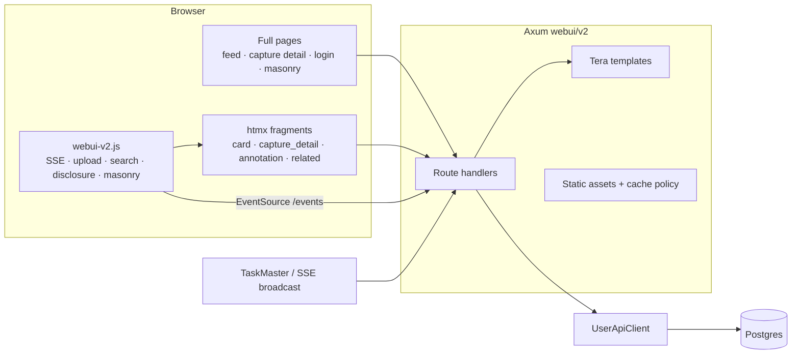

# WebUI v2 Audit — Bugs, Architecture, and Pruning

**Status:** Open; UI2-001 fixed; D01/D02/D03/D04/D05 pruned, D08 partial; UI2-005 and UI2-009 accepted. Audit date: 2026-10-22.
**Scope:** `web/v2` templates/static assets and `src/webui/v2` handlers, plus the
API/data shapes those views consume.
**Method:** Full read of 13 templates, 1,061-line CSS, 1,238-line JS, all 19
`src/webui/v2` handlers (including the 508-line SSE endpoint), and relevant
`src/api`/`model` schemas. One live probe was run for the escaping finding
(`curl` against the local server). No browser flow tests were run for this
audit.

**Convention:** Use the numeric ID or the slug when discussing. Both are stable.
Severity is user impact, not effort.

---

## 1. Slug index

| ID | Slug | Severity | Status | One-liner |
|---|---|---|---|---|
| UI2-001 | `xss-autoescape-off` | P0 | Fixed | Tera never autoescaped `.html.tera`; fixed in the template loader. |
| UI2-002 | `detail-search-hijack` | P1 | Open | Header search/clear on a detail page swaps the detail feed and fights SSE. |
| UI2-003 | `draft-clobber` | P1 | Open | SSE card refreshes destroy in-progress annotation drafts and disclosure state. |
| UI2-004 | `related-json-breakout` | P1 | Open | Related-captures JSON is marked `safe` and embeds full models; `</script>` breaks out. |
| UI2-005 | `catchup-skips-reruns` | P1 | Accepted | SSE catch-up ignores cards that already have an old illumination, so rerun progress is missing after reload. Accepted DB-load trade-off. |
| UI2-006 | `related-leak` | P1 | Open | Detail SSE re-fetches related captures and leaks a `resize` listener per refresh. |
| UI2-007 | `silent-errors` | P2 | Open | htmx failures and HTML-route API errors have no user-visible channel. |
| UI2-008 | `collapse-a11y-clip` | P2 | Open | Collapsed panels stay focusable/readable; expanded panels clip at magic max-heights. |
| UI2-009 | `blend-limit` | P2 | Accepted | `limit` applies per source, so blended feeds can return up to 2× the requested cards. Deferred to feed architecture work. |
| UI2-010 | `entity-title-only` | P2 | Open | Entity descriptions on feed cards exist only in `title=`, unusable on touch. |
| UI2-011 | `pwa-share-feedback` | P3 | Open | PWA share-target upload redirects with no success/error notice. |
| UI2-012 | `related-double-wrapper` | P3 | Open | `/detail/{id}/related` returns a wrapper inserted inside another wrapper. |
| UI2-A01 | `no-base-layout` | Arch | Open | Every full page duplicates head/header/upload/search/progress markup. |
| UI2-A02 | `implicit-page-mode` | Arch | Open | Shared header markup has page-dependent behavior with no explicit page kind. |
| UI2-A03 | `fragment-contracts` | Arch | Open | Endpoints disagree on returning inner content vs a complete wrapper. |
| UI2-A04 | `no-pagination` | Arch | Open | Feed/related/entity listings have caps but no paging or “load more”. |
| UI2-A05 | `entity-identity` | Product | Open | `knowledge_entities` rows are occurrences; no canonical entity identity exists. |
| UI2-D01 | `spark-wrapper-dup` | Prune | Fixed | Removed `SparkClusterCard`; templates read `card.spark.spark_clusters`. |
| UI2-D02 | `unused-context` | Prune | Fixed | Removed unused `is_search` and `content_mode` inserts. |
| UI2-D03 | `annotation-empty-branches` | Prune | Fixed | Footer template now uses one condition. |
| UI2-D04 | `masonry-dup` | Prune | Fixed | Removed the standalone experiment; related-captures gallery is now the only gallery renderer. |
| UI2-D05 | `masonry-orphan` | Prune | Fixed | Removed `/masonry`, its template, handler, CSS, and dead query. |
| UI2-D06 | `noop-service-worker` | Prune | Open | `sw.js` only calls `skipWaiting`/`claim`. |
| UI2-D07 | `capture-lookup-dup` | Prune | Open | Four handlers repeat capture lookup/404/context assembly. |
| UI2-D08 | `css-noise` | Prune | Partial | Removed dead illumination and duplicate masonry selectors; login palette refactor remains. |

---

## 2. Architecture overview



- Pages are server-rendered documents with a single `#card-feed` region. Feed
  and detail differ in the initial fragment placed inside it.
- `partials/card.html.tera` dispatches `Card::{Capture,Spark}`. This is the
  correct seam for future card kinds.
- Mutations are htmx fragment swaps: annotation block, footer OOB, upload via
  XHR, search via `/cards`.
- SSE is capture-only. Task-status events carry `entity_type=capture`; the
  client filters to the current page/card and refreshes a partial. Catch-up is
  seeded from rendered cards with a DB-timestamp watermark.
- Data: `capture → media, annotation, illuminations (latest only) →
  knowledge_entities`; `spark → clusters → capture previews/links`. There is no
  canonical entity table.

Already solid: thin handlers over `UserApiClient`, no SPA/build step, immutable
asset versioning, a per-card partial endpoint, and the snapshot-watermark
refresh design.

---

## 3. Bugs

### UI2-001 — `xss-autoescape-off` (P0, fixed)

**Observed.** `GET /login?error=<b>x</b>` rendered
`<div class="login-error"><b>x</b></div>`.

**Cause.** Tera autoescapes based on filename suffix (`.html`, `.htm`, `.xml`).
All templates end in `.html.tera`, so `should_escape` was false for every
template. This was not limited to the login error: AI-generated summaries,
details, entity names/descriptions, annotations, and `?query=` in the search
input were raw HTML sinks. This enabled stored XSS from model output and
reflected XSS from the query string.

**Applied fix.** In `src/webui/v2/maker.rs::load_templates`:

```rust
tera.autoescape_on(vec![".html.tera"]);
```

The full suffix is intentional: it autoescapes every HTML template without
also HTML-escaping future non-HTML templates such as `.txt.tera`. The loader is
the single policy choke point; no file renames are needed.

**Regression test.** `html_templates_escape_untrusted_content` renders
`partials/cards/annotation_block.html.tera` with a `<script>` payload and
asserts the output is escaped. Passed.

**Evidence:** `maker.rs:16-27`; Tera `autoescape_suffixes`; live `curl` before
the fix. The two `| safe` JSON sites still need UI2-004.

### UI2-002 — `detail-search-hijack` (P1)

`detail.html.tera:33-36` copies the feed header search form (`hx-get="/cards"`,
`hx-target="#card-feed"`, `hx-push-url`). On `/detail/N`, searching replaces
the detail card with feed results and pushes `/?query=…` while the document
shell remains detail. `reloadFeedFrame()` has the same problem for the clear
button (`webui-v2.js:929`).

A later terminal task-status event for capture N runs the detail refresh path
(`webui-v2.js:75-80`) and replaces those search results with the detail
partial again.

**Fix.** Make search behavior page-kind-specific. On non-feed pages, use normal
navigation (`action="/"`, no `hx-*`) or target a dedicated results region that
detail SSE never touches. Serve the clear button's reload through the same page
kind decision.

### UI2-003 — `draft-clobber` (P1)

Feed SSE refreshes replace the entire card with `outerHTML`
(`webui-v2.js:92`); detail SSE replaces all of `#card-feed` with `innerHTML`
(`:75-80`). Both regions contain the annotation editor. A terminal illumination
event while the user is typing silently discards the draft. Expanded
disclosures are also reset.

**Fix.** Before refreshing, skip when the target contains
`.capture-card__annotation-input`, or preserve/restore the draft. Refresh a
smaller detail component rather than the whole feed. Morph swaps are the
long-term fix (`plan/htmx4.md`).

### UI2-004 — `related-json-breakout` (P1)

`related_captures.html.tera:7` embeds `captures | json_encode | safe` inside a
`<script type=application/json>`. `captures` is a full `CaptureInfo`, including
summaries and annotation text. Autoescaping is bypassed by `safe`, so a summary
containing `</script>` terminates the block and injects markup. It also bloats
the response and exposes internals (`media` storage fields, annotation) to all
feed HTML consumers.

**Fix.** Return a minimal server-side DTO `{id, url}` (as `r_masonry` already
does), or escape `<` as `\u003c` in the JSON. Do both: minimal DTO is the real
fix.

### UI2-005 — `catchup-skips-reruns` (P1, accepted trade-off)

`captureIdsForCatchup()` (`webui-v2.js:122-127`) only includes cards without
`.capture-card__illumination`. A capture with an old illumination being rerun
is excluded, so reloading during the rerun yields no catch-up event and no
progress bar. The terminal SSE event eventually refreshes the card, but the
in-progress period is invisible.

**Decision:** accepted. Catch-up would otherwise query latest TaskRun state for
every rendered capture on every page load and SSE connect, which is not worth
the DB load for the low-frequency reload-during-rerun flow. Recorded in
`plan/pragmatism.md`. Revisit only if that flow becomes common or in-progress
state during reruns becomes a product requirement.

### UI2-006 — `related-leak` (P1)

`capture_detail.html.tera:107-109` puts `hx-trigger="load"` on the related
section inside the detail partial. Every detail SSE refresh replaces
`#card-feed`, inserting a fresh related section and re-fetching `/related`.
`setupRelatedCapturesMasonry` adds a `window.resize` listener per gallery
(`webui-v2.js:618`) and never removes it, so detached galleries leak.

**Fix.** Refresh only the capture article, not related. Use one global debounced
resize listener that rescans bound galleries, or clean up on
`htmx:beforeCleanupElement`.

### UI2-007 — `silent-errors` (P2)

htmx 2 ignores 4xx/5xx responses. Invalid `/spark`, failed annotation
save/archive, and upload errors on htmx paths produce no feedback. HTML routes
also return JSON `ApiError` bodies (for example `/detail/999`), which is wrong
for a full-page navigation. htmx 4 will swap error bodies, making this worse.

**Fix.** Add one global `htmx:responseError` handler rendering a dismissible
notice, plus an HTML error page for full-page routes. Do this before the htmx 4
migration.

### UI2-008 — `collapse-a11y-clip` (P2)

Collapsed panels use `opacity:0` plus `max-height:0`
(`dreamscroll-v2.css:422-428`) without `hidden`/`inert`, so links inside remain
tabbable and readable by screen readers. Expanded panels cap at `900px`
(capture details) and `2400px` (metadata) and silently clip longer content
(`:740-757`).

**Fix.** Toggle `hidden`/`inert` or `visibility:hidden` when collapsed; remove
the max-height cap on expansion. Wire `aria-expanded`/`aria-controls` on the
capture toggle as already done for metadata toggles.

### UI2-009 — `blend-limit` (P2, accepted trade-off)

`render_timeline(Blend)` fetches `limit` captures and `limit` sparks, then
concatenates and sorts (`content.rs:105-120`). `limit=50` can return 100 cards;
`limit=1` can return 2.

**Decision:** accepted for now. No UI exposes `limit`; it is an internal read
bound, not a total-feed contract. Combined-limit semantics belong with the
planned feed architecture work. Recorded in `plan/pragmatism.md`.

### UI2-010 — `entity-title-only` (P2)

Feed entity pills (`capture.html:34`) put descriptions only in `title=`.
Touch users cannot access them; keyboard users get nothing useful. The detail
page displays descriptions, but the feed does not.

**Fix.** Link pills to the entity page (see §6) and show description text
there; optionally add an accessible disclosure in the feed.

### UI2-011 — `pwa-share-feedback` (P3)

The manifest share target posts to `/upload`. A non-htmx upload redirects to
`/` without an upload notice or capture link.

**Fix.** Redirect with a query/flag that the feed renders as a notice, or use a
dedicated share-result page.

### UI2-012 — `related-double-wrapper` (P3)

`#related-captures` targets `innerHTML`, but `partials/cards/related_captures.html.tera`
returns a `<section class="related-captures">` wrapper. The result is a section
inside a section with two responsibility layers.

**Fix.** Return inner content only, or target `outerHTML` with one root.

---

## 4. Architecture issues

### UI2-A01 — `no-base-layout`

`index.html.tera`, `detail.html.tera`, and `login.html.tera` each duplicate the
full head, header, upload form, search form, progress UI, and notice. A new
entity page would be a fourth copy.

**Fix.** Extract `base.html.tera` and `partials/header.html.tera` before adding
pages. Parameters: search query, page kind, SSE mode/capture ID, feed content
mode. Use Tera `extends`/`block`.

### UI2-A02 — `implicit-page-mode`

The same header search markup is reused on feed and detail, but should behave
differently. JS infers behavior from element existence and body data. This is
the root of `detail-search-hijack`.

**Fix.** Encode `data-page-kind` (`feed`, `capture_detail`, `entity_detail`) and
branch explicitly. Header partial takes behavior as a parameter.

### UI2-A03 — `fragment-contracts`

Endpoints disagree: `/cards` returns inner content for `innerHTML`; `/related`
returns a wrapper inserted inside another wrapper; the detail partial includes
unrelated regions (metadata, related). This makes target semantics fragile.

**Fix.** One rule: each endpoint returns exactly the target's inner content,
with one root element and no wrapper duplication. Document it next to the route
table.

### UI2-A04 — `no-pagination`

Feed is capped at 50, related at 12, masonry at 100. There is no paging or
“load more”, and the planned entity page would need a cap for “appears in”.
`plan/feed-view-incremental-updates.md` owns feed reconciliation but not the
page-size UX.

**Fix.** Decide whether prototype scope stops at caps or adds a cursor/limit
control. At minimum, make `limit` semantics consistent (`UI2-009`).

### UI2-A05 — `entity-identity`

`knowledge_entities.id` is unique per illumination run. There is no canonical
entity table or identity resolution. A “knowledge entity detail page” therefore
means either one occurrence or a name/type grouping, not a stable entity.

**Decision needed before implementation.** Recommendation: occurrence page
first (`/entity/{id}`), with an explicitly labeled “also appears in” list based
on exact `(name, type)` matches. Canonical pages would need a normalization key
and are a larger product decision.

---

## 5. Pruning candidates

| ID | Candidate | Notes |
|---|---|---|
| UI2-D01 | `spark-wrapper-dup` | `SparkClusterCard` clones `SparkClusterInfo` + `capture_previews`, both already in `SparkInfo.spark_clusters`. Render `card.spark.spark_clusters`; delete the struct and mapping. |
| UI2-D02 | `unused-context` | `r_index.rs` inserts `is_search` and `content_mode`; neither template reads them. |
| UI2-D03 | `annotation-empty-branches` | `annotation_footer_left.html.tera:7-11` has two empty branches; collapse to one condition. |
| UI2-D04 | `masonry-dup` | Standalone masonry JS (`masonry.html.tera:24-99`) and `setupRelatedCapturesMasonry` duplicate bucketing with different class names and caps. Extract one helper or render columns server-side. |
| UI2-D05 | `masonry-orphan` | `/masonry` has no links; the base CSS is fetched with a dead `&view=masonry-v2` query that only appears in cache tests. |
| UI2-D06 | `noop-service-worker` | `sw.js` only calls `skipWaiting`/`claim`. Keep only if PWA installability still needs it. |
| UI2-D07 | `capture-lookup-dup` | `r_detail`, `r_capture_card`, `r_detail_partial`, and `r_annotation` repeat capture lookup/404/context assembly. Add one `WebState::capture_or_404`. |
| UI2-D08 | `css-noise` | Redundant `#page-content-container.masonry-page`, `.capture-card__illumination { opacity: 1 }`, and login inline styles that hardcode palette values. |

---

## 6. Entity page design (pending UI2-A05)

Recommended starting point: occurrence page.

- **Data:** add `UserApiClient::get_knowledge_entity(context, id)` (join
  capture, filter owner + unarchived) and `get_entities_by_name(context, name,
  type)` for “also appears in”. No raw DB access in the handler.
- **Page:** entity type/name, description, platform link, canonical search,
  source capture thumbnail/date/link, sibling entities from the same
  illumination, and other captures with the same exact `(name, type)` labeled
  as name matches, not identity.
- **Navigation:** turn entity pills in `capture.html` and `capture_detail.html`
  into anchors to `/entity/{id}`. This also addresses `entity-title-only`.
- **Template:** extend the new base layout; reuse `pill`, `metadata-dict-list`,
  and a compact capture-preview partial. Do not reuse the full capture card.
- **Live updates:** start static. If live later, add an `entity` SSE mode that
  refreshes only the entity component when its source capture’s illumination
  completes; do not reuse the detail whole-feed refresh.

If canonical entities are wanted instead, the route should be name/type-based
(`/entities/{type}/{slug}`) and needs a normalization rule. IDs are the wrong
key for that.

---

## 7. Suggested execution order

1. **UI2-001** autoescape + regression test — **Done**.
2. **UI2-A01/A02** base layout and explicit page kind; then **UI2-002**
   detail search/clear semantics.
3. **UI2-003** draft guard and smaller detail refresh target.
4. **UI2-004/006/007** related DTO, related refresh cleanup, error channel.
5. **UI2-008** accessibility/clipping; then the pruning items D01-D08.
6. **UI2-A05** decide occurrence vs canonical, then build the entity page.
