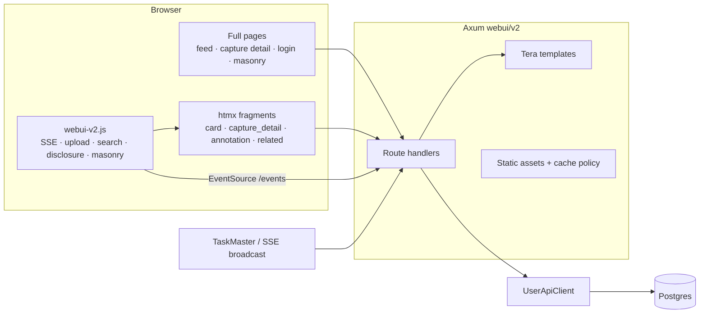

# WebUI v2 Audit — Bugs, Architecture, and Pruning

**Status:** Open; UI2-001/UI2-002/UI2-003/UI2-004/UI2-006/UI2-012/UI2-A01/UI2-A02/UI2-A03 fixed; UI2-008 partial; D01/D02/D03/D04/D05/D07/D08 pruned; UI2-005/UI2-009/UI2-A04/UI2-A05/UI2-D06 accepted. Audit date: 2026-10-22.
**Scope:** `web/v2` templates/static assets and `src/webui/v2` handlers, plus the
API/data shapes those views consume.
**Method:** Full read of 13 templates, 1,061-line CSS, 1,238-line JS, all 19
`src/webui/v2` handlers (including the 508-line SSE endpoint), and relevant
`src/api`/`model` schemas. One live probe was run for the escaping finding
(`curl` against the local server). No browser flow tests were run for this
audit.

**Convention:** Use the numeric ID or the slug when discussing. Both are stable.
Severity is user impact, not effort.

---

## 1. Slug index

| ID | Slug | Severity | Status | One-liner |
|---|---|---|---|---|
| UI2-001 | `xss-autoescape-off` | P0 | Fixed | Tera never autoescaped `.html.tera`; fixed in the template loader. |
| UI2-002 | `detail-search-hijack` | P1 | Fixed | Page-kind-aware header navigates detail search to the feed. |
| UI2-003 | `draft-clobber` | P1 | Fixed | SSE now refreshes only illumination fragments; annotation DOM is outside the target. |
| UI2-004 | `related-json-breakout` | P1 | Fixed | Related previews are a JSON resource; no inline JSON or full models in HTML. |
| UI2-005 | `catchup-skips-reruns` | P1 | Accepted | SSE catch-up ignores cards that already have an old illumination, so rerun progress is missing after reload. Accepted DB-load trade-off. |
| UI2-006 | `related-leak` | P1 | Fixed | Detail SSE no longer refreshes the feed/related section; related loads once. |
| UI2-007 | `silent-errors` | P2 | Open | htmx failures and HTML-route API errors have no user-visible channel. |
| UI2-008 | `collapse-a11y-clip` | P2 | Partial | Collapsed content is inert and disclosures expose ARIA state; fixed max-height clipping remains. |
| UI2-009 | `blend-limit` | P2 | Accepted | `limit` applies per source, so blended feeds can return up to 2× the requested cards. Deferred to feed architecture work. |
| UI2-010 | `entity-title-only` | P2 | Open | Entity descriptions on feed cards exist only in `title=`, unusable on touch. |
| UI2-011 | `pwa-share-feedback` | P3 | Open | PWA share-target upload redirects with no success/error notice. |
| UI2-012 | `related-double-wrapper` | P3 | Fixed | Related fragment now returns inner content into the existing section root. |
| UI2-A01 | `no-base-layout` | Arch | Fixed | Added `base.html.tera` and shared header/upload chrome. |
| UI2-A02 | `implicit-page-mode` | Arch | Fixed | `data-page-kind` now drives search, SSE routing, and chrome. |
| UI2-A03 | `fragment-contracts` | Arch | Fixed | HTML fragment shape now matches each target’s swap mode; JSON is separate. |
| UI2-A04 | `no-pagination` | Arch | Accepted | Fixed caps are accepted for UI v2; pagination is a future enhancement. |
| UI2-A05 | `entity-identity` | Product | Accepted | Canonical identity is deferred to the future knowledge-system model. |
| UI2-D01 | `spark-wrapper-dup` | Prune | Fixed | Removed `SparkClusterCard`; templates read `card.spark.spark_clusters`. |
| UI2-D02 | `unused-context` | Prune | Fixed | Removed unused `is_search` and `content_mode` inserts. |
| UI2-D03 | `annotation-empty-branches` | Prune | Fixed | Footer template now uses one condition. |
| UI2-D04 | `masonry-dup` | Prune | Fixed | Removed the standalone experiment; related-captures gallery is now the only gallery renderer. |
| UI2-D05 | `masonry-orphan` | Prune | Fixed | Removed `/masonry`, its template, handler, CSS, and dead query. |
| UI2-D06 | `noop-service-worker` | Prune | Accepted | Retained as a PWA installability/share-target requirement; no behavior needed. |
| UI2-D07 | `capture-lookup-dup` | Prune | Fixed | Added `UserApiClient::get_capture`; four handlers use it. |
| UI2-D08 | `css-noise` | Prune | Fixed | Removed dead selectors; auth styles moved to shared CSS and palette tokens. |

---

## 2. Architecture overview



- Pages are server-rendered documents with a single `#card-feed` region. Feed
  and detail differ in the initial fragment placed inside it.
- `partials/card.html.tera` dispatches `Card::{Capture,Spark}`. This is the
  correct seam for future card kinds.
- Mutations are htmx fragment swaps: annotation block, footer OOB, upload via
  XHR, search via `/cards`.
- SSE is capture-only. Task-status events carry `entity_type=capture`; the
  client filters to the current page/card and refreshes a partial. Catch-up is
  seeded from rendered cards with a DB-timestamp watermark.
- Data: `capture → media, annotation, illuminations (latest only) →
  knowledge_entities`; `spark → clusters → capture previews/links`. There is no
  canonical entity table.

Already solid: thin handlers over `UserApiClient`, no SPA/build step, immutable
asset versioning, a per-card partial endpoint, and the snapshot-watermark
refresh design.

---

## 3. Bugs

### UI2-001 — `xss-autoescape-off` (P0, fixed)

**Observed.** `GET /login?error=<b>x</b>` rendered
`<div class="login-error"><b>x</b></div>`.

**Cause.** Tera autoescapes based on filename suffix (`.html`, `.htm`, `.xml`).
All templates end in `.html.tera`, so `should_escape` was false for every
template. This was not limited to the login error: AI-generated summaries,
details, entity names/descriptions, annotations, and `?query=` in the search
input were raw HTML sinks. This enabled stored XSS from model output and
reflected XSS from the query string.

**Applied fix.** In `src/webui/v2/maker.rs::load_templates`:

```rust
tera.autoescape_on(vec![".html.tera"]);
```

The full suffix is intentional: it autoescapes every HTML template without
also HTML-escaping future non-HTML templates such as `.txt.tera`. The loader is
the single policy choke point; no file renames are needed.

**Regression test.** `html_templates_escape_untrusted_content` renders
`partials/cards/annotation_block.html.tera` with a `<script>` payload and
asserts the output is escaped. Passed.

**Evidence:** `maker.rs:16-27`; Tera `autoescape_suffixes`; live `curl` before
the fix. The two `| safe` JSON sites still need UI2-004.

### UI2-002 — `detail-search-hijack` (P1, fixed)

The detail header reused the feed's htmx search, replacing `#card-feed` and
leaving detail SSE able to overwrite the temporary search results.

**Applied.** The shared header renders the feed search with `hx-get="/cards"`,
target `#card-feed`, and URL push. Non-feed pages render a plain `GET /?query=…`
form and the clear button only clears the input. No `sse_mode` remains; page kind
drives the behavior.

### UI2-003 — `draft-clobber` (P1, fixed)

Feed SSE used to replace the entire card with `outerHTML`; detail SSE replaced
all of `#card-feed` with `innerHTML`. Both regions contained the annotation
editor, so a terminal illumination event while the user was typing silently
discarded the draft.

**Applied.** SSE now targets `#capture-illumination-{id}` only. Feed uses
`/cards/capture/{id}/illumination`; detail uses `/detail/{id}/illumination`,
which also updates `#capture-metadata-{id}` via `hx-swap-oob`. The annotation
editor, footer, image, and related section are outside every target.

**Remaining limitation.** Detail summary/details disclosure state resets on
refresh; feed disclosure state is preserved because `is-expanded` lives on the
stable article. Morph swaps remain the long-term improvement
(`plan/htmx4.md`).

### UI2-004 — `related-json-breakout` (P1, fixed)

`related_captures.html.tera` embedded the full `CaptureInfo` with
`json_encode | safe` inside a `<script type=application/json>`. A summary
containing `</script>` could terminate the block and inject markup, and the
payload exposed annotation and media internals.

**Applied.** Related captures now use `CapturePreviewInfo` (`id`,
`thumbnail_url`, `summary`) as a narrow projection served by
`GET /detail/{id}/related/previews` as JSON. The detail template owns the
gallery shell; the client fetches previews and lays them out. No inline JSON or
full `CaptureInfo` models reach the HTML. The gallery uses `thumbnail_url` and
exposes `summary` as a desktop tooltip; accessibility for that summary remains
deferred.

### UI2-005 — `catchup-skips-reruns` (P1, accepted trade-off)

`captureIdsForCatchup()` only includes cards whose illumination region is
absent or has `data-has-illumination="false"`. A capture with an old
illumination being rerun is excluded, so reloading during the rerun yields no
catch-up event and no progress bar. The terminal SSE event eventually refreshes
the illumination, but the in-progress period is invisible.

**Decision:** accepted. Catch-up would otherwise query latest TaskRun state for
every rendered capture on every page load and SSE connect, which is not worth
the DB load for the low-frequency reload-during-rerun flow. Recorded in
`plan/pragmatism.md`. Revisit only if that flow becomes common or in-progress
state during reruns becomes a product requirement.

### UI2-006 — `related-leak` (P1, fixed)

`capture_detail.html.tera` puts `hx-trigger="load"` on the related section
inside the detail partial. Detail SSE used to replace `#card-feed`, inserting a
fresh related section and re-fetching `/related`; each gallery added a
`window.resize` listener and never removed it, so detached galleries leaked.

**Applied.** Detail SSE now swaps only the illumination region and metadata
article, so the related section loads once and its listener is not duplicated.

### UI2-007 — `silent-errors` (P2)

htmx 2 ignores 4xx/5xx responses. Invalid `/spark`, failed annotation
save/archive, and upload errors on htmx paths produce no feedback. HTML routes
also return JSON `ApiError` bodies (for example `/detail/999`), which is wrong
for a full-page navigation. htmx 4 will swap error bodies, making this worse.

**Fix.** Add one global `htmx:responseError` handler rendering a dismissible
notice, plus an HTML error page for full-page routes. Do this before the htmx 4
migration.

### UI2-008 — `collapse-a11y-clip` (P2, partial)

Collapsed panels used `opacity:0` plus `max-height:0` without `inert`, so links
inside remained tabbable and readable by screen readers. Expanded panels cap at
`900px` (capture details) and `2400px` (metadata) and silently clip longer
content.

**Applied.** Collapsed content is now `inert` on the server and toggled by JS.
Feed disclosures are real buttons with `aria-expanded` and `aria-controls`;
metadata toggles expose the same relationship. The search input has an
accessible name, and related-capture links use the summary as their accessible
name.

**Remaining.** Removing the fixed `900px`/`2400px` expansion caps needs a
disclosure height/animation decision.

### UI2-009 — `blend-limit` (P2, accepted trade-off)

`render_timeline(Blend)` fetches `limit` captures and `limit` sparks, then
concatenates and sorts (`content.rs:105-120`). `limit=50` can return 100 cards;
`limit=1` can return 2.

**Decision:** accepted for now. No UI exposes `limit`; it is an internal read
bound, not a total-feed contract. Combined-limit semantics belong with the
planned feed architecture work. Recorded in `plan/pragmatism.md`.

### UI2-010 — `entity-title-only` (P2)

Feed entity pills (`capture.html:34`) put descriptions only in `title=`.
Touch users cannot access them; keyboard users get nothing useful. The detail
page displays descriptions, but the feed does not.

**Fix.** Link pills to the entity page (see §6) and show description text
there; optionally add an accessible disclosure in the feed.

### UI2-011 — `pwa-share-feedback` (P3)

The manifest share target posts to `/upload`. A non-htmx upload redirects to
`/` without an upload notice or capture link.

**Fix.** Redirect with a query/flag that the feed renders as a notice, or use a
dedicated share-result page.

### UI2-012 — `related-double-wrapper` (P3, fixed)

`#related-captures` targeted `innerHTML`, but the fragment returned a
`<section class="related-captures">` wrapper. The result was a section inside a
section with two responsibility layers.

**Applied.** The related gallery is now a server-rendered shell inside the
detail shape. There is no related HTML partial or htmx load; the shell carries
`data-previews-url`, and the client populates its grid from the JSON endpoint.

---

## 4. Architecture issues

### UI2-A01 — `no-base-layout` (fixed)

`index.html.tera`, `detail.html.tera`, and `login.html.tera` each duplicated the
full head, header, upload form, search form, progress UI, and notice.

**Applied.** Added `base.html.tera` and `partials/header.html.tera`. Feed and
detail share the full chrome; account pages get the title-only header and no
SSE scripts. Page title, head extras, body attributes, and content are blocks.
No SSE mode was added to the base; page kind owns behavior.

### UI2-A02 — `implicit-page-mode` (fixed)

The same header search markup was reused on feed and detail, while JS inferred
behavior from element presence and a separate SSE mode.

**Applied.** Full pages now set `data-page-kind` (`feed`, `capture_detail`,
`account`). The header renders search presentation from it, and JS derives SSE
routing from it. `data-sse-mode` is gone. All authenticated pages start SSE;
catch-up and event targeting are page-specific.

### UI2-A03 — `fragment-contracts` (fixed)

The original problem was concrete: `/related` returned a wrapper inserted inside
another wrapper, and the detail partial included unrelated regions (metadata,
related). Both paths have been removed/replaced.

The remaining rule is consistent:

- `innerHTML` targets receive inner content (`/cards`).
- `outerHTML` targets receive exactly one root (`/cards/capture/{id}/illumination`,
  annotation blocks).
- Multi-region updates return a primary root plus explicit `hx-swap-oob`
  fragments (`/detail/{id}/illumination`, annotation footer).
- Client-rendered components use JSON resources (`/detail/{id}/related/previews`),
  not HTML fragments carrying embedded data.

No wrapper duplication or unrelated region inclusion remains.

### UI2-A04 — `no-pagination` (accepted for v2)

Feed is capped at 50 and related captures at 12. There is no paging or “load
more”, and the planned entity page would need a cap for “appears in”.
`plan/feed-view-incremental-updates.md` owns feed reconciliation but not the
page-size UX.

**Decision:** accepted for UI v2. Pagination is a future enhancement, to be
considered alongside the feed architecture work.

### UI2-A05 — `entity-identity` (accepted)

`knowledge_entities.id` is unique per illumination run. There is no canonical
entity table or identity resolution. A “knowledge entity detail page” therefore
means either one occurrence or a name/type grouping, not a stable entity.

**Decision:** accepted. Canonical entity identity, merging, and clustering are
a future knowledge-system cornerstone, not a UI v2 fix. Revisit only when that
identity model is designed. An occurrence page remains optional, but must be
labeled as an occurrence rather than a canonical entity.

---

## 5. Pruning candidates

| ID | Candidate | Notes |
|---|---|---|
| UI2-D01 | `spark-wrapper-dup` | `SparkClusterCard` clones `SparkClusterInfo` + `capture_previews`, both already in `SparkInfo.spark_clusters`. Render `card.spark.spark_clusters`; delete the struct and mapping. |
| UI2-D02 | `unused-context` | `r_index.rs` inserts `is_search` and `content_mode`; neither template reads them. |
| UI2-D03 | `annotation-empty-branches` | `annotation_footer_left.html.tera:7-11` has two empty branches; collapse to one condition. |
| UI2-D04 | `masonry-dup` | Standalone masonry JS (`masonry.html.tera:24-99`) and `setupRelatedCapturesMasonry` duplicate bucketing with different class names and caps. Extract one helper or render columns server-side. |
| UI2-D05 | `masonry-orphan` | `/masonry` has no links; the base CSS is fetched with a dead `&view=masonry-v2` query that only appears in cache tests. |
| UI2-D06 | `noop-service-worker` | `sw.js` only calls `skipWaiting`/`claim`. Keep only if PWA installability still needs it. |
| UI2-D07 | `capture-lookup-dup` | `r_detail`, `r_capture_card`, `r_detail_partial`, and `r_annotation` repeat capture lookup/404/context assembly. Add one `WebState::capture_or_404`. |
| UI2-D08 | `css-noise` | Redundant `#page-content-container.masonry-page`, `.capture-card__illumination { opacity: 1 }`, and login inline styles that hardcode palette values. |

---

## 6. Entity page design (deferred with UI2-A05)

These notes remain a possible occurrence-page design, but the page is deferred
until the canonical identity model is addressed.

Recommended starting point: occurrence page.

- **Data:** add `UserApiClient::get_knowledge_entity(context, id)` (join
  capture, filter owner + unarchived) and `get_entities_by_name(context, name,
  type)` for “also appears in”. No raw DB access in the handler.
- **Page:** entity type/name, description, platform link, canonical search,
  source capture thumbnail/date/link, sibling entities from the same
  illumination, and other captures with the same exact `(name, type)` labeled
  as name matches, not identity.
- **Navigation:** turn entity pills in `capture.html` and `capture_detail.html`
  into anchors to `/entity/{id}`. This also addresses `entity-title-only`.
- **Template:** extend the new base layout; reuse `pill`, `metadata-dict-list`,
  and a compact capture-preview partial. Do not reuse the full capture card.
- **Live updates:** start static. If live later, add an `entity` SSE mode that
  refreshes only the entity component when its source capture’s illumination
  completes; do not reuse the detail whole-feed refresh.

If canonical entities are wanted instead, the route should be name/type-based
(`/entities/{type}/{slug}`) and needs a normalization rule. IDs are the wrong
key for that.

---

## 7. Suggested execution order

1. **UI2-001** autoescape + regression test — **Done**.
2. **UI2-A01/A02 + UI2-002** base layout, page kind, and detail search — **Done**.
3. **UI2-003** draft guard and smaller detail refresh target.
4. **UI2-006/007** related refresh cleanup, error channel.
5. **UI2-008** accessibility/clipping; then the pruning items D01-D08.
